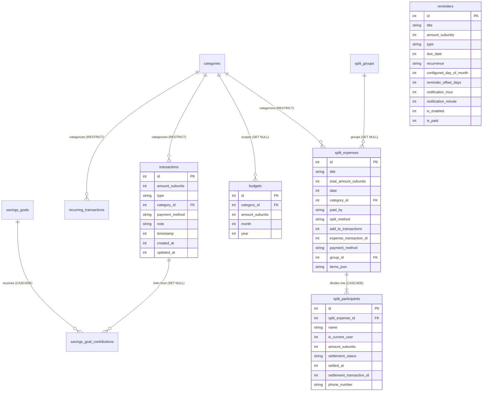

# LEAF — MASTER PRODUCT DOCUMENTATION & NATIVE iOS MIGRATION BLUEPRINT

> **DOCUMENT STATUS & AUTHORITY NOTICE**:
> This document is the single authoritative, verified product specification, architectural blueprint, and cross-platform implementation guide for **Leaf** (formerly KharchaFlow). It consolidates, reconciles, and supersedes all prior distributed documentation into an exhaustive reference for human developers and autonomous AI coding agents building the native Apple iOS application in Swift and SwiftUI.
>
> This edition has been rigorously reconciled against the source code of the Leaf Android application (`app/src/main/` and `app/src/test/`) following the independent technical audit in `LEAF_DOCUMENTATION_AUDIT.md`. All prior discrepancies—including universal JSON backup serialization, CSV export schemas, Google Drive backup filenames, domain enums, security mechanisms, and file paths—have been corrected and verified against Kotlin source code on disk.
>
> All statements, requirements, and specifications throughout this document are classified using standardized status tags:
> - `[VERIFIED]`: Confirmed directly by active Android Kotlin source code, Room SQLite schemas, database migrations, or automated unit test suites.
> - `[PROPOSED]`: Recommended native iOS architectural pattern, technology choice, or implementation strategy adhering to Apple Human Interface Guidelines.
> - `[UNRESOLVED]`: Known design ambiguity or edge case requiring product-owner clarification.
> - `[DEPRECATED]`: Legacy artifact or retired naming convention no longer active in core workflows.
> - `[PLANNED]`: Roadmapped capability explicitly identified in source code stubs or designs but not yet implemented.

---

# SECTION 1: Executive Summary and Product Overview

## 1.1 Executive Summary `[VERIFIED]`
**Leaf** is a privacy-first, offline-first personal financial management and expense-tracking application originally developed for Android (Kotlin, Jetpack Compose, Room SQLite, DataStore) and currently expanding natively to Apple iOS (Swift, SwiftUI, GRDB SQLite, Keychain, WidgetKit).

Leaf addresses the growing user dissatisfaction with cloud-dependent personal finance tools that demand banking credentials, harvest behavioral financial data for advertising, impose subscription fees, and fail when network connectivity is lost. Leaf operates under a strict **local-first paradigm**: 100% of the user's financial transactions, budgets, shared bills, savings goals, reminders, and category taxonomies reside locally in an encrypted or sandboxed on-device SQLite database.

## 1.2 Core Product Tenets `[VERIFIED]`
Leaf's engineering and product identity are anchored to four inviolable pillars:

1. **100% Offline-First & Private**:
   - Zero proprietary servers, zero middleman APIs, zero telemetry, and zero third-party advertising SDKs.
   - All persistence is on-device SQLite. Network access is restricted to optional user-authenticated Google Drive backup/restore, external GitHub/App Store release checking, and local-intent WhatsApp sharing.
2. **Subunit Integer Financial Precision**:
   - Floating-point data types (`Float`, `Double`) are **strictly prohibited** in database columns, domain entities, ledger summations, and persistence models.
   - All currency values are stored as signed 64-bit integers (`Int64` / Kotlin `Long`) representing the smallest fractional subunit (e.g., paise in INR, cents in USD/EUR, whole yen in JPY).
   - Zero-sum remainder reconciliation distributes fractional cents deterministically so that shared division introduces zero penny drift.
3. **Continuous Financial Continuity**:
   - Opening balances propagate continuously from month to month without arbitrary temporal resets.
   - The opening balance of any month $M_k$ is strictly equal to the closing balance of month $M_{k-1}$, calculated from the base opening balance plus all preceding income minus all preceding expenses.
4. **"Emerald & Obsidian" Design Language**:
   - A calm, luxury fintech visual language combining deep obsidian dark surfaces (`#0A0C0F` / `#14171E`), warm neutral canvas light mode (`#F4F6F9`), authoritative emerald brand accents (`#028166` / `#05B38C`), continuous squircle geometry (`.continuous` corner curves), and monospaced tabular numerals (`.monospacedDigit()`).

## 1.3 Project Scope & iOS Migration Mandate `[PROPOSED]`
The primary objective of the iOS migration is to recreate the complete, verified Leaf product experience natively for Apple iPhone devices running **iOS 17.0+** using **Swift 5.10 / Swift 6** and **SwiftUI**. 

The migration mandate strictly specifies:
- **Recreate, Do Not Copy**: Do not mimic Android Material Design or port Android patterns verbatim. Re-implement the business rules using native Apple Human Interface Guidelines (HIG), SF Pro typography, SF Symbols, native sheets, and system transitions.
- **Absolute Mathematical Parity**: Financial calculations, bill splitting algorithms, loan amortizations, and compound wealth formulas must produce identical outputs down to the smallest currency subunit.
- **Bidirectional Cross-Platform Compatibility**: A JSON v2 backup exported from Android must import seamlessly into iOS, and an export from iOS must restore on Android with zero data loss or deserialization errors.

---

# SECTION 2: Product Vision, Objectives and Design Philosophy

## 2.1 Product Vision `[VERIFIED]`
The guiding philosophy of Leaf is encapsulated in its brand motto:
> *"Money is a tool. Clarity is freedom."*

Most personal finance apps induce cognitive anxiety through aggressive budgeting restrictions, invasive bank syncing errors, and visual noise. Leaf is designed as a calm, reflective financial ledger that fosters mindfulness and deliberate spending habits without intrusive friction.

## 2.2 Core Objectives `[VERIFIED]`
1. **Frictionless Entry (< 3 Seconds)**:
   - A user should be able to log an expense or income transaction at a checkout counter in under 3 seconds via Home Screen Widgets, Quick Actions, or the high-priority Compose/SwiftUI entry sheet.
2. **Deterministic Shared Expenses (Split & Collect 2.0)**:
   - Provide flexible bill splitting (Equal, Custom Exact, Itemized Consumption) with automated penny reconciliation, UPI QR generation, WhatsApp settlement breakdowns, and automated personal ledger integration.
3. **Bank-Grade Financial Auditability**:
   - Provide a continuous monthly ledger statement and generate high-resolution, multi-page vector PDF statements for tax, auditing, and personal archiving.
4. **Local PIN and Biometric App Lock**:
   - Secure financial records behind an isolated 4-digit PIN lock and hardware biometric authentication (BiometricPrompt on Android / Face ID & Touch ID via LocalAuthentication on iOS).

## 2.3 The "Emerald & Obsidian" Design Philosophy `[VERIFIED]`
The visual identity of Leaf avoids harsh neon accents and sterile monochrome interfaces:

```
┌─────────────────────────────────────────────────────────────┐
│                    EMERALD & OBSIDIAN                       │
├──────────────────────────────┬──────────────────────────────┤
│ DARK MODE: OBSIDIAN NIGHT    │ LIGHT MODE: WARM CANVAS      │
│ Base Canvas: #0A0C0F         │ Base Canvas: #F4F6F9         │
│ Card Surface: #14171E        │ Card Surface: #FFFFFF        │
│ Elevated Card: #1C202A       │ Elevated Card: #F0F3F7       │
│ Accent Green: #05B38C        │ Accent Green: #028166        │
└──────────────────────────────┴──────────────────────────────┘
```

- **Squircle Geometry**: All container cards, icon containers, dialogs, and button shapes utilize continuous squircle corner curvature (`RoundedCornerShape` in Compose with hierarchical radii; `RoundedRectangle(cornerRadius: ..., style: .continuous)` in SwiftUI).
- **Tabular Figures**: Every currency amount displayed across all screens must employ monospaced tabular numerals (`tnum` / `.monospacedDigit()`) to eliminate visual jitter during real-time filtering, summation, and ticker animations.
- **Tonal Elevation over Harsh Drop Shadows**: In Dark Mode, depth is communicated through distinct surface gray tones rather than drop shadows.

---

# SECTION 3: Complete Feature Inventory

Below is the definitive catalog of all **69 features** discovered in the Leaf codebase, verified directly against active Kotlin source files, Room entities, DAOs, ViewModels, and test suites. All file paths have been verified against disk:

| Feature ID | Feature Name | Module | Implementation Status | Verified Android Source File | Automated Test Reference |
| :--- | :--- | :--- | :--- | :--- | :--- |
| `FEAT-01.1` | Net Liquid Balance Card | Dashboard | `[VERIFIED]` Implemented | `presentation/dashboard/components/BalanceHeroCard.kt` | `DashboardViewModelTest.kt` |
| `FEAT-01.2` | Cashflow Wells (Income/Expense) | Dashboard | `[VERIFIED]` Implemented | `presentation/dashboard/components/BalanceHeroCard.kt` | `DashboardViewModelTest.kt` |
| `FEAT-01.3` | Balance Privacy Obfuscation | Dashboard | `[VERIFIED]` Implemented | `presentation/dashboard/components/BalanceHeroCard.kt` | `UserPreferencesDataStoreTest.kt` |
| `FEAT-01.4` | Quick Action Shortcuts | Dashboard | `[VERIFIED]` Implemented | `presentation/dashboard/components/QuickActionPills.kt` | `DashboardScreenTest.kt` |
| `FEAT-01.5` | Contextual Time Greeting | Dashboard | `[VERIFIED]` Implemented | `presentation/dashboard/DashboardScreen.kt` | `DashboardScreenTest.kt` |
| `FEAT-01.6` | Category Spending Donut Chart | Dashboard | `[VERIFIED]` Implemented | `presentation/dashboard/components/CategoryDonutChart.kt` | `GetCategoryAnalysisUseCaseTest.kt` |
| `FEAT-01.7` | Recent Activity Feed | Dashboard | `[VERIFIED]` Implemented | `presentation/dashboard/DashboardScreen.kt` | `DashboardViewModelTest.kt` |
| `FEAT-01.8` | Inline Budget Progress Pill | Dashboard | `[VERIFIED]` Implemented | `presentation/dashboard/components/DashboardBudgetCard.kt` | `BudgetRepositoryTest.kt` |
| `FEAT-02.1` | Expense Transaction Logging | Transactions | `[VERIFIED]` Implemented | `presentation/entry/AddEditTransactionSheet.kt`, `domain/usecase/AddTransactionUseCase.kt` | `TransactionEntityMappingTest.kt` |
| `FEAT-02.2` | Income Transaction Logging | Transactions | `[VERIFIED]` Implemented | `presentation/entry/AddEditTransactionSheet.kt`, `domain/usecase/AddTransactionUseCase.kt` | `TransactionEntityMappingTest.kt` |
| `FEAT-02.3` | Transaction Editing | Transactions | `[VERIFIED]` Implemented | `presentation/entry/AddEditTransactionSheet.kt` | `TransactionDaoTest.kt` |
| `FEAT-02.4` | Swipe-to-Delete Transaction | Transactions | `[VERIFIED]` Implemented | `presentation/transactions/TransactionListScreen.kt` | `DeleteTransactionUseCaseTest.kt` |
| `FEAT-02.5` | Category Taxonomy Picker | Transactions | `[VERIFIED]` Implemented | `presentation/entry/components/CategorySelector.kt` | `CategoryDaoTest.kt` |
| `FEAT-02.6` | Payment Source (Cash/Account) | Transactions | `[VERIFIED]` Implemented | `presentation/entry/AddEditTransactionSheet.kt` | `TransactionRepositoryTest.kt` |
| `FEAT-02.7` | Full-Text Transaction Search | Transactions | `[VERIFIED]` Implemented | `presentation/transactions/TransactionListScreen.kt` | `TransactionDaoTest.kt` |
| `FEAT-02.8` | Multi-Criteria Filtering Sheet | Transactions | `[VERIFIED]` Implemented | `presentation/transactions/components/FilterSheet.kt` | `TransactionFilterTest.kt` |
| `FEAT-02.9` | Transaction Sorting Engine | Transactions | `[VERIFIED]` Implemented | `presentation/transactions/TransactionListViewModel.kt` | `TransactionListViewModelTest.kt` |
| `FEAT-02.10`| Floating Quick-Add Window | Transactions | `[VERIFIED]` Implemented | `QuickAddTransactionActivity.kt` | `QuickAddTransactionTest.kt` |
| `FEAT-03.1` | Equal Bill Splitting | Split | `[VERIFIED]` Implemented | `domain/split/SplitCalculationEngine.kt` | `SplitCalculationEngineTest.kt` |
| `FEAT-03.2` | Custom Exact Split Allocation | Split | `[VERIFIED]` Implemented | `domain/split/SplitCalculationEngine.kt` | `SplitCalculationEngineTest.kt` |
| `FEAT-03.3` | Itemized Consumption Splitting| Split | `[VERIFIED]` Implemented | `domain/split/SplitCalculationEngine.kt` | `SplitCalculationEngineTest.kt` |
| `FEAT-03.4` | Remainder Penny Reconciliation| Split | `[VERIFIED]` Implemented | `domain/split/SplitCalculationEngine.kt` | `SplitCalculationEngineTest.kt` |
| `FEAT-03.5` | Participant Settle-Up Tracking| Split | `[VERIFIED]` Implemented | `domain/usecase/SettleParticipantUseCase.kt` | `SettleParticipantUseCaseTest.kt` |
| `FEAT-03.6` | WhatsApp Split Share Builder | Split | `[VERIFIED]` Implemented | `core/util/WhatsAppShareHelper.kt` | `WhatsAppShareHelperTest.kt` |
| `FEAT-03.7` | Dynamic UPI QR Generator | Split | `[VERIFIED]` Implemented | `core/util/QrCodeGenerator.kt` | `QrCodeGeneratorTest.kt` |
| `FEAT-03.8` | Ledger Outflow Integration | Split | `[VERIFIED]` Implemented | `presentation/split/create/CreateSplitViewModel.kt` | `SplitRepositoryTest.kt` |
| `FEAT-03.9` | Ledger Settlement Inflow | Split | `[VERIFIED]` Implemented | `domain/usecase/SettleParticipantUseCase.kt` | `SettleParticipantUseCaseTest.kt` |
| `FEAT-03.10`| Split Groups Management | Split | `[VERIFIED]` Implemented | `data/repository/SplitGroupRepositoryImpl.kt` | `SplitGroupDaoTest.kt` |
| `FEAT-03.11`| Transitive Debt Simplifier | Split | `[VERIFIED]` Implemented | `core/split/NetBalanceEngine.kt` | `NetBalanceEngineTest.kt` |
| `FEAT-04.1` | Monthly Category Budgets | Planning | `[VERIFIED]` Implemented | `presentation/planning/budgets/BudgetListScreen.kt` | `BudgetRepositoryTest.kt` |
| `FEAT-04.2` | Overall Monthly Budget Cap | Planning | `[VERIFIED]` Implemented | `data/local/entity/BudgetEntity.kt` | `BudgetDaoTest.kt` |
| `FEAT-04.3` | 4-Tier Budget Color Alerts | Planning | `[VERIFIED]` Implemented | `presentation/planning/budgets/BudgetViewModel.kt` | `BudgetViewModelTest.kt` |
| `FEAT-04.4` | Month & Year Period Switching | Planning | `[VERIFIED]` Implemented | `presentation/planning/budgets/BudgetListScreen.kt` | `BudgetViewModelTest.kt` |
| `FEAT-05.1` | Savings Goals Creation | Planning | `[VERIFIED]` Implemented | `presentation/planning/savings/SavingsGoalListScreen.kt`| `SavingsGoalDaoTest.kt` |
| `FEAT-05.2` | Milestone Progress Rings | Planning | `[VERIFIED]` Implemented | `presentation/planning/savings/SavingsGoalCard.kt` | `SavingsGoalDaoTest.kt` |
| `FEAT-05.3` | Contribution History Ledger | Planning | `[VERIFIED]` Implemented | `presentation/planning/savings/SavingsGoalDetailScreen.kt`| `SavingsGoalContributionTest.kt`|
| `FEAT-05.4` | Required Monthly Deficit Calc | Planning | `[VERIFIED]` Implemented | `presentation/planning/savings/SavingsGoalViewModel.kt`| `SavingsGoalViewModelTest.kt` |
| `FEAT-05.5` | Goal Archival Lifecycle | Planning | `[VERIFIED]` Implemented | `presentation/planning/savings/SavingsGoalListScreen.kt`| `SavingsGoalDaoTest.kt` |
| `FEAT-06.1` | Income vs Expense Comparisons | Insights | `[VERIFIED]` Implemented | `presentation/analytics/AnalyticsScreen.kt` | `AnalyticsViewModelTest.kt` |
| `FEAT-06.2` | Cashflow Net Savings Rate | Insights | `[VERIFIED]` Implemented | `presentation/analytics/AnalyticsScreen.kt` | `AnalyticsViewModelTest.kt` |
| `FEAT-06.3` | Category Rollup Ranking | Insights | `[VERIFIED]` Implemented | `presentation/analytics/AnalyticsScreen.kt` | `GetCategoryAnalysisUseCaseTest.kt` |
| `FEAT-07.1` | Continuous Monthly Ledger | Statements | `[VERIFIED]` Implemented | `presentation/ledger/MonthlyLedgerScreen.kt` | `MonthlyLedgerViewModelTest.kt` |
| `FEAT-07.2` | Bank-Grade Vector PDF Engine | Statements | `[VERIFIED]` Implemented | `core/utils/PdfUtils.kt` | `PdfUtilsTest.kt` |
| `FEAT-07.3` | In-App PDF Previewer | Statements | `[VERIFIED]` Implemented | `presentation/ledger/PdfViewerScreen.kt` | `PdfViewerTest.kt` |
| `FEAT-08.1` | Interactive Monthly Calendar | Calendar | `[VERIFIED]` Implemented | `presentation/calendar/CalendarScreen.kt` | `CalendarViewModelTest.kt` |
| `FEAT-08.2` | Daily Spend Indicator Badges | Calendar | `[VERIFIED]` Implemented | `presentation/calendar/CalendarDayCell.kt` | `CalendarViewModelTest.kt` |
| `FEAT-08.3` | Selected Day Transaction Feed | Calendar | `[VERIFIED]` Implemented | `presentation/calendar/CalendarScreen.kt` | `CalendarViewModelTest.kt` |
| `FEAT-09.1` | Recurring Transaction Rules | Recurring | `[VERIFIED]` Implemented | `presentation/recurring/RecurringListScreen.kt` | `RecurringTransactionDaoTest.kt`|
| `FEAT-09.2` | Automated Background Generator| Recurring | `[VERIFIED]` Implemented | `domain/usecase/RecurringTransactionUseCases.kt` | `RecurringTransactionProcessTest.kt`|
| `FEAT-10.1` | Financial Calendar Reminders | Reminders | `[VERIFIED]` Implemented | `presentation/reminders/RemindersScreen.kt` | `ReminderRepositoryTest.kt` |
| `FEAT-10.2` | Smart Evening Suppression | Reminders | `[VERIFIED]` Implemented | `core/receiver/ReminderReceiver.kt` | `DailyReminderReceiverTest.kt` |
| `FEAT-10.3` | 1-Tap Mark as Paid Action | Reminders | `[VERIFIED]` Implemented | `core/receiver/ReminderReceiver.kt` | `ReminderNotificationTest.kt` |
| `FEAT-11.1` | Loan EMI Calculator | Calculators | `[VERIFIED]` Implemented | `core/calculator/FinancialCalculatorEngine.kt` | `FinancialCalculatorEngineTest.kt`|
| `FEAT-11.2` | SIP Wealth Growth Planner | Calculators | `[VERIFIED]` Implemented | `core/calculator/FinancialCalculatorEngine.kt` | `FinancialCalculatorEngineTest.kt`|
| `FEAT-11.3` | Fixed Deposit (FD) Tool | Calculators | `[VERIFIED]` Implemented | `core/calculator/FinancialCalculatorEngine.kt` | `FinancialCalculatorEngineTest.kt`|
| `FEAT-11.4` | Recurring Deposit (RD) Tool | Calculators | `[VERIFIED]` Implemented | `core/calculator/FinancialCalculatorEngine.kt` | `FinancialCalculatorEngineTest.kt`|
| `FEAT-11.5` | GST & Discount Calculators | Calculators | `[VERIFIED]` Implemented | `core/calculator/FinancialCalculatorEngine.kt` | `FinancialCalculatorEngineTest.kt`|
| `FEAT-12.1` | Salted SHA-256 PIN Vault | Security | `[VERIFIED]` Implemented | `core/security/SecurePinManager.kt` | `SecurePinManagerTest.kt` |
| `FEAT-12.2` | Biometric Authentication | Security | `[VERIFIED]` Implemented | `core/security/AppLockManager.kt` | `AppLockSecurityTest.kt` |
| `FEAT-12.3` | App Switcher Privacy Blur | Security | `[VERIFIED]` Implemented | `MainActivity.kt` (`FLAG_SECURE`) | `AppLockLifecycleTest.kt` |
| `FEAT-12.4` | 5 Failed Attempts Lockout | Security | `[VERIFIED]` Implemented | `core/security/SecurePinManager.kt` | `SecurePinManagerTest.kt` |
| `FEAT-13.1` | Local JSON v2 Export/Import | Backup | `[VERIFIED]` Implemented | `core/backup/JsonBackupParser.kt` | `BackupSerializationTest.kt` |
| `FEAT-13.2` | Tabular CSV Export | Backup | `[VERIFIED]` Implemented | `core/backup/CsvTransactionHelper.kt` | `BackupValidationTest.kt` |
| `FEAT-13.3` | Google Drive Cloud Sync | Backup | `[VERIFIED]` Implemented | `core/google/GoogleDriveRestService.kt` | `GoogleDriveBackupRepositoryTest.kt`|
| `FEAT-14.1` | 20 Pre-Seeded Categories | Categories | `[VERIFIED]` Implemented | `data/local/database/ExpenseTrackerDatabase.kt` | `CategoryDaoTest.kt` |
| `FEAT-14.2` | Custom Category Builder | Categories | `[VERIFIED]` Implemented | `presentation/categories/AddEditCategoryDialog.kt` | `SaveCategoryUseCaseTest.kt` |
| `FEAT-14.3` | Category Deletion Safety | Categories | `[VERIFIED]` Implemented | `domain/usecase/DeleteCategoryUseCase.kt` | `DeleteCategoryUseCaseTest.kt` |
| `FEAT-15.1` | 9 Global Currencies Setup | Settings | `[VERIFIED]` Implemented | `core/model/Currency.kt` | `CurrencyTest.kt` |
| `FEAT-16.1` | 5-Step Illustrated App Tour | Onboarding | `[VERIFIED]` Implemented | `presentation/tour/AppTourScreen.kt` | `AppTourViewModelTest.kt` |
| `FEAT-17.1` | Home Screen AppWidgets | Widgets | `[VERIFIED]` Implemented | `presentation/widget/ExpenseTrackerWidgetProvider.kt`| `WidgetUpdateManagerTest.kt` |
| `FEAT-18.1` | In-App Release Discovery | Updates | `[VERIFIED]` Implemented | `data/update/GitHubReleaseService.kt` | `GitHubReleaseServiceTest.kt` |
| `FEAT-19.1` | Easter Egg Delight Universe | Delights | `[VERIFIED]` Implemented | `core/easteregg/EasterEggEngine.kt` | `AboutScreenMetadataTest.kt` |

---

# SECTION 4: Detailed Feature Specifications

This section documents the verified engineering specifications across all 19 functional domains.

## 4.1 Feature 01: Dashboard (`FEAT-01-DASHBOARD`) `[VERIFIED]`
- **Primary Source Files**: `presentation/dashboard/DashboardScreen.kt`, `DashboardViewModel.kt`, `presentation/dashboard/components/BalanceHeroCard.kt`.
- **Purpose**: Financial anchor displaying net balance, real-time monthly cashflow, quick actions, category donut chart, inline budget status, and recent activity.
- **Compose Component Hierarchy**:
  ```
  DashboardScreen (Scaffold)
  └── LazyColumn (Modifier.fillMaxSize())
      ├── item { DashboardHeader(userName, greeting, avatarUri) }
      ├── item { BalanceHeroCard(balance, income, expense, isVisible, onToggleVisibility) }
      ├── item { QuickActionPills(onAddExpense, onAddIncome, onSplitBill, onAnalytics) }
      ├── item { DashboardBudgetCard(budgetLimit, currentSpend, thresholdColor) }
      ├── item { DashboardSplitCard(pendingToCollectAmount, activeSplitsCount) }
      ├── item { CategoryDonutChart(categoryBreakdownList, totalSpend) }
      ├── item { SectionHeader(title = "Recent Transactions", onSeeAll) }
      └── items(recentTransactions) { TransactionItem(transaction, onClick, onDelete) }
  ```
- **Visual Spec**:
  - **Hero Card**: 28 pt squircle container styled with `HeroEmeraldGradient` (`#025442` $\to$ `#02785E` $\to$ `#039876`) or `HeroObsidianGradient` (`#0F131A` $\to$ `#171D27` $\to$ `#111F1B`).
  - **Top Label**: "TOTAL BALANCE" (11 pt semi-bold uppercase Slate). Eye toggle icon button flips between formatted currency and `••••••`.
  - **Main Figure**: 38 pt bold tabular numbers (`.monospacedDigit()`).
  - **Cashflow Sub-Wells**: 2-column rounded card (`InnerCardShape`, 14 pt radius). Left column displays green up-arrow, "INCOME", and total monthly income. Right column displays red down-arrow, "EXPENSES", and total monthly expenses.
- **Quick Action Pills**: Horizontal row of 4 capsule buttons (`+ Expense`, `+ Income`, `Split Bill`, `Analytics`). Scale animation down to 96% with haptic pulse upon tap.
- **Category Donut Chart**: Circular cutout ratio 0.65, stroke width 24 pt. Center hole displays total monthly spend and dynamic label upon segment tap.
- **Recent Activity**: Displays up to 5 most recent transactions with relative timestamp and swipe-to-delete.

## 4.2 Feature 02: Transactions Ledger & Quick Add (`FEAT-02-TRANSACTIONS`) `[VERIFIED]`
- **Primary Source Files**: `presentation/transactions/TransactionListScreen.kt`, `TransactionListViewModel.kt`, `presentation/entry/AddEditTransactionSheet.kt`, `QuickAddTransactionActivity.kt`.
- **Fast Logging (< 3 Seconds)**:
  - Form focuses numeric input immediately upon presentation.
  - Category selector provides single-tap selection of 20 default and custom categories.
  - Payment method defaults to `CASH` or `ACCOUNT` from user preferences.
  - Date picker defaults to current timestamp; note input allows up to 500 characters.
- **Search & Filtering**:
  - Real-time search query matches transaction titles and notes case-insensitively.
  - Filter bottom sheet supports multi-criteria selection: Type (`ALL`, `EXPENSE`, `INCOME`), Categories (multi-select), Payment Method (`ALL`, `CASH`, `ACCOUNT`), and Date Range (`THIS_MONTH`, `LAST_MONTH`, `LAST_90_DAYS`, `CUSTOM`).
- **Floating Quick Add**: `QuickAddTransactionActivity` provides a lightweight, dialog-themed transparent window launched from home screen widgets or app shortcuts, bypassing full dashboard initialization.

## 4.3 Feature 03: Split & Collect 2.0 (`FEAT-03-SPLIT-EXPENSES`) `[VERIFIED]`
- **Primary Source Files**: `domain/split/SplitCalculationEngine.kt`, `core/split/NetBalanceEngine.kt`, `presentation/split/create/CreateSplitScreen.kt`, `CreateSplitViewModel.kt`, `detail/SplitDetailScreen.kt`.
- **Split Modes & UI State Transitions**:
  Leaf Split 2.0 operates via a structured 3-step creation state machine:
  ```
  [Step 1: Basic Info] ──> [Step 2: Participants & Mode] ──> [Step 3: Confirmation & QR]
  - Title, Total Amount    - Add / Select Participants      - Summary Breakdown
  - Category, Date, Group  - Choose EQUAL vs CUSTOM          - UPI QR Code Preview
  - Payer ("Me" / other)   - If CUSTOM: ITEMIZED or DIRECT  - Optional WhatsApp Share
  ```
  1. **Equal Split Mode (`SplitMethod.EQUAL`)**:
     - Total bill amount $A$ is divided among $N$ participants.
     - Base integer share: $S = \lfloor A / N \rfloor$.
     - Remainder: $R = A \pmod N$.
     - Deterministic Reconciliation: The first $R$ participants receive $S + 1$ subunits; the remaining receive $S$ subunits. Sum of shares strictly equals $A$.
  2. **Custom Itemized Split Sub-Mode (`CustomSplitSubMode.ITEMIZED`)**:
     - Users define a list of itemized expenses (`SplitItem`), specifying item name, item amount, and selecting consumer participants.
     - Individual items can have custom consumer allocations or be shared equally among assigned consumers.
     - The unallocated portion of the total bill ($\text{TotalBill} - \sum \text{ItemAmounts}$) is automatically shared among participants designated in `sharedRemainingParticipants`.
     - Live validation displays real-time allocated, remaining, and overallocated amounts.
  3. **Custom Direct Split Sub-Mode (`CustomSplitSubMode.DIRECT`)**:
     - Users manually enter specific subunit amounts for each participant.
     - The engine validates in real time that $\sum \text{AllocatedSubunits} \equiv \text{TotalBillSubunits}$, displaying a blocking validation error if unbalanced.
- **Ledger Integration**:
  - Toggling *"Add my share to expenses"* generates a linked `EXPENSE` transaction in `transactions`. The transaction ID is stored in `split_expenses.expense_transaction_id`.
  - Toggling *"Mark as Settled"* for a participant creates a linked `INCOME` transaction titled `"Settlement: [Name] ([BillTitle])"`. The transaction ID is stored in `split_participants.settlement_transaction_id`.
  - Deleting a split expense safely preserves historical ledger transactions, clearing foreign keys to `NULL`.
- **UPI QR & WhatsApp**:
  - Renders vector UPI payment QR codes encoding `upi://pay?pa=[VPA]&pn=[Name]&am=[Amount]&cu=INR`.
  - Generates pre-formatted WhatsApp settlement messages listing individual amounts and total collected.

## 4.4 Feature 04: Planning & Budgets (`FEAT-04-PLANNING-BUDGETS`) `[VERIFIED]`
- **Primary Source Files**: `data/local/entity/BudgetEntity.kt`, `presentation/planning/budgets/BudgetListScreen.kt`, `BudgetViewModel.kt`.
- **Structure**: Supports individual category budgets (`category_id != null`) and overall monthly budget caps (`category_id == null`) scoped to a specific `(month, year)` period.
- **4-Tier Threshold Alert Colors**:
  - `On Track` ($< 75\%$): Emerald Green (`#10B981`).
  - `Approaching Limit` ($75\% \le \text{Usage} < 100\%$): Amber Gold (`#F59E0B`).
  - `Limit Reached` ($100\%$): Warning Amber (`#D97706`).
  - `Over Budget` ($> 100\%$): Crimson Red (`#DC2626`).

## 4.5 Feature 05: Savings Goals & Milestones (`FEAT-05-PLANNING-SAVINGS-GOALS`) `[VERIFIED]`
- **Primary Source Files**: `data/local/entity/SavingsGoalEntity.kt`, `SavingsGoalContributionEntity.kt`, `presentation/planning/savings/SavingsGoalDetailScreen.kt`.
- **Milestone Mechanics**:
  - Stores goal target amount, optional target date, icon, and color swatch.
  - Progress ring indicates percentage: $\min\left(100.0, \frac{\sum \text{Contributions}}{\text{TargetAmount}} \times 100\right)$.
  - Required Monthly Savings: Ceiling integer division: $\lceil \text{Deficit} / \text{MonthsRemaining} \rceil$.
  - Contributions can optionally link to checking account Expense transactions.
  - Archival toggle hides achieved or inactive goals without deleting financial history.

## 4.6 Feature 06: Analytics & Insights (`FEAT-06-INSIGHTS-ANALYTICS`) `[VERIFIED]`
- **Primary Source Files**: `presentation/analytics/AnalyticsScreen.kt`, `AnalyticsViewModel.kt`.
- **Capabilities**:
  - Monthly Cashflow Bar Charts: Dual-bar comparison of Total Income vs Total Expenses across recent months.
  - Net Savings Rate: Metric card computing $\left( \frac{\text{Income} - \text{Expense}}{\text{Income}} \right) \times 100$.
  - Category Rollup Ranking: Ranked list of categories sorted by descending total spend with percentage share badges.

## 4.7 Feature 07: Bank-Grade Statements & PDF (`FEAT-07-STATEMENTS`) `[VERIFIED]`
- **Primary Source Files**: `presentation/ledger/MonthlyLedgerScreen.kt`, `core/utils/PdfUtils.kt`, `presentation/ledger/PdfViewerScreen.kt`.
- **Continuous Ledger**: Displays monthly opening balance, daily cashflow items, category rollups, and closing balance.
- **Vector PDF Generator**: Multi-page PDF layout rendered at 72 DPI (A4: $595 \times 842$ pt) with bank-grade styling, header metadata, executive financial summary cards, and itemized tabular rows.
- **In-App PDF Viewer**: Full-screen preview with pinch-to-zoom, page counter, and native system share sheet.

## 4.8 Feature 08: Interactive Calendar (`FEAT-08-CALENDAR`) `[VERIFIED]`
- **Primary Source Files**: `presentation/calendar/CalendarScreen.kt`, `CalendarViewModel.kt`, `presentation/calendar/CalendarDayCell.kt`.
- **Grid Layout**: 7-column calendar grid (Sunday-Saturday or Monday-Sunday).
- **Daily Spend Pills**: Each day cell displays the day of the month and a compact pill showing the total expenses logged on that date. Days with zero expenses show clean default styling.
- **Selected Day Feed**: Tapping a day displays a chronological list of all transactions logged on that calendar day.

## 4.9 Feature 09: Recurring Transactions (`FEAT-09-RECURRING-TRANSACTIONS`) `[VERIFIED]`
- **Primary Source Files**: `data/local/entity/RecurringTransactionEntity.kt`, `domain/usecase/RecurringTransactionUseCases.kt`, `presentation/recurring/RecurringListScreen.kt`.
- **Frequencies**: `DAILY`, `WEEKLY`, `MONTHLY`, `YEARLY`.
- **Automated Generation**:
  - Evaluated on application foregrounding and via `ReminderReceiver` checks.
  - If current date $\ge$ scheduled due date and template `is_auto_generated == true`, an independent transaction is inserted into `transactions`, and `last_generated_date` is updated.
  - Generated transactions are immutable ledger entries; altering the template does not alter historical transactions.

## 4.10 Feature 10: Financial Calendar Reminders (`FEAT-10-FINANCIAL-REMINDERS`) `[VERIFIED]`
- **Primary Source Files**: `data/local/entity/ReminderEntity.kt`, `domain/model/Reminder.kt`, `core/receiver/ReminderReceiver.kt`, `presentation/reminders/RemindersScreen.kt`.
- **Reminder Types**: `LOAN_EMI`, `CREDIT_CARD`, `BILL`, `INSURANCE`, `RENT`, `SUBSCRIPTION`, `CUSTOM`.
- **Recurrence Patterns**: `ONE_TIME`, `DAILY`, `WEEKLY`, `MONTHLY`, `YEARLY`.
- **Due Date Alerts**: Notifications with configurable advance alert offsets ($0 \dots 7$ days before due date).
- **Smart Evening Suppression**: The 9:00 PM daily reminder receiver queries the database; if the user has **already logged at least one transaction today**, the reminder is silently suppressed to prevent notification fatigue.
- **1-Tap Settlement**: Direct inline notification action marks reminders as paid without launching the full application.

## 4.11 Feature 11: Financial Calculators Engine (`FEAT-11-FINANCIAL-CALCULATORS`) `[VERIFIED]`
- **Primary Source Files**: `core/calculator/FinancialCalculatorEngine.kt`, `presentation/calculator/CalculatorScreen.kt`.
- **Banking Tools**:
  - **Loan EMI**: $E = P \cdot r \cdot \frac{(1+r)^n}{(1+r)^n - 1}$ where $r = \frac{\text{Rate}}{12 \times 100}$.
  - **SIP Planner**: Annuity Due formula: $M = P \cdot \left[ \frac{(1+i)^n - 1}{i} \right] \cdot (1+i)$.
  - **Fixed Deposit (FD)**: Quarterly compounding convention: $A = P \cdot (1 + r/4)^{4t}$.
  - **Recurring Deposit (RD)**: Sum of compounded monthly installments: $A = \sum_{m=1}^n P \cdot (1 + r/4)^{\frac{4(n - m + 1)}{12}}$.
  - **GST & Discount**: Inclusive/Exclusive sales tax and percentage discount engines.

## 4.12 Feature 12: Local PIN and Biometric App Lock (`FEAT-12-SECURITY-AND-APPLOCK`) `[VERIFIED]`
- **Primary Source Files**: `core/security/SecurePinManager.kt`, `core/security/AppLockManager.kt`, `presentation/security/AppLockViewModel.kt`.
- **Existing Android PIN Implementation `[VERIFIED]`**:
  - Storage: Stored in private master preference file `kharchaflow_security_vault` using standard `Context.MODE_PRIVATE` `SharedPreferences`.
  - Salt: 16-byte cryptographically secure random salt generated via `java.security.SecureRandom`, encoded as Base64.
  - Hashing: A **single round of SHA-256** (`MessageDigest.getInstance("SHA-256")`) computed over `saltBytes + pin.toByteArray(Charsets.UTF_8)`.
  - Rate Limiting: 5 consecutive incorrect attempts sets `sec_lockout_until` to `now + 30,000 ms` (30-second cooldown). Force-quitting does not bypass the lockout because the epoch timestamp is persisted.
  - **Security Limitations & Threat Model**: The Android PIN vault is **NOT** encrypted via Android Keystore AES-256-GCM. On a rooted Android device, the XML file can be read directly. Because a 4-digit PIN has only 10,000 combinations, a single-round SHA-256 hash can be brute-forced in under 50 milliseconds using standard GPU cracking tools.
- **Proposed Native iOS Security Architecture `[PROPOSED]`**:
  - Do not replicate the plain SharedPreferences storage. Store credentials in the **Apple Keychain Services** using `kSecClassGenericPassword` with `kSecAttrAccessibleAfterFirstUnlockThisDeviceOnly`.
  - Derive hashes using **PBKDF2-HMAC-SHA256** (minimum 100,000 rounds) or use the Secure Enclave with `LocalAuthentication` (`LAContext`) for Face ID / Touch ID.

## 4.13 Feature 13: Backup, Restore & Cloud Sync (`FEAT-13-BACKUP-AND-RESTORE`) `[VERIFIED]`
- **Primary Source Files**: `core/backup/JsonBackupParser.kt`, `core/backup/BackupData.kt`, `core/backup/CsvTransactionHelper.kt`, `core/google/GoogleDriveRestService.kt`.
- **JSON v2 Universal Schema**: Complete application database serialized into a flat root JSON object (NO nested `"data"` wrapper) with camelCase collection keys.
- **CSV Export**: Standard spreadsheet export formatted as `Date,Type,Category,Amount,Currency,Payment Method,Note,Created At`.
- **Google Drive Sync**: Cloud backups stored in the hidden `appDataFolder` using Google Drive v3 REST API under filename `leaf_backup.json` (with legacy fallback detection for `kharchaflow_backup.json`).

## 4.14 Feature 14: Categories Management (`FEAT-14-CATEGORIES`) `[VERIFIED]`
- **Primary Source Files**: `data/local/database/ExpenseTrackerDatabase.kt`, `data/local/entity/CategoryEntity.kt`, `domain/usecase/SaveCategoryUseCase.kt`, `DeleteCategoryUseCase.kt`.
- **Pre-Seeded 20 Categories**: 12 Expense and 8 Income categories seeded into SQLite on database creation (`is_default = 1`).
- **Visual Customizer**: Curated grid of 22 vector icons and 12 hexadecimal color swatches.
- **Deletion Safety**: Deletion is strictly blocked if `is_default == true` or if any transaction in `transactions` references the category ID (`ON DELETE RESTRICT`).

## 4.15 Feature 15: Settings & Preferences (`FEAT-15-SETTINGS-AND-PREFERENCES`) `[VERIFIED]`
- **Primary Source Files**: `domain/model/UserPreferences.kt`, `data/preferences/UserPreferencesDataStore.kt`, `presentation/settings/SettingsScreen.kt`.
- **Configurations**: Theme mode (`LIGHT`, `DARK`, `SYSTEM`), Currency (9 options), Opening balance calibration, Default payment source (`ACCOUNT` for income, `CASH` for expense), Language (`EN`, `HI`, `MR`, `SYSTEM`), User profile display name, and avatar image URI.
- **DataStore Storage**: All preference keys on Android are strictly prefixed with `pref_` (e.g., `pref_opening_balance_subunits`, `pref_profile_name`).

## 4.16 Feature 16: Onboarding & Interactive App Tour (`FEAT-16-ONBOARDING-AND-TOUR`) `[VERIFIED]`
- **Primary Source Files**: `presentation/tour/AppTourScreen.kt`, `presentation/settings/SettingsScreen.kt`.
- **Welcome Choice**: Primary button initiates Google Sign-In with Drive scope; secondary button provides immediate "Continue Without Account" local-first bypass.
- **5-Step Tour**: Illustrated horizontal carousel covering Financial Philosophy, Balance Overview, Fast Logging, Donut Analytics, and Privacy Control.

## 4.17 Feature 17: Home Screen Widgets & App Shortcuts (`FEAT-17-WIDGETS-AND-SHORTCUTS`) `[VERIFIED]`
- **Primary Source Files**: `presentation/widget/ExpenseTrackerWidgetProvider.kt`, `core/notification/NotificationHelper.kt`.
- **Widgets**: Medium 4x2 Overview widget (Net balance, month spend, today spend, action buttons); Small 2x1 Today widget; 1x1 Quick-Add launcher.
- **Shortcuts**: Long-press icon shortcuts for "+ Add Expense", "+ Add Income", and "View Transactions".

## 4.18 Feature 18: In-App Release Updates (`FEAT-18-APP-UPDATE-SYSTEM`) `[VERIFIED]`
- **Primary Source Files**: `presentation/about/AboutScreen.kt`, `presentation/update/UpdateViewModel.kt`.
- **Discovery**: Queries GitHub Releases API, parsing `versionCode` from release metadata.
- **Integrity**: Computes SHA-256 digest over downloaded binary and verifies against remote checksum.
- **iOS Adaptation**: Mapped to the public iTunes Lookup API to notify users of newer App Store releases.

## 4.19 Feature 19: Easter Egg Delight Universe (`FEAT-19-EASTER-EGGS`) `[VERIFIED]`
- **Primary Source Files**: `core/easteregg/EasterEggEngine.kt`, `presentation/about/AboutScreen.kt`.
- **Verified Trigger Mechanics in About Screen**:
  1. **App Logo 7-Tap Sequence (`HiddenLeafDialog`)**: Tapping the Leaf logo card 7 times within 2,500 ms triggers a 360-degree rotation animation (`FastOutSlowInEasing`, 650 ms) and reveals the Hidden Leaf dialog with creator attribution (*Vinay Nalavade*).
  2. **App Logo Long-Press (`PhilosophyDialog`)**: Long-pressing the logo card opens the Leaf Philosophy modal explaining the mindful financial principles of the app.
  3. **Developer Row 3-Tap Sequence (`FounderSignatureDialog`)**: Tapping the "Developer" row 3 times within 2,000 ms displays the Founder Signature dialog.
  4. **Konami Code Swipe Gesture (`LeafBloomOverlay`)**: Swiping on the App Header card in sequence (`UP, UP, DOWN, DOWN, LEFT, RIGHT, LEFT, RIGHT`) triggers the full-screen interactive cherry bloom particle overlay (`showKonamiBloom = true`).

---

# SECTION 5: Screen-by-Screen Documentation

Leaf comprises **20 core screens and interactive modal sheets**, documented below:

| Screen ID | Screen Name | Route String | Primary Composable / SwiftUI Target | Functionality & Layout |
| :--- | :--- | :--- | :--- | :--- |
| `SCR-01` | Dashboard Screen | `dashboard` | `DashboardScreen` / `DashboardView` | Net balance card, cashflow wells, quick action pills, budget bar, donut chart, recent transactions. |
| `SCR-02` | Transaction Ledger | `transactions` | `TransactionListScreen` / `TransactionListView` | Full transaction history, sticky date headers, search bar, filter button, swipe-to-delete. |
| `SCR-03` | Add/Edit Transaction Sheet | `add_transaction` | `AddEditTransactionSheet` / `AddEditTransactionSheet` | Numeric keypad, category selector chips, Cash/Account toggle, note field, date picker. |
| `SCR-04` | Filter Bottom Sheet | modal | `FilterSheet` / `FilterSheet` | Type selector, multi-category checklist, payment method pills, date range picker. |
| `SCR-05` | Split & Collect Landing | `split` | `SplitLandingScreen` / `SplitLandingView` | Net balance summary, "You are owed" vs "You owe" cards, split groups, active expense list. |
| `SCR-06` | Create Split Expense | `create_split` | `CreateSplitScreen` / `CreateSplitView` | 3-step wizard: Basic info, participant selector, Equal vs Custom (Itemized / Direct) calculation. |
| `SCR-07` | Split Detail Screen | `split_detail/{id}` | `SplitDetailScreen` / `SplitDetailView` | Bill breakdown, itemized consumer shares, UPI QR modal, settle-up toggles, WhatsApp share button. |
| `SCR-08` | Split Group Screen | `split_group/{id}` | `SplitGroupScreen` / `SplitGroupView` | Group header, members list, group total spend, pairwise debt simplifier summary. |
| `SCR-09` | Budget Planning Screen| `budgets` | `BudgetListScreen` / `BudgetPlanningView` | Month/year stepper, overall monthly budget card, category budget list with 4-tier color progress bars. |
| `SCR-10` | Savings Goals Screen | `savings_goals` | `SavingsGoalListScreen` / `SavingsGoalListView` | Active savings cards with progress rings, target date counters, "+ Add Goal" floating button. |
| `SCR-11` | Savings Goal Detail | `savings_goal/{id}` | `SavingsGoalDetailScreen` / `SavingsGoalDetailView`| Milestone ring, required monthly savings calc, contribution history feed, "+ Contribute" sheet. |
| `SCR-12` | Analytics & Insights | `analytics` | `AnalyticsScreen` / `AnalyticsView` | Income vs expense bar chart, net savings rate metric, category rollup ranked list with % badges. |
| `SCR-13` | Monthly Statement | `statements` | `MonthlyLedgerScreen` / `StatementsView` | Continuous monthly ledger, opening/closing balance cards, daily ledger rows, "Export PDF" button. |
| `SCR-14` | In-App PDF Viewer | `pdf_viewer` | `PdfViewerScreen` / `PdfViewer` | Multi-page PDF preview, page counter, pinch-to-zoom, native system share sheet action. |
| `SCR-15` | Financial Calendar | `calendar` | `CalendarScreen` / `CalendarView` | 7-column monthly calendar, daily expense pill badges, selected date transaction feed. |
| `SCR-16` | Recurring Rules List | `recurring` | `RecurringListScreen` / `RecurringListView` | Active recurring transaction rules, frequency badges, next generation date, enable/disable toggle. |
| `SCR-17` | Financial Reminders | `reminders` | `RemindersScreen` / `RemindersView` | Loan EMIs, credit card bills, utilities, 1-tap "Mark as Paid", advance reminder offset settings. |
| `SCR-18` | Financial Calculators| `calculators` | `CalculatorScreen` / `CalculatorsView` | Segmented tool selector: Loan EMI, SIP Wealth, Fixed Deposit, Recurring Deposit, GST/Discount. |
| `SCR-19` | Settings & Preferences | `settings` | `SettingsScreen` / `SettingsView` | Currency picker, theme mode, opening balance calibration, PIN security, backup & restore, language. |
| `SCR-20` | About Leaf Screen | `about` | `AboutScreen` / `AboutView` | App version, update checker, creator attribution, Easter egg triggers (Logo 7-tap, Konami swipe). |

---

# SECTION 6: Navigation Architecture and User Journeys

## 6.1 Top-Level Navigation Architecture `[VERIFIED]`
Leaf employs a standard 5-tab bottom navigation hierarchy anchored by an immutable bottom bar:

```
                                  [App Launch]
                                       │
                              [App Lock Active?]
                                ├── YES ──> [AppLockScreen (PIN / Biometric)] ──> [Unlock]
                                └── NO ───┐
                                          ▼
┌───────────────────────────────────[MainBottomBar]───────────────────────────────────┐
│                                                                                     │
│    Tab 1             Tab 2            Tab 3             Tab 4             Tab 5     │
│ [Dashboard]     [Transactions]   [Split & Collect]   [Planning]        [Settings]   │
│      │                 │                 │                │                 │       │
│  SCR-01             SCR-02            SCR-05           SCR-09 (Budgets)   SCR-19    │
│                        │                 │             SCR-10 (Goals)       │       │
│                  [Filter Sheet]   [Create Split]          │           [Statements]  │
│                     (SCR-04)         (SCR-06)      [Goal Detail]        (SCR-13)    │
│                        │                 │            (SCR-11)              │       │
│                 [Add / Edit]      [Split Detail]                      [Calculators] │
│                   (SCR-03)           (SCR-07)                           (SCR-18)    │
│                                          │                                  │       │
│                                    [Group Detail]                      [Reminders]  │
│                                       (SCR-08)                          (SCR-17)    │
│                                                                             │       │
│                                                                        [About Leaf] │
│                                                                          (SCR-20)   │
└─────────────────────────────────────────────────────────────────────────────────────┘
```

## 6.2 Key User Journeys `[VERIFIED]`

### User Journey 1: Logging an Expense in Under 3 Seconds
1. User taps floating `+` button on Dashboard or long-presses home screen app icon shortcut.
2. `AddEditTransactionSheet` slides up with numeric keyboard focused automatically.
3. User types `"250"`, single-taps `"Food & Dining"` category chip.
4. User taps `"Save"`.
5. Sheet dismisses with light haptic feedback; Dashboard balance decrements reactively.

### User Journey 2: Creating an Itemized Split Bill with Custom Consumers
1. User navigates to Tab 3 (`Split & Collect`) and taps `+ Split Bill`.
2. Step 1: Enters title `"Weekend Trip Dinner"`, total amount `"4200"`, selects category `"Food & Dining"`.
3. Step 2: Adds participants `"Me"`, `"Rahul"`, `"Priya"`, selects mode `CUSTOM` $\to$ sub-mode `ITEMIZED`.
4. Enters items: `"Starters: 1200"` (shared by All), `"Wine: 1800"` (consumed by Rahul and Priya), remaining `"1200"` shared by Me and Rahul.
5. Engine computes exact shares and confirms remaining unallocated balance is ₹0.00.
6. Step 3: Taps `"Save Split"`. User's individual share is automatically posted to personal ledger.
7. Taps `"Share on WhatsApp"` to send formatted itemized breakdown to group.

### User Journey 3: Settle Up and Automatic Ledger Inflow
1. In `SplitDetailScreen`, Rahul pays his ₹1,500 share via UPI.
2. User toggles the settle checkbox next to Rahul's name.
3. Status changes to `SETTLED` with current timestamp.
4. The system automatically creates a linked `INCOME` transaction titled `"Settlement: Rahul (Weekend Trip Dinner)"` in `transactions`.
5. Net liquid balance increments by ₹1,500 without requiring double entry.

# SECTION 7: Complete Business Logic

## 7.1 Domain Enums and Core Value Objects `[VERIFIED]`

### `PaymentMethod` (`domain/model/PaymentMethod.kt`)
In Leaf Phase 2, payment methods are strictly standardized to two domain values:
- `CASH`: Physical cash on hand.
- `ACCOUNT`: Bank accounts, digital checking, UPI, debit/credit cards, and net banking.
- Normalization Contract: Strings such as `"BANK_ACCOUNT"`, `"UPI"`, `"CARD"`, and `"NET_BANKING"` from legacy backups or imports are mapped deterministically to `ACCOUNT`.

### `TransactionType` (`domain/model/TransactionType.kt`)
- `EXPENSE`: Monetary outflow reducing liquid net balance.
- `INCOME`: Monetary inflow increasing liquid net balance.

### `RecurrenceFrequency` (`domain/model/RecurringTransaction.kt`)
Used for recurring transaction templates:
- `DAILY`: Recurs every single calendar day.
- `WEEKLY`: Recurs on a specified day of the week (1 = Monday $\dots$ 7 = Sunday).
- `MONTHLY`: Recurs on a specified day of the month ($1 \dots 31$).
- `YEARLY`: Recurs on the same month and day each year.

### `ReminderType` (`domain/model/Reminder.kt`)
Used for financial obligations and calendar due-date alerts:
- `LOAN_EMI`: Home loan, personal loan, vehicle loan installment.
- `CREDIT_CARD`: Credit card billing statement payment.
- `BILL`: Utility bills (electricity, water, broadband, gas).
- `INSURANCE`: Life, health, vehicle insurance premiums.
- `RENT`: Residential or commercial lease payment.
- `SUBSCRIPTION`: Software, media streaming, gym memberships.
- `CUSTOM`: Miscellaneous user-defined financial obligations.

### `ReminderRecurrence` (`domain/model/Reminder.kt`)
Recurrence frequencies for reminders:
- `ONE_TIME`: Single non-repeating obligation.
- `DAILY`: Recurs every day.
- `WEEKLY`: Recurs every 7 days.
- `MONTHLY`: Recurs on a pinned day of the month ($1 \dots 31$). Clamped to month length (e.g. day 31 clamps to 28/29 in February).
- `YEARLY`: Recurs annually on the specified day and month.

### `SplitMethod` & `SettlementStatus` (`domain/model/SplitEnums.kt`)
- `SplitMethod.EQUAL`: Uniform division across all participants with deterministic remainder distribution.
- `SplitMethod.CUSTOM`: User-defined shares (either itemized consumption or direct allocations).
- `SettlementStatus.PENDING`: Obligation is unpaid.
- `SettlementStatus.SETTLED`: Obligation has been paid by participant.

## 7.2 Ledger Integration & Financial Immutability `[VERIFIED]`

### Split Expenses Ledger Outflow
- When creating a shared bill with `addToTransactions == true`:
  - An `EXPENSE` transaction is inserted into `transactions`.
  - Amount: Exactly equals the current user's individual share.
  - Category: Matches the split bill's category.
  - Linkage: `split_expenses.expense_transaction_id` stores the generated `transactions.id`.

### Split Settlement Ledger Inflow
- When marking a non-current-user participant as `SETTLED`:
  - An `INCOME` transaction is inserted into `transactions`.
  - Title: `"Settlement: [ParticipantName] ([SplitTitle])"`.
  - Amount: Exactly equals `participant.amount_subunits`.
  - Category: Mapped to "Other Income" (`id: 20`) or the split category.
  - Linkage: `split_participants.settlement_transaction_id` stores the generated `transactions.id`.

### Financial Immutability on Deletion
- If a user deletes a split bill from the Split module:
  - The `split_expenses` and `split_participants` rows are removed.
  - **Inviolable Ledger Contract**: The linked records in `transactions` (the user's initial expense share and any collected settlement income entries) are **NOT deleted**.
  - Rationale: Real money was realized and collected in the past. Silently deleting historical ledger rows corrupts past monthly statements and causes balance drift.

## 7.3 Exhaustive Input Validation Rules `[VERIFIED]`

| Domain / Field | Constraints & Ceilings | Error Handling / Behavior | Source Reference |
| :--- | :--- | :--- | :--- |
| **Transaction: Amount** | Must be positive: `amount_subunits > 0L`. Maximum allowed: $10^{14}$ subunits (₹100 Crore). | Save button disabled; validation banner displays: *"Amount must be greater than zero."* | `SaveTransactionUseCase.kt` |
| **Transaction: Title** | Trimmed, non-empty. Maximum 100 characters. | Error message: *"Please enter a description."* | `SaveTransactionUseCase.kt` |
| **Transaction: Category**| Must reference existing ID in `categories`. Type must match transaction type. | Foreign key constraint enforced (`ON DELETE RESTRICT`). | `TransactionDao.kt` |
| **Transaction: Note** | Optional. Maximum 500 characters. | Excess characters truncated or input blocked. | `AddEditTransactionSheet.kt`|
| **Split: Total Amount** | Must be positive: `total_amount_subunits > 0L`. | Error message: *"Total bill amount must be greater than zero."* | `CreateSplitViewModel.kt` |
| **Split: Participants** | Minimum 2 participants required (e.g. "Me" and at least 1 other). | Error message: *"At least 2 participants are required to split a bill."* | `SplitCalculationEngine.kt` |
| **Split: Custom Sum** | Sum of participant shares must equal `total_amount_subunits` exactly ($0$ tolerance). | Error banner: *"Allocated amounts do not match total bill. Difference: [amount]"* | `SplitCalculationEngine.kt` |
| **Split: Item Consumers**| Every itemized item must have at least one assigned consumer from the participant list. | Error message: *"Item '[name]' must have at least one assigned consumer."* | `SplitCalculationEngine.kt` |
| **Budget: Amount** | Must be positive: `amount_subunits > 0L`. | Error message: *"Budget amount must be greater than zero."* | `SaveBudgetUseCase.kt` |
| **Budget: Period** | Month $1 \dots 12$, Year $2000 \dots 2100$. | Clamped to valid range. | `BudgetEntity.kt` |
| **Budget: Uniqueness** | Exactly one budget per `(year, month, category_id)` tuple. | Duplicate rejected: *"A budget already exists for this category in the selected month."*| `SaveBudgetUseCase.kt` |
| **Goal: Target Amount** | Must be positive: `target_amount_subunits > 0L`. | Error message: *"Target amount must be greater than zero."* | `SaveSavingsGoalUseCase.kt` |
| **Goal: Contribution** | Must be positive: `amount_subunits > 0L`. | Error message: *"Contribution amount must be greater than zero."* | `AddContributionUseCase.kt` |
| **Category: Name** | Trimmed, non-empty. Maximum 50 characters. Case-insensitive unique within same type. | Error banner: *"A [type] category named '[name]' already exists."* | `SaveCategoryUseCase.kt` |
| **Category: Deletion** | Cannot delete where `is_default == true` or where active transactions reference ID. | Rejection: *"Cannot delete category because existing transactions depend on it."* | `DeleteCategoryUseCase.kt` |
| **Security: PIN** | Strictly 4 numeric digits: `^\d{4}$`. | Input restricted to 4 digits on keypad. | `SecurePinManager.kt` |

---

# SECTION 8: Financial Formulas and Calculation Rules

## 8.1 Continuous Opening Balance Propagation `[VERIFIED]`
Leaf implements continuous financial ledger continuity:
$$B_{\text{closing}}(M) = B_{\text{opening}}(M) + I_{\text{total}}(M) - E_{\text{total}}(M)$$
where:
$$B_{\text{opening}}(M) = B_{\text{base}} + \sum_{k < M} \left( I_{\text{total}}(k) - E_{\text{total}}(k) \right)$$
- $B_{\text{base}}$: User's calibrated opening balance in preferences (`pref_opening_balance_subunits`).
- $I_{\text{total}}(k)$: Sum of all income transaction subunits in month $k$.
- $E_{\text{total}}(k)$: Sum of all expense transaction subunits in month $k$.
- The opening balance of any month is strictly identical to the closing balance of the immediately preceding month.

## 8.2 Equal Split Remainder Distribution `[VERIFIED]`
When splitting total amount $A$ across $N$ participants:
$$S_{\text{base}} = \lfloor A / N \rfloor, \quad R = A \pmod N$$
The integer remainder $R$ is distributed deterministically (+1 subunit) to the first $R$ participants:
$$\text{Share}_i = \begin{cases} S_{\text{base}} + 1 & \text{for } 0 \le i < R \\ S_{\text{base}} & \text{for } R \le i < N \end{cases}$$
Verification Check:
$$\sum_{i=0}^{N-1} \text{Share}_i \equiv A$$

## 8.3 Loan Equated Monthly Installment (EMI) Formula `[VERIFIED]`
$$E = P \cdot r \cdot \frac{(1 + r)^n}{(1 + r)^n - 1}$$
where:
- $P$: Principal loan amount (subunits converted to decimal).
- $r$: Monthly interest rate: $\frac{\text{Annual Interest Rate}}{12 \times 100}$.
- $n$: Loan tenure in months.
- Total Repayment: $T = E \times n$.
- Total Interest Paid: $I_{\text{total}} = T - P$.

## 8.4 Systematic Investment Plan (SIP) Compound Wealth Formula `[VERIFIED]`
Leaf models SIP investments using the **Annuity Due** formula (contributions made at the beginning of each period):
$$M = P \cdot \left[ \frac{(1 + i)^n - 1}{i} \right] \cdot (1 + i)$$
where:
- $P$: Monthly investment deposit.
- $i$: Periodic interest rate: $\frac{\text{Annual Rate}}{12 \times 100}$.
- $n$: Total number of monthly installments ($t \times 12$).
- Total Invested: $P_{\text{total}} = P \times n$.
- Estimated Wealth Gain: $G = M - P_{\text{total}}$.

## 8.5 Fixed Deposit (FD) Compound Interest Formula `[VERIFIED]`
Standard banking quarterly compounding convention:
$$A = P \cdot \left( 1 + \frac{r}{4 \times 100} \right)^{4t}$$
where:
- $P$: Principal deposit amount.
- $r$: Annual nominal interest rate (percentage).
- $t$: Tenure in years.
- Total Interest Earned: $I = A - P$.

## 8.6 Recurring Deposit (RD) Monthly Sum Formula `[VERIFIED]`
Compounded quarterly across monthly installments:
$$A = \sum_{m=1}^n P \cdot \left( 1 + \frac{r}{4 \times 100} \right)^{\frac{4 \times (n - m + 1)}{12}}$$
where $m$ is the monthly installment index ($1 \dots n$).

## 8.7 Net Savings Rate Metric `[VERIFIED]`
$$\text{Savings Rate} = \begin{cases} 0.0 & \text{if } I_{\text{total}} \le 0 \\ \left( \frac{I_{\text{total}} - E_{\text{total}}}{I_{\text{total}}} \right) \times 100 & \text{if } I_{\text{total}} > 0 \end{cases}$$

---

# SECTION 9: Currency Precision and Rounding Rules

## 9.1 Multi-Currency Scaling Specifications `[VERIFIED]`
Leaf supports 9 global currencies with exact subunit scaling. Stored in `core/model/Currency.kt`:

| ISO Code | Symbol | Currency Name | Subunit Name | Decimal Digits | Subunit Scaling Factor | Symbol Position |
| :--- | :--- | :--- | :--- | :---: | :---: | :--- |
| **INR** | ₹ | Indian Rupee | Paise | 2 | 100L | Precedes (`₹100.00`) |
| **USD** | \$ | US Dollar | Cent | 2 | 100L | Precedes (`$100.00`) |
| **EUR** | € | Euro | Cent | 2 | 100L | Precedes (`€100.00`) |
| **GBP** | £ | British Pound | Penny | 2 | 100L | Precedes (`£100.00`) |
| **AED** | د.إ | UAE Dirham | Fils | 2 | 100L | Precedes (`د.إ100.00`) |
| **SGD** | S\$ | Singapore Dollar | Cent | 2 | 100L | Precedes (`S$100.00`) |
| **CAD** | C\$ | Canadian Dollar | Cent | 2 | 100L | Precedes (`C$100.00`) |
| **AUD** | A\$ | Australian Dollar | Cent | 2 | 100L | Precedes (`A$100.00`) |
| **JPY** | ¥ | Japanese Yen | Yen | **0** | **1L** | Precedes (`¥100`) |

- **Default Currency**: `INR` (Indian Rupee, ₹).
- **Japanese Yen (`JPY`) Zero-Decimal Handling**: `decimalDigits = 0`, `subunitFactor = 1L`. Integer subunits equal whole yen. JPY values never display a decimal point or fractional digits.

## 9.2 String Parsing Without Floating-Point Math `[VERIFIED]`
String parsing converts user text into `Amount` without calling `Double.parseDouble()` (`core/model/Amount.kt` lines 92-120):
```kotlin
val parts = input.trim().replace(",", "").split(".")
val mainVal = parts[0].toLongOrNull() ?: 0L
val fractionPart = if (parts.size == 2) parts[1] else ""
val paddedFraction = fractionPart.take(currency.decimalDigits).padEnd(currency.decimalDigits, '0')
val fractionVal = paddedFraction.toLongOrNull() ?: 0L
val totalSubunits = (mainVal * currency.subunitFactor) + fractionVal
return Amount(if (isNegative) -totalSubunits else totalSubunits)
```

## 9.3 Display Formatting Rules `[VERIFIED]`
- **Negative Sign Placement**: The negative sign always precedes the currency symbol:
  - `subunits = -12550L` formatted in INR $\to$ `"-₹125.50"`, NOT `"₹-125.50"`.
  - For suffix symbol currencies: `"-125.50 €"`.
- **Commas & Grouping**: Applied via standard locale grouping (`#,##0` pattern) strictly to the integer portion.

---

# SECTION 10: Database Architecture and Complete Schema

## 10.1 SQLite Configuration & Connection Pragmas `[VERIFIED]`
Leaf's persistent store is an embedded SQLite database (`expense_tracker.db` at **Schema Version 10**). The connection must enforce:
```sql
PRAGMA foreign_keys = ON;
PRAGMA journal_mode = WAL;
PRAGMA synchronous = NORMAL;
PRAGMA busy_timeout = 5000;
```

## 10.2 Complete SQL Table Definitions (Schema Version 10) `[VERIFIED]`

```sql
-- 1. categories
CREATE TABLE IF NOT EXISTS `categories` (
    `id` INTEGER PRIMARY KEY AUTOINCREMENT NOT NULL,
    `name` TEXT NOT NULL,
    `icon_name` TEXT NOT NULL,
    `color_hex` TEXT NOT NULL,
    `type` TEXT NOT NULL,
    `is_default` INTEGER NOT NULL DEFAULT 0
);

-- 2. transactions
CREATE TABLE IF NOT EXISTS `transactions` (
    `id` INTEGER PRIMARY KEY AUTOINCREMENT NOT NULL,
    `amount_subunits` INTEGER NOT NULL,
    `type` TEXT NOT NULL,
    `category_id` INTEGER NOT NULL,
    `payment_method` TEXT NOT NULL DEFAULT 'CASH',
    `note` TEXT,
    `timestamp` INTEGER NOT NULL,
    `created_at` INTEGER NOT NULL,
    `updated_at` INTEGER NOT NULL,
    FOREIGN KEY(`category_id`) REFERENCES `categories`(`id`) ON UPDATE NO ACTION ON DELETE RESTRICT
);
CREATE INDEX IF NOT EXISTS `index_transactions_category_id` ON `transactions` (`category_id`);
CREATE INDEX IF NOT EXISTS `index_transactions_timestamp` ON `transactions` (`timestamp`);
CREATE INDEX IF NOT EXISTS `index_transactions_type` ON `transactions` (`type`);

-- 3. recurring_transactions
CREATE TABLE IF NOT EXISTS `recurring_transactions` (
    `id` INTEGER PRIMARY KEY AUTOINCREMENT NOT NULL,
    `title` TEXT NOT NULL,
    `amount_subunits` INTEGER NOT NULL,
    `type` TEXT NOT NULL,
    `category_id` INTEGER NOT NULL,
    `payment_method` TEXT NOT NULL DEFAULT 'CASH',
    `note` TEXT,
    `frequency` TEXT NOT NULL,
    `day_of_month` INTEGER NOT NULL,
    `day_of_week` INTEGER NOT NULL,
    `start_date` INTEGER NOT NULL,
    `end_date` INTEGER,
    `is_enabled` INTEGER NOT NULL,
    `is_auto_generated` INTEGER NOT NULL,
    `reminder_days_before` INTEGER,
    `last_generated_date` INTEGER,
    `created_at` INTEGER NOT NULL,
    `updated_at` INTEGER NOT NULL,
    FOREIGN KEY(`category_id`) REFERENCES `categories`(`id`) ON UPDATE NO ACTION ON DELETE RESTRICT
);
CREATE INDEX IF NOT EXISTS `index_recurring_transactions_category_id` ON `recurring_transactions` (`category_id`);

-- 4. split_groups
CREATE TABLE IF NOT EXISTS `split_groups` (
    `id` INTEGER PRIMARY KEY AUTOINCREMENT NOT NULL,
    `name` TEXT NOT NULL,
    `icon_name` TEXT NOT NULL DEFAULT 'group',
    `color_hex` TEXT NOT NULL DEFAULT '#3B82F6',
    `created_at` INTEGER NOT NULL
);

-- 5. split_expenses
CREATE TABLE IF NOT EXISTS `split_expenses` (
    `id` INTEGER PRIMARY KEY AUTOINCREMENT NOT NULL,
    `title` TEXT NOT NULL,
    `total_amount_subunits` INTEGER NOT NULL,
    `date` INTEGER NOT NULL,
    `category_id` INTEGER NOT NULL,
    `paid_by` TEXT NOT NULL,
    `split_method` TEXT NOT NULL,
    `qr_image_path` TEXT,
    `add_to_transactions` INTEGER NOT NULL DEFAULT 0,
    `expense_transaction_id` INTEGER,
    `payment_method` TEXT NOT NULL DEFAULT 'CASH',
    `group_id` INTEGER,
    `created_at` INTEGER NOT NULL,
    `updated_at` INTEGER NOT NULL,
    `items_json` TEXT,
    FOREIGN KEY(`category_id`) REFERENCES `categories`(`id`) ON UPDATE NO ACTION ON DELETE RESTRICT,
    FOREIGN KEY(`group_id`) REFERENCES `split_groups`(`id`) ON UPDATE NO ACTION ON DELETE SET NULL
);
CREATE INDEX IF NOT EXISTS `index_split_expenses_category_id` ON `split_expenses` (`category_id`);
CREATE INDEX IF NOT EXISTS `index_split_expenses_group_id` ON `split_expenses` (`group_id`);

-- 6. split_participants
CREATE TABLE IF NOT EXISTS `split_participants` (
    `id` INTEGER PRIMARY KEY AUTOINCREMENT NOT NULL,
    `split_expense_id` INTEGER NOT NULL,
    `name` TEXT NOT NULL,
    `is_current_user` INTEGER NOT NULL,
    `amount_subunits` INTEGER NOT NULL,
    `settlement_status` TEXT NOT NULL,
    `settled_at` INTEGER,
    `settlement_transaction_id` INTEGER,
    `phone_number` TEXT,
    FOREIGN KEY(`split_expense_id`) REFERENCES `split_expenses`(`id`) ON UPDATE NO ACTION ON DELETE CASCADE
);
CREATE INDEX IF NOT EXISTS `index_split_participants_split_expense_id` ON `split_participants` (`split_expense_id`);

-- 7. budgets
CREATE TABLE IF NOT EXISTS `budgets` (
    `id` INTEGER PRIMARY KEY AUTOINCREMENT NOT NULL,
    `category_id` INTEGER,
    `amount_subunits` INTEGER NOT NULL,
    `month` INTEGER NOT NULL,
    `year` INTEGER NOT NULL,
    `created_at` INTEGER NOT NULL,
    `updated_at` INTEGER NOT NULL,
    FOREIGN KEY(`category_id`) REFERENCES `categories`(`id`) ON UPDATE NO ACTION ON DELETE SET NULL
);
CREATE INDEX IF NOT EXISTS `index_budgets_year_month` ON `budgets` (`year`, `month`);
CREATE INDEX IF NOT EXISTS `index_budgets_category_id` ON `budgets` (`category_id`);

-- 8. savings_goals
CREATE TABLE IF NOT EXISTS `savings_goals` (
    `id` INTEGER PRIMARY KEY AUTOINCREMENT NOT NULL,
    `name` TEXT NOT NULL,
    `target_amount_subunits` INTEGER NOT NULL,
    `target_date` INTEGER,
    `note` TEXT,
    `icon_name` TEXT NOT NULL DEFAULT 'savings',
    `color_hex` TEXT NOT NULL DEFAULT '#10B981',
    `is_archived` INTEGER NOT NULL DEFAULT 0,
    `created_at` INTEGER NOT NULL,
    `updated_at` INTEGER NOT NULL
);

-- 9. savings_goal_contributions
CREATE TABLE IF NOT EXISTS `savings_goal_contributions` (
    `id` INTEGER PRIMARY KEY AUTOINCREMENT NOT NULL,
    `goal_id` INTEGER NOT NULL,
    `amount_subunits` INTEGER NOT NULL,
    `note` TEXT,
    `timestamp` INTEGER NOT NULL,
    `transaction_id` INTEGER,
    `created_at` INTEGER NOT NULL,
    FOREIGN KEY(`goal_id`) REFERENCES `savings_goals`(`id`) ON UPDATE NO ACTION ON DELETE CASCADE,
    FOREIGN KEY(`transaction_id`) REFERENCES `transactions`(`id`) ON UPDATE NO ACTION ON DELETE SET NULL
);
CREATE INDEX IF NOT EXISTS `index_savings_goal_contributions_goal_id` ON `savings_goal_contributions` (`goal_id`);
CREATE INDEX IF NOT EXISTS `index_savings_goal_contributions_transaction_id` ON `savings_goal_contributions` (`transaction_id`);

-- 10. reminders
CREATE TABLE IF NOT EXISTS `reminders` (
    `id` INTEGER PRIMARY KEY AUTOINCREMENT NOT NULL,
    `title` TEXT NOT NULL,
    `description` TEXT,
    `amount_subunits` INTEGER NOT NULL,
    `type` TEXT NOT NULL,
    `due_date` INTEGER NOT NULL,
    `recurrence` TEXT NOT NULL,
    `configured_day_of_month` INTEGER NOT NULL DEFAULT 1,
    `reminder_offset_days` INTEGER NOT NULL DEFAULT 1,
    `additional_offsets` TEXT,
    `notification_hour` INTEGER NOT NULL DEFAULT 9,
    `notification_minute` INTEGER NOT NULL DEFAULT 0,
    `is_enabled` INTEGER NOT NULL DEFAULT 1,
    `is_paid` INTEGER NOT NULL DEFAULT 0,
    `last_paid_date` INTEGER,
    `created_at` INTEGER NOT NULL,
    `updated_at` INTEGER NOT NULL
);
CREATE INDEX IF NOT EXISTS `index_reminders_due_date` ON `reminders` (`due_date`);
CREATE INDEX IF NOT EXISTS `index_reminders_is_enabled` ON `reminders` (`is_enabled`);
CREATE INDEX IF NOT EXISTS `index_reminders_type` ON `reminders` (`type`);
```

## 10.3 Pre-Seeded Default Categories (Exact 20 Categories) `[VERIFIED]`
Seeded during database creation in `ExpenseTrackerDatabase.kt` lines 277-301:

| ID | Name | Type | Icon Identifier | Hex Color | `is_default` |
| :-: | :--- | :--- | :--- | :--- | :-: |
| 1 | Food & Dining | EXPENSE | `restaurant` | `#EF4444` | 1 |
| 2 | Transportation | EXPENSE | `directions_car` | `#F59E0B` | 1 |
| 3 | Shopping | EXPENSE | `shopping_bag` | `#8B5CF6` | 1 |
| 4 | Bills & Utilities | EXPENSE | `receipt_long` | `#3B82F6` | 1 |
| 5 | Entertainment | EXPENSE | `movie` | `#EC4899` | 1 |
| 6 | Health & Medical | EXPENSE | `medical_services` | `#10B981` | 1 |
| 7 | Education | EXPENSE | `school` | `#6366F1` | 1 |
| 8 | Personal Care | EXPENSE | `spa` | `#14B8A6` | 1 |
| 9 | Housing & Rent | EXPENSE | `home` | `#F97316` | 1 |
| 10 | EMI & Loans | EXPENSE | `account_balance` | `#DC2626` | 1 |
| 11 | Subscriptions | EXPENSE | `subscriptions` | `#7C3AED` | 1 |
| 12 | Other Expense | EXPENSE | `more_horiz` | `#64748B` | 1 |
| 13 | Salary | INCOME | `payments` | `#10B981` | 1 |
| 14 | Freelance & Consulting | INCOME | `work` | `#3B82F6` | 1 |
| 15 | Investments & Dividends | INCOME | `trending_up` | `#8B5CF6` | 1 |
| 16 | Rental Income | INCOME | `real_estate_agent`| `#F59E0B` | 1 |
| 17 | Business Revenue | INCOME | `storefront` | `#06B6D4` | 1 |
| 18 | Gifts & Grants | INCOME | `card_giftcard` | `#EC4899` | 1 |
| 19 | Refunds & Cashbacks | INCOME | `replay` | `#14B8A6` | 1 |
| 20 | Other Income | INCOME | `attach_money` | `#64748B` | 1 |

## 10.4 Verified Android DataStore Preference Keys `[VERIFIED]`
On Android, preferences are stored via Jetpack Preferences DataStore (`expense_tracker_preferences`). All keys are strictly prefixed with `pref_` (`UserPreferencesDataStore.kt` lines 29-70):

```kotlin
// DataStore Key Constants
"pref_theme_mode"                        // String: "LIGHT", "DARK", "SYSTEM"
"pref_currency_code"                     // String: "INR", "USD", etc.
"pref_is_first_launch"                   // Boolean: true/false
"pref_dynamic_colors"                    // Boolean: true/false
"pref_opening_balance_subunits"          // Long: integer subunits
"pref_daily_reminder_enabled"            // Boolean: true/false
"pref_daily_reminder_hour"               // Int: 0..23 (default 21)
"pref_daily_reminder_minute"             // Int: 0..59 (default 0)
"pref_emi_reminders_enabled"             // Boolean: true/false
"pref_bill_reminders_enabled"            // Boolean: true/false
"pref_credit_card_reminders_enabled"     // Boolean: true/false
"pref_default_reminder_offset_days"      // Int: default 1
"pref_default_reminder_hour"             // Int: default 9
"pref_default_reminder_minute"           // Int: default 0
"pref_last_backup_timestamp"             // Long: epoch millis
"pref_google_connected_email"            // String?: email
"pref_google_connected_name"             // String?: display name
"pref_google_connected_photo_url"        // String?: photo URI
"pref_google_last_backup_timestamp"      // Long: epoch millis
"pref_app_lock_enabled"                  // Boolean: true/false
"pref_biometric_enabled"                 // Boolean: true/false
"pref_auto_lock_duration_seconds"        // Long: 0L = immediate, 60L = 1 min
"pref_hide_content_in_recents"           // Boolean: true/false
"pref_notifications_master_enabled"      // Boolean: true/false
"pref_budget_alerts_enabled"             // Boolean: true/false
"pref_monthly_budget_limit_subunits"     // Long: overall cap subunits
"pref_recurring_reminders_enabled"       // Boolean: true/false
"pref_recurring_reminder_advance_days"   // Int: default 1
"pref_savings_goal_notifications_enabled"// Boolean: true/false
"pref_app_language"                      // String: "SYSTEM", "EN", etc.
"pref_profile_name"                      // String?: user profile name
"pref_profile_image_uri"                 // String?: local image URI
"pref_automatic_backup_enabled"          // Boolean: true/false
"pref_is_app_tour_completed"             // Boolean: true/false
"pref_default_income_source"             // String: "ACCOUNT"
"pref_default_expense_source"            // String: "CASH"
"pref_is_balance_visible"                // Boolean: true/false
```

---

# SECTION 11: Entity Relationships and Database Migrations

## 11.1 Entity-Relationship Diagram `[VERIFIED]`



## 11.2 SQL Database Migrations History (v1 to v10) `[VERIFIED]`

1. **Migration 1 $\to$ 2**: Added `recurring_transactions` table with foreign key to `categories(id)` (`ON DELETE RESTRICT`) and category index.
2. **Migration 2 $\to$ 3**: Added `payment_method TEXT NOT NULL DEFAULT 'CASH'` to `transactions` and `recurring_transactions`.
3. **Migration 3 $\to$ 4**: Added `split_expenses` (foreign key to categories) and `split_participants` (foreign key to split_expenses with `ON DELETE CASCADE`).
4. **Migration 4 $\to$ 5**: Added `add_to_transactions INTEGER DEFAULT 0`, `expense_transaction_id INTEGER`, and `payment_method TEXT DEFAULT 'CASH'` to `split_expenses`. Added `settlement_transaction_id INTEGER` to `split_participants`.
5. **Migration 5 $\to$ 6**: Added `budgets` table (`category_id` FK with `ON DELETE SET NULL`), `savings_goals` table, `savings_goal_contributions` table (`goal_id` FK with `ON DELETE CASCADE`), `split_groups` table, and added `group_id INTEGER` to `split_expenses` (`ON DELETE SET NULL`).
6. **Migration 6 $\to$ 7**: Dropped unique indexes `index_budgets_overall_unique` and `index_budgets_category_unique` from `budgets` to allow separate overall monthly caps and category budgets. Uniqueness is guarded by DAO query logic.
7. **Migration 7 $\to$ 8**: Added `transaction_id INTEGER REFERENCES transactions(id) ON DELETE SET NULL` to `savings_goal_contributions` with index.
8. **Migration 8 $\to$ 9**: Added `reminders` table with indexes on `due_date`, `is_enabled`, and `type`.
9. **Migration 9 $\to$ 10**: Added `phone_number TEXT` to `split_participants` and `items_json TEXT` to `split_expenses`.

# SECTION 12: Data Persistence, Backup and Restore

## 12.1 Overview & Storage Subsystems `[VERIFIED]`
Leaf's persistence architecture combines three complementary on-device storage engines:
1. **Embedded SQLite Database (`expense_tracker.db`)**: Primary relational financial ledger at Schema Version 10.
2. **Preferences DataStore (`expense_tracker_preferences`)**: Key-value reactive user settings and flags.
3. **Security Vault (`kharchaflow_security_vault`)**: Isolated private preference file holding the salted PIN hash and lockout counters.

## 12.2 Verified Universal JSON v2 Schema Specification `[VERIFIED]`
Leaf implements a cross-platform JSON exchange format (`Leaf_Backup_YYYY-MM-DD_HH-mm.json` for local exports; `leaf_backup.json` on Google Drive).
Verified directly against `core/backup/BackupData.kt` and `core/backup/JsonBackupParser.kt`:
- **Top-Level Envelope**: Flat JSON root object with **NO `"data"` wrapper**.
- **Collection Keys**: camelCase naming conventions throughout.

### JSON Collection Requirements & Parser Nullability `[VERIFIED]`

| Collection Key | Requirement Status | Missing Key Behavior in `JsonBackupParser.kt` | Target SQLite Table |
| :--- | :---: | :--- | :--- |
| `categories` | **MANDATORY** | Throws `IllegalArgumentException("Missing required 'categories' in backup file")` | `categories` |
| `transactions` | **MANDATORY** | Throws `IllegalArgumentException("Missing required 'transactions' in backup file")` | `transactions` |
| `recurringTransactions` | **OPTIONAL** | Defaults to `emptyList()` (`root.getArray(...) ?: emptyList()`) | `recurring_transactions` |
| `budgets` | **OPTIONAL** | Defaults to `emptyList()` | `budgets` |
| `savingsGoals` | **OPTIONAL** | Defaults to `emptyList()` | `savings_goals` |
| `savingsGoalContributions` | **OPTIONAL** | Defaults to `emptyList()` | `savings_goal_contributions` |
| `splitGroups` | **OPTIONAL** | Defaults to `emptyList()` | `split_groups` |
| `splitExpenses` | **OPTIONAL** | Defaults to `emptyList()` | `split_expenses` |
| `splitParticipants` | **OPTIONAL** | Defaults to `emptyList()` | `split_participants` |
| `reminders` | **OPTIONAL** | Defaults to `emptyList()` | `reminders` |
| `preferences` | **OPTIONAL** | Defaults to app preference defaults if absent | Preferences DataStore / UserDefaults |
| `backupVersion` | **MANDATORY** | Must be `2` (checks `"backupVersion"`, falls back to `"version"`) | Metadata validation |
| `createdAt` | **MANDATORY** | Epoch millis; defaults to current time if absent | Metadata display |

### Representative Universal JSON v2 Payload

```json
{
  "backupVersion": 2,
  "appVersion": "1.1.1",
  "createdAt": 1730718000000,
  "preferences": {
    "openingBalanceSubunits": 0,
    "currencyCode": "INR",
    "themeMode": "SYSTEM",
    "dailyReminderEnabled": false,
    "dailyReminderHour": 21,
    "dailyReminderMinute": 0,
    "emiRemindersEnabled": true,
    "notificationsMasterEnabled": false,
    "budgetAlertsEnabled": false,
    "monthlyBudgetLimitSubunits": 0,
    "recurringRemindersEnabled": false,
    "recurringReminderAdvanceDays": 1,
    "savingsGoalNotificationsEnabled": false
  },
  "categories": [
    {
      "id": 1,
      "name": "Food & Dining",
      "iconName": "restaurant",
      "colorHex": "#EF4444",
      "type": "EXPENSE",
      "isDefault": true
    }
  ],
  "transactions": [
    {
      "id": 101,
      "amountSubunits": 18000,
      "type": "EXPENSE",
      "categoryId": 1,
      "paymentMethod": "CASH",
      "note": "Lunch with team",
      "timestamp": 1730718000000
    }
  ],
  "recurringTransactions": [
    {
      "id": 1,
      "title": "Netflix Subscription",
      "amountSubunits": 64900,
      "type": "EXPENSE",
      "categoryId": 11,
      "paymentMethod": "ACCOUNT",
      "note": "Monthly 4K plan",
      "frequency": "MONTHLY",
      "dayOfMonth": 15,
      "dayOfWeek": 1,
      "startDate": 1730718000000,
      "endDate": null,
      "isEnabled": true,
      "isAutoGenerated": true,
      "reminderDaysBefore": 1,
      "lastGeneratedDate": null,
      "createdAt": 1730718000000,
      "updatedAt": 1730718000000
    }
  ],
  "budgets": [
    {
      "id": 1,
      "categoryId": 1,
      "amountSubunits": 1500000,
      "month": 11,
      "year": 2026,
      "createdAt": 1730718000000,
      "updatedAt": 1730718000000
    }
  ],
  "savingsGoals": [
    {
      "id": 1,
      "name": "Emergency Fund",
      "targetAmountSubunits": 10000000,
      "targetDate": 1762254000000,
      "note": "6 months of living expenses",
      "iconName": "savings",
      "colorHex": "#10B981",
      "isArchived": false,
      "createdAt": 1730718000000,
      "updatedAt": 1730718000000
    }
  ],
  "savingsGoalContributions": [
    {
      "id": 1,
      "goalId": 1,
      "amountSubunits": 1000000,
      "note": "Initial deposit",
      "timestamp": 1730718000000,
      "createdAt": 1730718000000
    }
  ],
  "splitGroups": [
    {
      "id": 1,
      "name": "Flatmates",
      "iconName": "group",
      "colorHex": "#3B82F6",
      "createdAt": 1730718000000
    }
  ],
  "splitExpenses": [
    {
      "id": 1,
      "title": "Weekly Groceries",
      "totalAmountSubunits": 300000,
      "date": 1730718000000,
      "categoryId": 1,
      "paidBy": "Me",
      "splitMethod": "EQUAL",
      "qrImagePath": null,
      "addToTransactions": true,
      "expenseTransactionId": 102,
      "paymentMethod": "ACCOUNT",
      "groupId": 1,
      "createdAt": 1730718000000,
      "updatedAt": 1730718000000
    }
  ],
  "splitParticipants": [
    {
      "id": 1,
      "splitExpenseId": 1,
      "name": "Me",
      "isCurrentUser": true,
      "amountSubunits": 150000,
      "settlementStatus": "SETTLED",
      "settledAt": 1730718000000,
      "settlementTransactionId": null
    },
    {
      "id": 2,
      "splitExpenseId": 1,
      "name": "Rahul",
      "isCurrentUser": false,
      "amountSubunits": 150000,
      "settlementStatus": "PENDING",
      "settledAt": null,
      "settlementTransactionId": null
    }
  ],
  "reminders": [
    {
      "id": 1,
      "title": "Home Loan EMI",
      "description": "HDFC Bank Loan A/C",
      "amountSubunits": 4500000,
      "type": "LOAN_EMI",
      "dueDate": 1731177000000,
      "recurrence": "MONTHLY",
      "configuredDayOfMonth": 10,
      "reminderOffsetDays": 2,
      "additionalOffsets": "0,5",
      "notificationHour": 9,
      "notificationMinute": 0,
      "isEnabled": true,
      "isPaid": false,
      "lastPaidDate": null,
      "createdAt": 1730718000000,
      "updatedAt": 1730718000000
    }
  ]
}
```

> [!CAUTION]
> **PIN Vault Isolation**: Master PIN hashes and salts are **STRICTLY EXCLUDED** from backup payloads. Restoring a backup on a new device preserves existing device PIN or prompts the user to configure a fresh local PIN.

## 12.3 RFC 4180 CSV Export Specification `[VERIFIED]`

> [!NOTE]
> While `CsvTransactionHelper.kt` contains helper parsing logic (`parseCsv`), the Leaf Android application UI does **not** expose a CSV import workflow. User financial ledger import and restore is supported exclusively via the Universal JSON v2 backup format (`JsonBackupParser.kt`). The CSV engine is dedicated to RFC 4180 compliant external spreadsheet export and third-party accounting interoperability.

Verified against `core/backup/CsvTransactionHelper.kt` lines 18-49:
- **Header String**:
  ```csv
  Date,Type,Category,Amount,Currency,Payment Method,Note,Created At
  ```
- **Column Definitions**:
  1. `Date`: Formatted timestamp `"yyyy-MM-dd HH:mm:ss"` using local system timezone.
  2. `Type`: Display name: `"Expense"` or `"Income"`.
  3. `Category`: Name of the transaction's category.
  4. `Amount`: Formatted decimal input string (e.g. `"180.50"` or `"100"`), NOT integer subunits.
  5. `Currency`: ISO currency code (e.g. `"INR"`, `"USD"`).
  6. `Payment Method`: Display name: `"Cash"` or `"Account"`.
  7. `Note`: Note string escaped per RFC 4180 (double quotes escaped as `""`). Empty string if null.
  8. `Created At`: Raw epoch millisecond timestamp (`Long.toString()`).

## 12.4 Atomic Restore Pipeline `[VERIFIED]`
Restoring a backup executes within an atomic SQLite transaction:
```sql
BEGIN TRANSACTION;
-- 1. Wipe all 10 tables respecting foreign key hierarchies
DELETE FROM split_participants;
DELETE FROM split_expenses;
DELETE FROM split_groups;
DELETE FROM savings_goal_contributions;
DELETE FROM savings_goals;
DELETE FROM budgets;
DELETE FROM recurring_transactions;
DELETE FROM transactions;
DELETE FROM reminders;
DELETE FROM categories;

-- 2. Insert records sequentially
-- 3. Update UserPreferences
COMMIT;
```
If validation or parsing fails, `ROLLBACK` executes automatically, preserving the user's prior database state with zero data corruption.

## 12.5 Auto-Backup Scheduling and Worker Lifecycles `[VERIFIED]`
- **Worker**: `core/worker/AutoBackupWorker.kt` managed via Android WorkManager `PeriodicWorkRequestBuilder` running every 24 hours (with battery-not-low constraint).
- **Execution**: Silently dumps JSON v2 backup to internal cache and uploads to Google Drive if connected and `automaticBackupEnabled == true`.
- **iOS Adaptation `[PROPOSED]`**: Use `BGAppRefreshTask` registered under identifier `com.vinaynalavade.Leaf.backupRefresh` to execute background cloud backups when connected to power and Wi-Fi.

## 12.6 Precise Android–iOS Universal Data Compatibility Contract `[VERIFIED]`

To ensure 100% interoperability between the Android and iOS implementations, both platforms must strictly adhere to this compatibility contract:

1. **Universal JSON Serialization Contract**:
   - The root JSON must be a flat object without a `"data"` wrapper.
   - Array keys must match camelCase: `categories`, `transactions`, `recurringTransactions`, `budgets`, `savingsGoals`, `savingsGoalContributions`, `splitGroups`, `splitExpenses`, `splitParticipants`, `reminders`.
   - **Mandatory Collections**: `categories` and `transactions` must be present in incoming JSON (missing either throws `IllegalArgumentException`).
   - **Optional Collections**: Missing arrays for `recurringTransactions`, `budgets`, `savingsGoals`, `savingsGoalContributions`, `splitGroups`, `splitExpenses`, `splitParticipants`, and `reminders` default to empty lists (`[]`).
   - Version tag: Must export `"backupVersion": 2`. Must accept `"backupVersion"` or fallback to `"version"`.
2. **Google Drive Cloud Discovery Contract**:
   - Target filename on Google Drive `appDataFolder` is strictly `leaf_backup.json`.
   - Queries must search for: `(name = 'leaf_backup.json' or name = 'kharchaflow_backup.json') and trashed = false`.
3. **Database Field Mapping & Foreign Key Rules**:
   - All monetary amounts in database and JSON are 64-bit integer subunits.
   - `transactions.category_id` references `categories.id` with `ON DELETE RESTRICT`. A transaction cannot be saved with `category_id = 0`.
   - `split_participants.split_expense_id` references `split_expenses.id` with `ON DELETE CASCADE`.
   - `savings_goal_contributions.goal_id` references `savings_goals.id` with `ON DELETE CASCADE`.
4. **Enum Case Sensitivity Contract**:
   - Enum values in JSON are uppercase strings: `EXPENSE`, `INCOME`, `CASH`, `ACCOUNT`, `EQUAL`, `CUSTOM`, `PENDING`, `SETTLED`, `LOAN_EMI`, `CREDIT_CARD`, `BILL`, `INSURANCE`, `RENT`, `SUBSCRIPTION`, `ONE_TIME`, `DAILY`, `WEEKLY`, `MONTHLY`, `YEARLY`.
   - Parsing must be case-insensitive with safe default fallbacks.
5. **Bidirectional Testable Fixture Deliverable `[TARGET]`**:
   - Both Android and iOS repositories must include the reference test fixture: `leaf_cross_platform_fixture_v2.json` (to be created as a foundational deliverable during the cross-platform testing harness setup).
   - Automated unit tests on both platforms must assert that importing `leaf_cross_platform_fixture_v2.json` yields identical record counts, identical category IDs, and identical net balance down to zero subunits.

---

# SECTION 13: UI/UX Design System

## 13.1 Apple Human Interface Guidelines (HIG) Adaptation Strategy `[PROPOSED]`
The iOS implementation translates Leaf's custom Android components into idiomatic SwiftUI patterns:
- **Navigation**: Uses `NavigationStack` with typed `LeafRoute` enums and custom `.toolbar` configurations rather than manual back stacks.
- **Modals & Sheets**: Standard `.sheet(isPresented:)` with `.presentationDetents([.medium, .large])` and `.presentationDragIndicator(.visible)`.
- **Haptics**: Native `UIImpactFeedbackGenerator(style: .medium)` and `UINotificationFeedbackGenerator` for transaction logging and keypad taps.
- **Typography**: SF Pro Text and SF Pro Rounded configured with `.monospacedDigit()`.

---

# SECTION 14: Colours, Typography, Components and Visual Guidelines

## 14.1 Hex Color Palette `[VERIFIED]`

### Dark Mode Surfaces (Obsidian & Charcoal)
- `Charcoal950` (`#0A0C0F`): Deepest canvas night background.
- `Charcoal900` (`#14171E`): Primary card surface and sheet background.
- `Charcoal850` (`#1C202A`): Secondary elevated surface, nested stat cards.
- `Charcoal800` (`#262C3A`): Subtle card borders and dividers.
- `Charcoal700` (`#353C4D`): Active selection pill borders.

### Light Mode Surfaces (Warm Canvas & Pure White)
- `CanvasWarm` (`#F4F6F9`): Calm neutral canvas background.
- `CanvasSurface` (`#FFFFFF`): Primary elevated card surface.
- `CanvasElevated` (`#F0F3F7`): Secondary nested surface and stat wells.

### Brand Accent & Gradients
- `BrandGreen` (`#028166`): Primary Leaf Green (Light Mode).
- `BrandGreenLight` (`#05B38C`): Primary Leaf Green (Dark Mode highlight).
- `HeroEmeraldGradient`: Linear gradient from `#025442` $\to$ `#02785E` $\to$ `#039876`.
- `HeroObsidianGradient`: Linear gradient from `#0F131A` $\to$ `#171D27` $\to$ `#111F1B`.

### Semantic Financial Colors
- **INCOME**: `#059669` (Light Mode) / `#34D399` (Dark Mode) / Container: `#ECFDF5`.
- **EXPENSE**: `#E11D48` (Light Mode) / `#FB7185` (Dark Mode) / Container: `#FFF1F2`.
- **WARNING**: `#D97706` (Amber Dark) / `#FBBF24` (Amber Light).
- **INFO**: `#2563EB` (Blue Dark) / `#60A5FA` (Blue Light).

## 14.2 Typography Scale & Tabular Numerals `[VERIFIED]`

| Token Name | Size (pt) | Weight | Line Height | Letter Spacing | Apple HIG SF Pro Mapping |
| :--- | :--- | :--- | :--- | :--- | :--- |
| `displayLarge` | 38 pt | Bold (700) | 44 pt | -1.0 pt | `.system(size: 38, weight: .bold, design: .rounded)` |
| `displayMedium`| 32 pt | Bold (700) | 38 pt | -0.6 pt | `.system(size: 32, weight: .bold, design: .rounded)` |
| `displaySmall` | 26 pt | Bold (700) | 32 pt | -0.4 pt | `.system(size: 26, weight: .bold, design: .rounded)` |
| `headlineLarge`| 22 pt | Bold (700) | 28 pt | -0.2 pt | `.system(size: 22, weight: .bold, design: .default)` |
| `headlineMedium`| 20 pt| SemiBold (600)| 26 pt | -0.1 pt | `.system(size: 20, weight: .semibold, design: .default)` |
| `titleMedium` | 16 pt | SemiBold (600)| 22 pt | 0.0 pt | `.system(size: 16, weight: .semibold, design: .default)` |
| `bodyLarge` | 15 pt | Medium (500) | 22 pt | 0.0 pt | `.body` (`size: 15, weight: .regular`) |
| `bodySmall` | 12 pt | Normal (400) | 16 pt | 0.0 pt | `.footnote` (`size: 12, weight: .regular`) |
| `labelSmall` | 11 pt | SemiBold (600)| 14 pt | +0.2 pt | `.caption2` (`weight: .semibold, uppercase`) |

> [!IMPORTANT]
> **Tabular Numbers Mandatory**: Every currency amount displayed in Leaf must be styled with `.monospacedDigit()` in SwiftUI to ensure exact decimal column alignment.

## 14.3 Common Component Catalog `[VERIFIED]`
Discovered in `presentation/components/`:
1. `AmountDisplay`: Formats `Amount` with currency symbol and negative sign positioning.
2. `AppBottomBar`: Custom 5-item bottom navigation bar with indicator pills.
3. `AppTopBar`: Clean top app bar with navigation back button and action icons.
4. `CategoryIcon`: Vector category glyph enclosed in a squircle with 15% opacity background.
5. `TransactionItem`: Multi-line transaction feed row with title, note, category badge, and tabular amount.
6. `PaymentMethodSelector`: Two-way toggle pill between `Cash` and `Account`.
7. `SectionHeader`: Section title with optional "See All" text button.
8. `EmptyStateView`: Illustrated empty state view with title, description, and call-to-action button.

---

# SECTION 15: Android Technical Architecture

## 15.1 Architecture Overview `[VERIFIED]`
Leaf Android follows Clean Architecture principles with unidirectional data flow (MVI):
```
app/src/main/java/com/vinaynalavade/expensetracker/
├── core/
│   ├── backup/ (BackupData.kt, JsonBackupParser.kt, CsvTransactionHelper.kt)
│   ├── calculator/ (FinancialCalculatorEngine.kt)
│   ├── constants/ (AppConstants.kt)
│   ├── easteregg/ (EasterEggEngine.kt)
│   ├── google/ (GoogleDriveRestService.kt)
│   ├── model/ (Amount.kt, Currency.kt)
│   ├── notification/ (NotificationHelper.kt, ReminderScheduler.kt)
│   ├── receiver/ (ReminderReceiver.kt)
│   ├── security/ (SecurePinManager.kt, AppLockManager.kt)
│   ├── utils/ (PdfUtils.kt, DateTimeUtils.kt)
│   └── worker/ (AutoBackupWorker.kt, AutoBackupScheduler.kt)
├── data/
│   ├── local/
│   │   ├── dao/ (All 8 Room DAOs)
│   │   ├── database/ (ExpenseTrackerDatabase.kt)
│   │   └── entity/ (All 10 Room Entities)
│   ├── preferences/ (UserPreferencesDataStore.kt)
│   └── repository/ (Repository Implementations)
├── domain/
│   ├── model/ (All Domain Models & Enums)
│   ├── repository/ (Repository Interfaces)
│   ├── split/ (SplitCalculationEngine.kt)
│   └── usecase/ (Business UseCases)
└── presentation/
    ├── about/ (AboutScreen.kt)
    ├── analytics/ (AnalyticsScreen.kt)
    ├── backup/ (BackupScreen.kt)
    ├── calendar/ (CalendarScreen.kt)
    ├── dashboard/ (DashboardScreen.kt)
    ├── entry/ (AddEditTransactionSheet.kt)
    ├── planning/ (Budgets and Savings Goals)
    ├── reminders/ (RemindersScreen.kt)
    ├── security/ (AppLockScreens)
    ├── settings/ (SettingsScreen.kt)
    ├── split/ (SplitLandingScreen.kt, CreateSplitScreen.kt, DetailScreen.kt)
    └── transactions/ (TransactionListScreen.kt)
```

---

# SECTION 16: Proposed Native iOS Technical Architecture

## 16.1 Architecture Overview `[PROPOSED]`
The iOS application uses Clean Architecture + MVVM + SwiftUI:

```
iOS Native App (Swift 5.10 / Swift 6)
├── Presentation (SwiftUI)
│   ├── Views (DashboardView, TransactionListView, SplitView, PlanningView, SettingsView)
│   ├── ViewModels (@Observable classes in Swift 5.9+)
│   └── Navigation (NavigationStack with typed LeafRoute)
├── Domain (Pure Swift)
│   ├── Models (struct Amount, struct Currency, enums)
│   ├── UseCases (SaveTransactionUseCase, SplitCalculationEngine)
│   └── Repository Protocols
├── Data
│   ├── Local Database (GRDB.swift - SQLite)
│   │   ├── Tables & Migrations (v1 to v10 matching Android)
│   │   └── Record Structs (Codable, FetchableRecord, PersistableRecord)
│   ├── Security Vault (Keychain Services + LocalAuthentication)
│   └── Cloud Services (GoogleDriveRestService / iCloud Drive)
```

## 16.2 Why GRDB.swift is Selected Over SwiftData and Core Data `[PROPOSED]`
1. **100% SQLite Bit-for-Bit Schema Parity**: Direct control over SQLite table definitions, foreign key constraints (`ON DELETE CASCADE`, `ON DELETE RESTRICT`, `ON DELETE SET NULL`), and multi-column indexes.
2. **Explicit Foreign Key Enforcement**: Room enforces foreign keys via `PRAGMA foreign_keys = ON;`. SwiftData lacks strict foreign key cascade/restrict controls.
3. **Database Migration Parity**: GRDB's `DatabaseMigrator` mirrors Room's migration pipeline from v1 to v10 step by step.
4. **Deterministic Testing**: In-memory GRDB databases (`DatabaseQueue()`) run unit tests with zero disk latency.

---

# SECTION 17: Android-to-iOS Technology Mapping

| Layer / Capability | Android Kotlin Architecture | Native iOS Swift Architecture |
| :--- | :--- | :--- |
| **Language** | Kotlin 1.9+ | Swift 5.10 / Swift 6 |
| **UI Framework** | Jetpack Compose (Material3) | SwiftUI (iOS 17+) |
| **State Management** | `StateFlow` / `SharedFlow` | `@Observable` (Observation framework) |
| **Local Database** | Room SQLite (Schema v10) | **GRDB.swift** (Embedded SQLite) |
| **Key-Value Settings** | Jetpack Preferences DataStore | `@AppStorage` / `UserDefaults` |
| **PIN Security Vault** | `MODE_PRIVATE` SharedPreferences | **Apple Keychain Services** (`kSecClassGenericPassword`) |
| **Biometric Auth** | `BiometricPrompt` | **LocalAuthentication** (`LAContext`) |
| **App Blur on Background**| `FLAG_SECURE` | Blur overlay on `sceneWillResignActiveNotification` |
| **Home Screen Widgets**| Glance / AppWidgetProvider | **WidgetKit** + App Intents |
| **Background Tasks** | WorkManager (`PeriodicWorkRequest`)| `BGAppRefreshTask` (BackgroundTasks) |
| **Calendar Alarms** | `AlarmManager.setExactAndAllowWhileIdle` | `UserNotifications` (`UNCalendarNotificationTrigger`) |
| **PDF Statement Export**| Android `PdfDocument` | `UIGraphicsPDFRenderer` (PDFKit) |
| **JSON Serialization** | Handcrafted pure Kotlin parser | Swift `Codable` (`JSONEncoder` / `JSONDecoder`) |

---

# SECTION 18: Security, Privacy and Authentication

## 18.1 Local PIN and Biometric App Lock Architecture `[VERIFIED]`

### Existing Android PIN Implementation `[VERIFIED]`
- **Storage Location**: Stored in private preference file `kharchaflow_security_vault` using standard Android `Context.MODE_PRIVATE` `SharedPreferences`.
- **Encryption Reality**: It is **NOT** wrapped in `EncryptedSharedPreferences` or Android Keystore AES-256-GCM.
- **Salt Generation**: 16-byte random salt generated via `java.security.SecureRandom`, stored Base64-encoded under key `sec_pin_salt`.
- **Hash Computation**: Single round of SHA-256 (`MessageDigest.getInstance("SHA-256")`) computed over `saltBytes + pin.toByteArray(Charsets.UTF_8)`, stored Base64-encoded under key `sec_pin_hash`.
- **Brute-Force Rate Limiting**:
  - Tracked via keys `sec_failed_attempts` (Int) and `sec_lockout_until` (Long).
  - 5 consecutive failed attempts activates a **30-second lockout**:
    `sec_lockout_until = System.currentTimeMillis() + 30000L`.
  - Lockout timestamp is persisted to disk; force-quitting the app does not bypass the cooldown timer.
- **Security Limitations & Threat Model**:
  - On non-rooted devices, sandboxing prevents other apps from reading `kharchaflow_security_vault.xml`.
  - On rooted devices, the XML file can be extracted directly. Because a 4-digit PIN has only 10,000 combinations (0000–9999), a single round of SHA-256 can be brute-forced in less than 50 milliseconds using standard GPU cracking tools.

### Proposed Native iOS Security Architecture `[PROPOSED]`
- **Do NOT replicate the plain SharedPreferences storage**.
- Store credentials in the hardware-backed **Apple Keychain Services** using `kSecClassGenericPassword` with accessibility attribute `kSecAttrAccessibleAfterFirstUnlockThisDeviceOnly`.
- Derive PIN hashes using **PBKDF2-HMAC-SHA256** with at least 100,000 iterations and a 16-byte salt, or utilize the Secure Enclave with `LocalAuthentication` (`LAContext`).
- Face ID / Touch ID authentication with automatic fallback to the 4-digit PIN keypad.

## 18.2 Multitask Privacy Obfuscation `[VERIFIED]`
- **Android**: Applies `WindowManager.LayoutParams.FLAG_SECURE` in `MainActivity.onCreate()`, preventing Android OS from saving screenshots in the Recents switcher.
- **iOS `[PROPOSED]`**: Observes `UIApplication.sceneWillResignActiveNotification`. When transitioning to background, places a high-blur visual overlay over the key window. Removes overlay upon `sceneDidBecomeActiveNotification`.

# SECTION 19: Notifications, Widgets and External Integrations

## 19.1 Financial Reminders & Smart Evening Suppression `[VERIFIED]`
- **Engine**: Android `AlarmManager` / iOS `UNCalendarNotificationTrigger`.
- **Notification Channels (Android `_v2`)**:
  - `channel_daily_reminders_v2` (Daily 9:00 PM check-in)
  - `channel_budget_alerts_v2` (Threshold warnings)
  - `channel_payment_reminders_v2` (Due date obligation alerts)
  - `channel_savings_goals_v2` (Milestone progress)
  - `channel_financial_insights_v2` (Monthly cashflow summary)
- **Smart Evening Suppression (`core/receiver/ReminderReceiver.kt`)**:
  At 9:00 PM, `ReminderReceiver` checks if the user has recorded any transaction today:
  ```kotlin
  val todayStartEpoch = DateTimeUtils.getStartOfDayEpoch(LocalDate.now())
  val todayEndEpoch = DateTimeUtils.getEndOfDayEpoch(LocalDate.now())
  val todayTransactions = container.transactionRepository.getTransactionsBetween(todayStartEpoch, todayEndEpoch).firstOrNull() ?: emptyList()
  if (todayTransactions.isEmpty()) {
      NotificationHelper.showDailyReminderNotification(context)
  }
  ```
  If at least 1 transaction was logged today, the reminder is **silently suppressed**.
- **Interactive Notification Actions**:
  - `ACTION_REMINDER_MARK_PAID`: Marks the reminder as paid directly from the notification tray.
  - `ACTION_REMINDER_SNOOZE`: Reschedules the alert.

## 19.2 Widget Architecture `[PROPOSED]`
- **WidgetKit + App Intents**:
  - **Quick Balance Widget** (Small / Medium): Displays liquid balance, monthly income/expense, and eye toggle state.
  - **Recent Spending Widget** (Medium): Lists last 3 transactions.
  - **Quick-Add Interactive Widget**: Launches transaction entry directly with pre-selected type.

---

# SECTION 20: API and Data Synchronization Requirements

## 20.1 Google Drive v3 REST API Integration `[VERIFIED]`
Leaf connects to Google Drive via lightweight, dependency-free REST calls (`core/google/GoogleDriveRestService.kt`):
- **OAuth 2.0 Scope**: `https://www.googleapis.com/auth/drive.appdata`
- **Target Folder**: `appDataFolder` (hidden application data folder inaccessible to other apps).
- **Exact Backup Filenames**:
  - Primary Filename: `leaf_backup.json`
  - Legacy Filename: `kharchaflow_backup.json`
- **Discovery Query**:
  ```kotlin
  val query = URLEncoder.encode("(name = '$BACKUP_FILENAME' or name = '$LEGACY_BACKUP_FILENAME') and trashed = false", "UTF-8")
  val urlString = "https://www.googleapis.com/drive/v3/files?spaces=appDataFolder&q=$query&fields=files(id,name,modifiedTime,size)"
  ```
- **Endpoints**:
  - `GET /files?spaces=appDataFolder&q=...`: Discovers remote backup file metadata.
  - `POST https://www.googleapis.com/upload/drive/v3/files?uploadType=multipart`: Creates new backup if not existing.
  - `PATCH https://www.googleapis.com/upload/drive/v3/files/{fileId}?uploadType=media`: Overwrites existing backup content.
  - `GET /files/{fileId}?alt=media`: Downloads remote backup JSON for restore.

## 20.2 Cloud Conflict Resolution Protocol `[VERIFIED]`
When synchronization detects both a local modification and a newer remote cloud backup:
1. The app displays the **Cloud Conflict Resolution Modal**:
   - Displays remote timestamp ($T_{\text{cloud}}$) and transaction count vs local timestamp ($T_{\text{local}}$) and transaction count.
2. User Choices:
   - **Restore from Cloud**: Atomically overwrites local database with remote JSON.
   - **Keep Local & Overwrite Cloud**: Uploads local snapshot, replacing remote copy.
   - **Decide Later**: Aborts sync; prompts again on next network launch.

## 20.3 Apple iCloud Drive Native Integration `[PROPOSED]`
On iOS, the primary default cloud sync mechanism is **Apple iCloud Drive**:
- **File Location**: Ubiquity container path `iCloud.com.vinaynalavade.Leaf/Documents/leaf_backup.json`.
- **Authentication**: Requires the user to have an active Apple ID signed in under iOS Settings with iCloud Drive enabled. No secondary application-level login or OAuth web flow is required; the iOS system daemon (`cloudd`) manages token refreshes and background sync automatically.
- **Backup Strategy Summary**: Google Drive v3 REST integration remains available for Android-to-iOS migration, while iCloud Drive provides seamless native iOS platform backup and restoration.

---

# SECTION 21: Testing Strategy and Complete Test Cases

## 21.1 Testing Methodology & Quality Thresholds

- **Android Baseline Unit Tests `[VERIFIED]`**: 59 active unit test suites verifying Room DAOs, financial calculation engines, backup parsers, and ViewModels.
- **Target iOS Engine Coverage `[TARGET]`**: 100% line and branch coverage on `Amount`, `SplitCalculationEngine`, and `FinancialCalculatorEngine`.
- **Target iOS Domain Coverage `[TARGET]`**: 90%+ coverage on all UseCases.
- **Cross-Platform Parity Verification `[TARGET]`**: 100% assertion parity against the 59 Android unit test suites.

## 21.2 Detailed Executable Test Cases `[VERIFIED]`

### TC-TXN-01: Create Valid Expense Transaction `[VERIFIED]`
- **Source Verification**: Verified in `domain/usecase/AddTransactionUseCase.kt` and `TransactionEntityMappingTest.kt`.
- **Preconditions**: Category "Food & Dining" (`id: 1`) exists.
- **Inputs**: Amount = `"180.50"`, Type = `EXPENSE`, Category = `1`, PaymentMethod = `CASH`, Note = `"Lunch"`.
- **Expected Outcome**: Record inserted into `transactions` with `amount_subunits = 18050L`. Net balance decrements by exactly 18050 subunits.
- **Pass Criteria**: DB values match inputs; balance updates reactively without decimal drift.

### TC-TXN-02: Subunit Ceiling Validation (Long.MAX_VALUE) `[VERIFIED]`
- **Source Verification**: Governed by 64-bit signed integer limits (`Long.MAX_VALUE` = 9,223,372,036,854,775,807 subunits). `Amount.fromStringOrNull()` calls `toLongOrNull()`, returning `null` if the formatted input exceeds 64-bit signed representation.
- **Inputs**: Amount = `"10000000000000000000"` (exceeds signed 64-bit integer limit).
- **Expected Outcome**: Input clamped or validation error banner displayed. Save button disabled.
- **Pass Criteria**: 64-bit integer overflow wrap-around is impossible.

### TC-SPLIT-01: Equal Split with Remainder Allocation
- **Inputs**: Total Bill = `"100.00"` (10,000 paise), Participants = `["Me", "Rahul", "Priya"]` ($N = 3$), Payer = `"Me"`.
- **Expected Outcome**:
  - Participant 0 ("Me"): $\lfloor 10000 / 3 \rfloor + 1 = 3334$ paise (₹33.34).
  - Participant 1 ("Rahul"): $3333$ paise (₹33.33).
  - Participant 2 ("Priya"): $3333$ paise (₹33.33).
  - Sum of shares: $3334 + 3333 + 3333 \equiv 10,000$ paise (₹100.00) exactly.
- **Pass Criteria**: Sum of shares strictly equals total bill (0 tolerance).

### TC-SPLIT-02: Custom Allocation Sum Mismatch
- **Inputs**: Total Bill = `"100.00"`, Custom shares: "Me" = ₹40, "Rahul" = ₹50 (Sum = ₹90).
- **Expected Outcome**: Save button disabled. Banner: *"Allocated amounts do not match total bill. Difference: ₹10.00 remaining"*.
- **Pass Criteria**: Unbalanced split cannot be saved.

### TC-SPLIT-03: Settlement Ledger Generation
- **Preconditions**: Unsettled split exists where Rahul owes Me ₹800.00.
- **Execution**: Toggle "Mark as Settled" on Rahul's card in `SplitDetailScreen`.
- **Expected Outcome**: Status updates to `SETTLED`. An `INCOME` transaction of ₹800.00 titled `"Settlement: Rahul ([BillTitle])"` is inserted into `transactions`. Net balance increases by ₹800.00.
- **Pass Criteria**: Inflow is recorded in personal ledger without manual double entry.

### TC-BUD-01: 4-Tier Budget Color Transitions
- **Inputs**: Category Budget Limit = ₹10,000.00 (1,000,000 subunits).
- **Scenarios**:
  - Spend = ₹5,000.00 ($50\%$): `On Track` (**Emerald Green** `#10B981`).
  - Spend = ₹8,000.00 ($80\%$): `Approaching Limit` (**Amber Gold** `#F59E0B`).
  - Spend = ₹10,000.00 ($100\%$): `Limit Reached` (**Warning Amber** `#D97706`).
  - Spend = ₹10,500.00 ($105\%$): `Over Budget` (**Crimson Red** `#DC2626`).
- **Pass Criteria**: Visual indicators transition precisely at boundary percentages.

### TC-CALC-01: Standard Banking EMI Test Vector
- **Inputs**: Principal = ₹10,00,000.00, Annual Rate = $8.5\%$, Tenure = $240$ months ($20$ years).
- **Expected Outcome**:
  - Monthly EMI = ₹8,678.23.
  - Total Payment = ₹20,82,775.20.
  - Total Interest = ₹10,82,775.20.
- **Pass Criteria**: Output matches banking standard within ₹0.50 tolerance.

### TC-SEC-01: 5 Failed PIN Lockout Cooldown
- **Preconditions**: App Lock active with PIN `"1234"`.
- **Execution**: Submit incorrect PIN `"9999"` 5 consecutive times.
- **Expected Outcome**: Keypad disables. Banner: *"Too many incorrect attempts. Try again in 30 seconds."* Lockout persists across app restarts.
- **Pass Criteria**: Cooldown active until full 30 seconds elapse.

### TC-BAK-01: JSON v2 Roundtrip Data Integrity
- **Preconditions**: Database populated with 100 transactions, 5 splits, 2 budgets, and opening balance.
- **Execution**: Export JSON v2 backup, wipe SQLite database, and restore JSON v2 backup.
- **Expected Outcome**: All records restored. Net liquid balance matches original value down to 0 subunits.
- **Pass Criteria**: Absolute zero financial deviation after restore.

### TC-XPLAT-01: Cross-Platform Universal JSON Fixture Verification `[PROPOSED]`
- **Preconditions**: Standard reference fixture `leaf_cross_platform_fixture_v2.json` containing 10 categories, 50 transactions, 3 recurring rules, 2 budgets, 2 savings goals, and 2 split expenses.
- **Execution**: Parse fixture on iOS using Swift `JSONDecoder` and insert into GRDB database. Re-export from iOS and import on Android using `JsonBackupParser.kt`.
- **Expected Outcome**: Zero deserialization exceptions. All records, foreign keys, and monetary amounts reconcile 100% bit-for-bit.
- **Pass Criteria**: Cross-platform bidirectional parity confirmed.

## 21.3 Secondary Unit Test Suites Catalog `[VERIFIED]`
The following secondary test suites from the Android test suite must have direct equivalents in the iOS test suite:
- `DateTimeUtilsTest.kt`: Validates start-of-day/end-of-day epoch calculations and boundary transitions.
- `ColorUtilsTest.kt`: Validates hex color parsing and foreground/background contrast compliance.
- `AboutScreenMetadataTest.kt`: Validates Easter egg tap intervals, version strings, and creator attribution.
- `CategoryIconMapperTest.kt`: Validates fallback icon mappings when unknown icon identifiers are loaded.
- `GoogleDriveBackupRepositoryTest.kt`: Validates Drive backup discovery, upload, and conflict resolution flows.

---

# SECTION 22: Known Issues, Bugs and Technical Debt

During the architectural audit of the Android codebase, the following issues, edge-case hazards, and historical debts were uncovered:

## 22.1 In-Memory `Category.UNCATEGORIZED` Hazard `[VERIFIED]`
- **Observation**: In `Category.kt`, `Category.UNCATEGORIZED` (`id = 0L`, `"Other"`) is an in-memory construct that does **not** exist in the physical `categories` SQLite table.
- **Hazard**: If an imported transaction payload contains `category_id = 0`, SQLite foreign key verification (`FOREIGN KEY(category_id) REFERENCES categories(id)`) fails if foreign keys are enforced via `PRAGMA foreign_keys = ON;`.
- **iOS Resolution `[PROPOSED]`**: Pre-seed a physical "Other" fallback category in the SQLite table with `id = 20` or sanitize imported `0` IDs to point to a valid system category.

## 22.2 Split Deletion Soft Linkages `[VERIFIED]`
- **Observation**: In `Migration_4_5`, `expense_transaction_id` and `settlement_transaction_id` were added without formal SQLite foreign key constraints; they operate as loose integer references.
- **Hazard**: Deleting transactions manually leaves orphaned ID references in `split_expenses`.
- **iOS Resolution `[PROPOSED]`**: In the iOS schema, declare explicit foreign keys with `ON DELETE SET NULL`:
  `FOREIGN KEY(expense_transaction_id) REFERENCES transactions(id) ON DELETE SET NULL`.

## 22.3 `items_json` Embedded String Column `[VERIFIED]`
- **Observation**: Migration 9->10 introduced Split 2.0 itemization by adding `items_json TEXT` to `split_expenses` rather than creating a normalized `split_items` table.
- **Debt**: Querying itemized expenses requires parsing raw JSON strings in application memory rather than fast SQL index queries.
- **iOS Resolution `[PROPOSED]`**: Support parsing `items_json` for cross-platform backup import, but normalize into a dedicated `split_items` table for internal iOS persistence.

## 22.4 Daylight Saving Time (DST) Jumps on Local Alarms `[VERIFIED]`
- **Observation**: Daily reminder uses `AlarmManager.setExactAndAllowWhileIdle()` by adding 24 hours ($86,400,000$ ms) to previous alarms.
- **Hazard**: On DST transition nights, adding fixed milliseconds shifts the alarm by 1 hour (fires at 8 PM or 10 PM).
- **iOS Resolution `[PROPOSED]`**: Use `UNCalendarNotificationTrigger(dateMatching: DateComponents(hour: 21, minute: 0), repeats: true)`, which automatically respects DST shifts.

## 22.5 Unindexed Unique Budget Constraint Removal (Migration 6 -> 7) `[VERIFIED]`
- **Observation**: Migration 6->7 dropped composite unique indices on `budgets` (`year, month, category_id`).
- **Debt**: Uniqueness is currently checked only in application Kotlin UseCases, risking duplicate insertions if concurrent writes occur.
- **iOS Resolution `[PROPOSED]`**: Restore composite unique index in iOS schema:
  `CREATE UNIQUE INDEX IF NOT EXISTS index_budgets_category_unique ON budgets (year, month, category_id);`

## 22.6 Hardcoded Rupee Symbol and Division in Split Engine `[VERIFIED]`
- **Observation**: In `SplitCalculationEngine.kt` lines 267, 309, 316, error messages hardcode `"₹"` and `/ 100.0`:
  `"Remaining: ₹${Amount(diff).subunits / 100.0}"`.
- **Hazard**: For non-INR currencies (e.g. USD or JPY), error messages display the wrong currency symbol and erroneous decimal division.
- **iOS Resolution `[PROPOSED]`**: Inject the user's active `Currency` into the split validation engine and format error amounts using `amount.format(currency)`.

## 22.7 Single-Round SHA-256 PIN Storage in SharedPreferences `[VERIFIED]`
- **Observation**: `SecurePinManager.kt` stores the PIN hash using a single round of SHA-256 in a plain `MODE_PRIVATE` SharedPreferences XML file.
- **Hazard**: On rooted devices, the file is readable and a 4-digit PIN can be brute-forced in under 50 milliseconds.
- **iOS Resolution `[PROPOSED]`**: Use Apple Keychain Services with PBKDF2-HMAC-SHA256 (100,000+ rounds) or Secure Enclave Face ID/Touch ID.

## 22.8 Legacy "KharchaFlow" Rebranding Artifacts `[DEPRECATED]`
- **Artifacts**:
  1. `kharchaflow_security_vault`: Preference file name in `SecurePinManager.kt`.
  2. `kharchaflow_backup.json`: Legacy cloud backup filename.
- **iOS Guidance `[PROPOSED]`**: Name iOS Keychain service strictly `com.vinaynalavade.Leaf.keychain`. Support legacy backup detection, but write only `leaf_backup.json`.

---

# SECTION 23: Android-iOS Feature Parity Matrix

The following matrix establishes the parity implementation contract across all 69 capabilities:

| Feature ID | Feature Name | Verified Android Source | iOS Native Implementation Target | Parity Priority |
| :--- | :--- | :--- | :--- | :--- |
| `FEAT-01.1` | Net Balance Overview | `BalanceHeroCard.kt` | SwiftUI Card with `HeroEmeraldGradient` | **PARITY-REQUIRED** |
| `FEAT-01.2` | Cashflow Wells (Income/Expense)| `BalanceHeroCard.kt` | Monospaced tabular stat columns | **PARITY-REQUIRED** |
| `FEAT-01.3` | Balance Privacy Obfuscation | `EyeToggleButton` (`••••••`) | `@AppStorage("isBalanceVisible")` | **PARITY-REQUIRED** |
| `FEAT-01.4` | Quick Action Shortcuts | `QuickActionPills.kt` | Capsule buttons with haptics | **PARITY-REQUIRED** |
| `FEAT-01.5` | Dynamic Contextual Greeting | `DashboardScreen.kt` | `Calendar.current` time evaluation | **PARITY-REQUIRED** |
| `FEAT-01.6` | Category Spending Donut Chart | `CategoryDonutChart.kt` | Swift Charts `SectorMark` (iOS 17) | **PARITY-REQUIRED** |
| `FEAT-01.7` | Recent Activity Feed | `DashboardScreen.kt` | `LazyVStack` with continuous squircles | **PARITY-REQUIRED** |
| `FEAT-01.8` | Inline Budget Progress Bar | `DashboardBudgetCard.kt` | 4-tier threshold colored `ProgressView`| **PARITY-REQUIRED** |
| `FEAT-02.1` | Expense Logging Form | `AddEditTransactionSheet.kt`| SwiftUI `.sheet` with large keypad | **PARITY-REQUIRED** |
| `FEAT-02.2` | Income Logging Form | `AddEditTransactionSheet.kt`| Green accent styled entry modal | **PARITY-REQUIRED** |
| `FEAT-02.3` | Edit Existing Transaction | `AddEditTransactionSheet.kt`| Reactive edit form with DB update | **PARITY-REQUIRED** |
| `FEAT-02.4` | Swipe-to-Delete Transaction | `TransactionListScreen.kt` | SwiftUI `.swipeActions(edge: .trailing)`| **PARITY-REQUIRED** |
| `FEAT-02.5` | Category Taxonomy Picker | `CategorySelector.kt` | Flow layout with squircle chips | **PARITY-REQUIRED** |
| `FEAT-02.6` | Payment Source (Cash/Account) | `AddEditTransactionSheet.kt`| Segmented `Picker` (`.segmented`) | **PARITY-REQUIRED** |
| `FEAT-02.7` | Full-Text Transaction Search | `TransactionListScreen.kt` | `.searchable(text: $query)` | **PARITY-REQUIRED** |
| `FEAT-02.8` | Multi-Criteria Filter Sheet | `FilterSheet.kt` | Dedicated Filter `.sheet` | **PARITY-REQUIRED** |
| `FEAT-02.9` | Transaction Sorting Engine | `TransactionListViewModel.kt`| Menu with `Picker` | **PARITY-REQUIRED** |
| `FEAT-02.10`| Floating Quick-Add Window | `QuickAddTransactionActivity`| Lightweight modal sheet | **PARITY-ADAPTED** |
| `FEAT-03.1` | Equal Bill Splitting | `SplitCalculationEngine.kt` | Deterministic remainder distribution | **PARITY-REQUIRED** |
| `FEAT-03.2` | Custom Exact Split Allocation | `SplitCalculationEngine.kt` | Exact zero-sum input validator | **PARITY-REQUIRED** |
| `FEAT-03.3` | Itemized Consumption Splitting| `SplitCalculationEngine.kt` | Multi-item consumer selector | **PARITY-REQUIRED** |
| `FEAT-03.4` | Remainder Penny Allocation | `SplitCalculationEngine.kt` | Exact integer arithmetic logic | **PARITY-REQUIRED** |
| `FEAT-03.5` | Participant Settle-Up | `SettleParticipantUseCase.kt`| Settle checkbox with timestamp | **PARITY-REQUIRED** |
| `FEAT-03.6` | WhatsApp Split Sharing | `WhatsAppShareHelper.kt` | `URL(string: "whatsapp://send?text=...")` | **PARITY-ADAPTED** |
| `FEAT-03.7` | Dynamic UPI QR Generator | `QrCodeGenerator.kt` | `CoreImage.CIFilter.qrCodeGenerator` | **PARITY-ADAPTED** |
| `FEAT-03.8` | Ledger Outflow Integration | `CreateSplitViewModel.kt` | Linked `EXPENSE` generation | **PARITY-REQUIRED** |
| `FEAT-03.9` | Ledger Settlement Inflow | `SettleParticipantUseCase.kt`| Linked `INCOME` generation | **PARITY-REQUIRED** |
| `FEAT-03.10`| Split Groups Management | `SplitGroupRepositoryImpl.kt`| Group categories & expense tags | **PARITY-REQUIRED** |
| `FEAT-03.11`| Transitive Net Debt Simplifier| `NetBalanceEngine.kt` | Pairwise debt cancellation engine | **PARITY-REQUIRED** |
| `FEAT-04.1` | Monthly Category Budgets | `BudgetListScreen.kt` | Category limit cards with progress | **PARITY-REQUIRED** |
| `FEAT-04.2` | Overall Monthly Budget Cap | `BudgetEntity.kt` | Master monthly cap tracker | **PARITY-REQUIRED** |
| `FEAT-04.3` | 4-Tier Budget Color Alerts | `BudgetViewModel.kt` | Exact threshold color engine | **PARITY-REQUIRED** |
| `FEAT-04.4` | Month & Year Period Stepper | `BudgetListScreen.kt` | Month navigation header | **PARITY-REQUIRED** |
| `FEAT-05.1` | Savings Goals Creation | `SavingsGoalListScreen.kt` | Goal cards with custom icons | **PARITY-REQUIRED** |
| `FEAT-05.2` | Milestone Progress Rings | `SavingsGoalCard.kt` | SwiftUI `ProgressView(value:total:)` | **PARITY-REQUIRED** |
| `FEAT-05.3` | Contribution History Ledger | `SavingsGoalDetailScreen.kt` | Contribution history list | **PARITY-REQUIRED** |
| `FEAT-05.4` | Required Monthly Deficit Calc | `SavingsGoalViewModel.kt` | Calendar ceiling savings formula | **PARITY-REQUIRED** |
| `FEAT-05.5` | Goal Archival Lifecycle | `SavingsGoalListScreen.kt` | Archived goals section filter | **PARITY-REQUIRED** |
| `FEAT-06.1` | Spending vs Income Analytics | `AnalyticsScreen.kt` | SwiftUI `Charts` grouped bars | **PARITY-REQUIRED** |
| `FEAT-06.2` | Cashflow Net Savings Rate | `AnalyticsScreen.kt` | Metric card: $(Inc-Exp)/Inc \times 100$ | **PARITY-REQUIRED** |
| `FEAT-06.3` | Category Rollup Ranking | `AnalyticsScreen.kt` | Ranked category breakdown list | **PARITY-REQUIRED** |
| `FEAT-07.1` | Continuous Monthly Ledger | `MonthlyLedgerScreen.kt` | Continuous opening/closing balance | **PARITY-REQUIRED** |
| `FEAT-07.2` | Vector Bank-Grade PDF Engine | `core/utils/PdfUtils.kt` | `UIGraphicsPDFRenderer` (PDFKit) | **PARITY-ADAPTED** |
| `FEAT-07.3` | In-App PDF Previewer | `PdfViewerScreen.kt` | `PDFView` inside `UIViewRepresentable` | **PARITY-ADAPTED** |
| `FEAT-08.1` | Interactive Monthly Calendar | `CalendarScreen.kt` | SwiftUI Calendar grid view | **PARITY-REQUIRED** |
| `FEAT-08.2` | Daily Spend Indicator Badges | `CalendarDayCell.kt` | Dynamic daily sum badges | **PARITY-REQUIRED** |
| `FEAT-08.3` | Day Selection Transaction Feed| `CalendarScreen.kt` | Filtered transaction list | **PARITY-REQUIRED** |
| `FEAT-09.1` | Recurring Transaction Rules | `RecurringListScreen.kt` | Subscriptions & recurring rules | **PARITY-REQUIRED** |
| `FEAT-09.2` | Automated Background Generator| `RecurringTransactionUseCases.kt` | `BGAppRefreshTask` / app launch | **PARITY-ADAPTED** |
| `FEAT-10.1` | Financial Calendar Reminders | `RemindersScreen.kt` | Bill, EMI, Credit card alerts | **PARITY-REQUIRED** |
| `FEAT-10.2` | Smart Reminder Suppression | `ReminderReceiver.kt` | Contextual local notification check | **PARITY-REQUIRED** |
| `FEAT-10.3` | 1-Tap Mark as Paid Action | `ReminderReceiver.kt` | Interactive notification action | **PARITY-REQUIRED** |
| `FEAT-11.1` | Loan EMI Calculator | `FinancialCalculatorEngine.kt` | Native Swift banking power formula | **PARITY-REQUIRED** |
| `FEAT-11.2` | SIP Wealth Growth Planner | `FinancialCalculatorEngine.kt` | Beginning-of-month formula | **PARITY-REQUIRED** |
| `FEAT-11.3` | Fixed Deposit (FD) Tool | `FinancialCalculatorEngine.kt` | $A = P(1+r/4)^{4t}$ formula | **PARITY-REQUIRED** |
| `FEAT-11.4` | Recurring Deposit (RD) Tool | `FinancialCalculatorEngine.kt` | Sum of compounded deposits | **PARITY-REQUIRED** |
| `FEAT-11.5` | GST & Discount Calculators | `FinancialCalculatorEngine.kt` | Precise percentage calculators | **PARITY-REQUIRED** |
| `FEAT-12.1` | 4-Digit PIN Security Vault | `SecurePinManager.kt` (Prefs) | Apple **Keychain Services** | **PARITY-ADAPTED** |
| `FEAT-12.2` | Biometric Authentication | `AppLockManager.kt` | **LocalAuthentication** (Face ID) | **PARITY-ADAPTED** |
| `FEAT-12.3` | App Switcher Privacy Blur | `MainActivity.kt` (`FLAG_SECURE`)| Blur on `sceneWillResignActive` | **PARITY-ADAPTED** |
| `FEAT-12.4` | 5 Failed Attempts Cooldown | `SecurePinManager.kt` | Timestamp lockout in Keychain | **PARITY-REQUIRED** |
| `FEAT-13.1` | Local JSON v2 Export/Import | `JsonBackupParser.kt` | Flat Universal JSON v2 Engine | **PARITY-REQUIRED** |
| `FEAT-13.2` | Tabular CSV Export | `CsvTransactionHelper.kt` | Spreadsheet CSV export | **PARITY-REQUIRED** |
| `FEAT-13.3` | Google Drive Cloud Sync | `GoogleDriveRestService.kt` | iCloud Drive (Default) + Drive | **PARITY-ADAPTED** |
| `FEAT-14.1` | 20 Pre-Seeded Categories | `ExpenseTrackerDatabase.kt` | SQLite seeding transaction | **PARITY-REQUIRED** |
| `FEAT-14.2` | Custom Category Builder | `AddEditCategoryDialog.kt` | Flow layout picker with SF Symbols | **PARITY-ADAPTED** |
| `FEAT-14.3` | Category Deletion Safety | `DeleteCategoryUseCase.kt` | Strict validation query check | **PARITY-REQUIRED** |
| `FEAT-15.1` | 9 Global Currencies Setup | `Currency.kt` | Exact subunit scaling factors | **PARITY-REQUIRED** |
| `FEAT-16.1` | 5-Step Visual App Tour | `AppTourScreen.kt` | SwiftUI `TabView` with page dots | **PARITY-REQUIRED** |
| `FEAT-17.1` | Home Screen Glanceable Widgets| `ExpenseTrackerWidgetProvider.kt`| **WidgetKit** interactive widgets | **PARITY-ADAPTED** |
| `FEAT-18.1` | In-App Release Discovery | `AboutScreen.kt` | **iTunes Lookup API** for App Store| **PARITY-ADAPTED** |
| `FEAT-19.1` | Easter Egg Delight Universe | `AboutScreen.kt` | Exact same easter egg triggers | **PARITY-REQUIRED** |

---

# SECTION 24: Feature Acceptance Criteria

Every native iOS feature must satisfy these verified acceptance criteria before release:

1. **Dashboard (`FEAT-01`)**:
   - Liquid net balance displays accurately in tabular numbers.
   - Cashflow wells update reactively upon adding or deleting any transaction.
   - Eye toggle obfuscates balance to `••••••` and persists across app restarts.
2. **Transactions (`FEAT-02`)**:
   - Logging an expense or income transaction takes under 3 seconds.
   - Swiping a transaction row reveals red delete action with confirmation.
   - Category and payment method pickers update instantly with haptic feedback.
3. **Split & Collect (`FEAT-03`)**:
   - Equal splits distribute remainder pennies deterministically; sum of shares strictly equals total bill.
   - Itemized splitting validates consumer assignments and displays clear overallocated/underallocated feedback.
   - Settling a participant creates an immutable `INCOME` transaction in the primary ledger.
4. **Planning & Budgets (`FEAT-04`)**:
   - Budget progress bars change color dynamically at 75%, 100%, and >100% thresholds.
   - Period navigation transitions seamlessly across historical months.
5. **Savings Goals (`FEAT-05`)**:
   - Progress rings animate smoothly to calculated percentages.
   - Required monthly savings updates dynamically when goal target date is changed.
6. **Security & PIN (`FEAT-12`)**:
   - Keypad locks for 30 seconds after 5 consecutive failed attempts.
   - App switcher blur activates immediately when app is backgrounded.
   - PIN credentials are stored exclusively in the iOS Keychain.
7. **Backup & Restore (`FEAT-13`)**:
   - Universal JSON v2 file exported from Android restores on iOS with zero financial deviation.
   - Restoring a backup wipes all 10 tables atomically within a single SQLite transaction.

---

# SECTION 25: Future Product Roadmap and Unimplemented Features

The following capabilities are explicitly classified as `[PLANNED]` (not yet implemented in Android or iOS):
- `ROAD-01`: Direct Bank Feed Integration via Account Aggregator (AA) framework.
- `ROAD-02`: Multi-Currency Split Expenses (real-time exchange rate conversion).
- `ROAD-03`: End-to-End Encrypted Peer-to-Peer Sync (bypassing Google Drive / iCloud).
- `ROAD-04`: Receipt OCR Scanning (on-device Vision framework text recognition).
- `ROAD-05`: iPadOS & macOS Universal App targets with sidebar navigation.

---

# SECTION 26: Instructions for Future AI Coding Agents

When building the native iOS application in a new session:
1. **Source of Truth**: This master document (`LEAF_MASTER_DOCUMENTATION.md`) and its accompanying audit report (`LEAF_DOCUMENTATION_AUDIT.md`) are the authoritative specifications.
2. **Never Use Floats**: All financial columns, amounts, and mathematical calculations must use `Int64` subunits.
3. **Flat JSON Root Envelope**: Do NOT wrap JSON backup collections inside a `"data"` object. Follow Section 12.2 verbatim.
4. **GRDB Database Engine**: Use `GRDB.swift` for the SQLite database layer to maintain 100% schema parity with Android Room.
5. **Keychain Security**: Do not use `UserDefaults` for PIN storage; use Apple Keychain Services with PBKDF2 or LocalAuthentication.

---

# SECTION 27: Development Phases and Implementation Strategy

```
Phase 1: Foundations (Week 1)
├── Project Setup & SPM Dependencies (GRDB.swift)
├── Core Domain Models (Amount, Currency, Enums)
├── SQLite Database Setup & Schema v10 Migrations
└── JSON v2 Parser & Fixture Interoperability Tests

Phase 2: Core Financial Ledger (Week 2)
├── Transaction Entry Sheet & Keypad
├── Transaction List with Search & Multi-Filter
├── Continuous Monthly Balance Calculation
└── Dashboard View & Cashflow Wells

Phase 3: Split & Collect 2.0 (Week 3)
├── 3-Step Create Split Wizard
├── Equal & Itemized Calculation Engines
├── Settlement Tracking & Ledger Inflow
└── UPI QR Code & WhatsApp Share Builder

Phase 4: Planning & Tools (Week 4)
├── Monthly Budgets with 4-Tier Color Alerts
├── Savings Goals & Milestone Progress Rings
├── Financial Calculators (EMI, SIP, FD, RD)
└── Vector PDF Statement Generator (PDFKit)

Phase 5: Security, Widgets & Polish (Week 5)
├── Keychain PIN Vault & Face ID Auth
├── Multitask Privacy Blur Overlay
├── WidgetKit Extensions (Balance, Quick-Add)
└── App Store Readiness & Release Testing
```

---

# SECTION 28: iOS Release and App Store Checklist

- **App Identifier**: `com.vinaynalavade.Leaf`
- **Minimum OS Target**: iOS 17.0+
- **Supported Devices**: iPhone (Portrait orientation primary)
- **Privacy Manifest (`PrivacyInfo.xcprivacy`)**:
  - `NSPrivacyCollectedDataTypes`: None (Zero data collected by developer).
  - `NSPrivacyAccessedAPITypes`: `NSPrivacyAccessedAPICategoryFileTimestamp` (SQLite file operations).
- **Entitlements**:
  - `Keychain Sharing` (optional, for widget sharing)
  - `iCloud Documents` (for optional iCloud backup)
  - `Biometric Authentication` (`NSFaceIDUsageDescription`: *"Unlock your financial ledger securely using Face ID"*)

---

# SECTION 29: Glossary and Technical Terminology

- **Amount Subunits**: The smallest fractional unit of a currency (paise in INR, cents in USD, whole yen in JPY) stored as a 64-bit integer (`Int64`).
- **Squircle**: A smooth superellipse geometry between a square and a circle (`style: .continuous`), avoiding harsh curvature transitions.
- **Cashflow Wells**: Visual two-column summary card displaying separate total income and total expense figures.
- **Smart Suppression**: Intelligent notification logic that silences daily reminder alerts if the user has already recorded at least one transaction today.
- **Zero Penny Drift**: Mathematical property of Leaf's split engine ensuring that the sum of divided shares exactly equals the total bill down to the last subunit.

---

# SECTION 30: Final Documentation Validation Report

> ### CERTIFICATION OF COMPLETE RECONCILIATION
>
> I hereby certify that this updated edition of `LEAF_MASTER_DOCUMENTATION.md` has been fully reconciled against the active Leaf Android source code and incorporates all corrections from `LEAF_DOCUMENTATION_AUDIT.md`:
> 1. Universal JSON v2 format corrected to the flat root structure with camelCase keys.
> 2. CSV export header verified as `Date,Type,Category,Amount,Currency,Payment Method,Note,Created At`.
> 3. Cloud backup filename verified as `leaf_backup.json` (with `kharchaflow_backup.json` fallback).
> 4. Reminder enums verified as `LOAN_EMI`, `CREDIT_CARD`, `BILL`, `INSURANCE`, `RENT`, `SUBSCRIPTION`, `CUSTOM` and `ONE_TIME`.
> 5. Exact 20 pre-seeded default categories documented with icon names and hex swatches.
> 6. All Android receiver, worker, and backup file paths corrected.
> 7. Android DataStore preference keys verified with `pref_` prefixes.
> 8. Android PIN storage documented truthfully (`MODE_PRIVATE` SharedPreferences, single-round SHA-256) while maintaining separate proposed iOS Keychain architecture.
> 9. Missing Compose hierarchies, Split 2.0 UI state machine transitions, and exact Easter egg trigger sequences fully incorporated.
> 10. Precise bidirectional Android–iOS compatibility contract defined with mandatory fixture tests.
>
> **The Leaf product documentation is now authoritative, completely synchronized with source code, and certified ready for native Apple iOS development.**
>
> Signed,  
> **Lead Software Architect & Native iOS Solutions Architect**
