# 00 — PRODUCT OVERVIEW: LEAF

## 1. Executive Summary

**Leaf** is a premium, 100% offline-first personal finance management and expense tracking application. Originally engineered natively for Android using Jetpack Compose and Kotlin, Leaf is designed to provide individuals with uncompromising financial clarity, zero advertising, zero telemetry, zero proprietary server dependencies, and strict on-device data sovereignty.

This document serves as the architectural foundation and executive product overview for migrating and expanding Leaf natively to Apple's iOS ecosystem using Swift, SwiftUI, and modern Apple platform frameworks.

---

## 2. Core Value Proposition

| Dimension | Leaf Product Philosophy |
| :--- | :--- |
| **Privacy Paradigm** | **100% Local-First & Confidential.** Zero telemetry SDKs, zero advertising networks, zero user tracking. All financial ledgers, recurring commitments, split debt trees, and credentials live exclusively in local sandbox storage. |
| **Monetary Integrity** | **Subunit-Strict Arithmetic.** Zero floating-point rounding errors. All transactions, splits, budgets, and savings goals operate strictly on integer subunits (paise / cents as 64-bit integers), guaranteeing zero penny/paisa drift across ledger balances. |
| **User Experience** | **Calm, Luxury Fintech Aesthetics.** The "Emerald & Obsidian" design system balances dark mode luxury (Obsidian `#0A0C0F` / Charcoal surfaces) with crisp, daylight clarity (`#F4F6F9`), continuous curvature (28dp hero cards), responsive typography, and tactile financial feedback. |
| **Autonomous Control** | **Private Cloud Synchronization.** Users retain full ownership over backups through Google Drive AppData folder sync (`leaf_backup.json`), RFC-4180 CSV export/import, and local versioned JSON backups, with zero intermediary proxy servers. |
| **Fast Interaction** | **Zero-Friction Transaction Capture.** Immediate keypad focus, live comma thousand-separators, persistent source selectors (Cash vs. Account), home-screen glanceable widgets, and instant quick-action entry points. |

---

## 3. Brand Identity & Product Heritage

- **Application Name:** Leaf
- **Application Descriptor:** Expense Tracker
- **Creator / Original Architect:** Vinay Nalavade
- **Creator Signature:** *"Crafted with 💚 in India"* / *"Money is a tool. Clarity is freedom."*
- **Android Application Namespace:** `com.vinaynalavade.expensetracker`
- **Current Production Version:** `1.1.3` (Build Version Code `15`)
- **Legacy Heritage:** Earlier developmental iterations originated under the project name *KharchaFlow* before undergoing full brand evolution into *Leaf*. Legacy identifiers (`kharchaflow_security_vault`, `kharchaflow_backup.json`) are preserved strictly for backward-compatible data migration.

---

## 4. Product Pillars & Capabilities

```mermaid
graph TD
    Leaf[Leaf Personal Finance]
    
    Leaf --> CoreLedger[1. Core Financial Ledger]
    Leaf --> SplitCollect[2. Split & Collect 2.0]
    Leaf --> PlanningModule[3. Financial Planning]
    Leaf --> InsightsModule[4. Insights & Analytics]
    Leaf --> ToolsModule[5. Financial Tools]
    Leaf --> SecurityModule[6. Vault & App Lock]
    Leaf --> StorageModule[7. Cloud & Backup Sync]

    CoreLedger --> Transactions[Income / Expense Capture]
    CoreLedger --> Recurring[Recurring Schedules & Auto-Pay]
    CoreLedger --> Reminders[Obligation & Bill Reminders]
    CoreLedger --> Statements[Bank-Grade PDF Statements]

    SplitCollect --> EqualSplit[Equal Paisa Split]
    SplitCollect --> ItemizedSplit[Itemized Custom Bill Splitting]
    SplitCollect --> DirectSplit[Direct Custom Allocation]
    SplitCollect --> NetBalance[Directional Net Balance Engine]
    SplitCollect --> WhatsApp[Personalized WhatsApp Reminders]
    SplitCollect --> UPI[UPI QR Storage & Presentation]

    PlanningModule --> Budgets[Overall & Category Budgets]
    PlanningModule --> Savings[Target-Driven Savings Goals]

    InsightsModule --> MonthlyLedger[Monthly Continuity & Carry-Forward]
    InsightsModule --> Trends[Weekly / Monthly Spending Trends]
    InsightsModule --> Categories[Categorized Distribution]

    ToolsModule --> EMI[Loan / EMI Calculator]
    ToolsModule --> SIP[SIP Annuity-Due Calculator]
    ToolsModule --> FD[Quarterly Compounded FD]
    ToolsModule --> RD[Quarterly Compounded RD]
    ToolsModule --> GST[GST Inclusive / Exclusive]
    ToolsModule --> Discount[Discount Calculator]

    SecurityModule --> PinVault[PBKDF2 / SHA-256 Salted PIN]
    SecurityModule --> Biometrics[FaceID / TouchID / BiometricPrompt]
    SecurityModule --> PrivacyWindow[Screen Hiding in App Switcher]

    StorageModule --> CloudDrive[Drive AppData / CloudKit]
    StorageModule --> JSONBackup[Versioned JSON Import/Export]
    StorageModule --> CSVEngine[RFC-4180 CSV Engine]
```

---

## 5. Scope of iOS Native Migration

The primary objective of the iOS expansion is to deliver the complete, authentic Leaf experience on Apple iPhone devices running iOS 17 and iOS 18+.

### Core Tenets of the iOS Migration
1. **Identical Business Logic & Precision:** Every calculation (EMI, SIP, FD, RD, GST, Discount, Equal Split penny-reconciliation, Itemized bill distribution, Net Balances, Monthly carry-forward, and Budget thresholds) must yield **exact, byte-for-byte mathematical parity** with the Android implementation.
2. **Native iOS Technology Stack:** Built from scratch using modern Apple technologies: Swift 6 / 5.10, SwiftUI, SwiftData / Core Data / SQLite, NavigationStack, Swift Charts, WidgetKit, UserNotifications, LocalAuthentication, and UniformTypeIdentifiers.
3. **No Direct Code Transliteration:** Android-specific architectural constructs (such as `RoomDatabase`, Android `BroadcastReceiver`, `AlarmManager`, Jetpack Compose `CompositionLocal`, `RemoteViews`, `Activity`, and `Intent`) must be cleanly re-architected into idiomatic Apple idioms (`AppIntent`, `@Observable`, `SwiftUI Environment`, `BackgroundTasks`, `WidgetKit`, `ShareLink`, `Keychain`, `LocalAuthentication`).
4. **Preservation of Design Language:** Retain the signature Leaf "Emerald & Obsidian" aesthetic, typography hierarchy, continuous corner rounding, and card-based surfaces while conforming strictly to Apple's **Human Interface Guidelines (HIG)**, native touch feedback (`UIImpactFeedbackGenerator`), navigation gestures, and dynamic system styling.
5. **Data Interoperability:** A Leaf JSON backup exported from an Android device must be seamlessly restorable on an iOS device, and vice versa.

