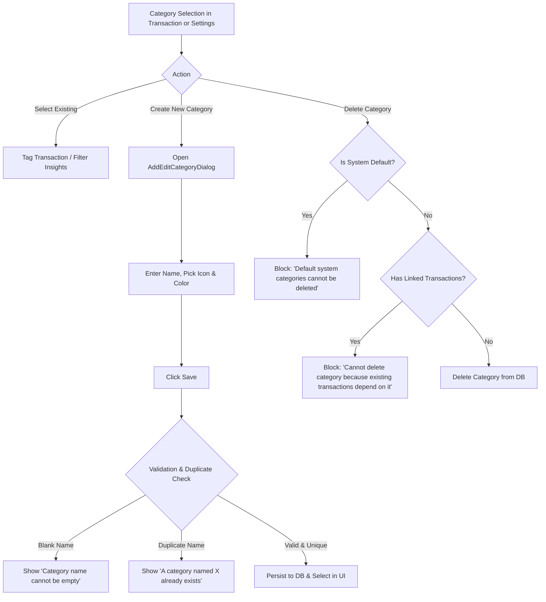

# FEAT-14: Categories Management Specification

## 1. Feature Name & Unique ID
- **Feature Name**: Categories Management (Default Seeding, Custom Taxonomy, Live Visual Customizer & Deletion Integrity)
- **Feature ID**: `FEAT-14-CATEGORIES`
- **Sub-Features**:
  - `FEAT-14.1`: Pre-seeded Default Categories (12 Expense, 8 Income)
  - `FEAT-14.2`: Custom Category Creation & Editing with Duplicate Protection
  - `FEAT-14.3`: Visual Customizer (22 Category Icons & 12 Curated Color Swatches)
  - `FEAT-14.4`: Category Deletion Safety & Referential Integrity Enforcement
  - `FEAT-14.5`: Category Spending & Income Analytics Aggregation

---

## 2. Business Goal & Purpose
Categories provide the foundational organizational schema for all monetary inflows and outflows in Leaf. By allowing transactions, budgets, and recurring rules to be categorized accurately, users gain clear visibility into spending behavior, lifestyle costs, and financial leaks.

Key product goals:
- Deliver an instant, zero-setup experience by pre-seeding 20 balanced, real-world personal finance categories.
- Enable personalization through custom category creation without risking duplicate categorization or visual chaos.
- Protect financial historical accuracy by forbidding the deletion of system default categories or categories attached to active transactions.

---

## 3. User Persona & Value
- **Everyday Budgeter**: Needs intuitive categories like "Food & Dining", "Bills & Utilities", and "Housing & Rent" ready immediately upon install.
- **Freelancer / Dual-Income User**: Needs custom income tags (e.g., "Client Retainer", "Design Projects") with distinctive icons and colors.
- **Meticulous Auditor**: Relies on system-enforced uniqueness and immutable history so historical category reports never break.

---

## 4. Complete Feature Scope
1. **Pre-Seeded Defaults**:
   - 12 Expense Categories: Food & Dining, Transportation, Shopping, Bills & Utilities, Entertainment, Health & Medical, Education, Personal Care, Housing & Rent, EMI & Loans, Subscriptions, Other Expense.
   - 8 Income Categories: Salary, Freelance & Consulting, Investments & Dividends, Rental Income, Business Revenue, Gifts & Grants, Refunds & Cashbacks, Other Income.
2. **Custom Category Authoring**:
   - Name input (trimmed, non-empty, case-insensitive collision check per transaction type).
   - Selection of icon from 22 curated SVG vector icons.
   - Selection of color from 12 curated hexadecimal swatches.
   - Assignment to `EXPENSE` or `INCOME` type.
3. **Category Editing**:
   - Rename custom categories, alter icon or color swatch.
   - Default categories cannot be renamed or deleted, but can be viewed.
4. **Category Deletion**:
   - Rejection if `is_default == true`.
   - Rejection if any existing transaction in the database is tagged with this category ID.
   - Success only for unused user-created categories.
5. **Fallback Category**:
   - "Other" (`id = 0L`, icon `category`, color `#64748B`, `isDefault = true`) used as in-memory fallback.

---

## 5. Explicit Exclusions
- Sub-categories / nested categories (flat taxonomy strictly maintained).
- Reassigning transactions in bulk upon category deletion (transactions must be manually updated or category kept).
- Dynamic RGB/HSV color wheel (strictly locked to the 12 approved hex palette swatches to maintain design system consistency).

---

## 6. User Flow & Journey


---

## 7. Visual & Layout Specifications
- **Category Icon Container**:
  - 40×40 pt squircle (continuous corner radius 12 pt) with 15% opacity background of the category color (`colorHex.copy(alpha = 0.15f)`).
  - Center glyph rendered in solid `colorHex` (size 22×22 pt).
- **Add/Edit Dialog (`AddEditCategoryDialog`)**:
  - Modal dialog with maximum width of 480 dp.
  - Live Preview Card at the top displaying the rendered category pill and squircle with real-time reactive feedback as the user taps icons or colors.
  - Icon Grid: `FlowRow` of 22 round icon chips (38×38 dp, 2 dp border on selected).
  - Color Grid: `FlowRow` of 12 circular swatches (32×32 dp, 3 dp border on selected).

---

## 8. Screen-by-Screen Breakdown
1. **Category Selector (`CategorySelector.kt`)**:
   - Horizontally scrolling or responsive grid chips shown inside `AddEditTransactionSheet`.
   - Selected chip has solid category color container with contrasting white/black text and icon.
   - Trailing "+" chip launches `AddEditCategoryDialog`.
2. **Category Management Screen / Section**:
   - Grouped into two tabs: "Expense Categories" and "Income Categories".
   - System categories display a lock badge indicating immutable status.
   - Custom categories reveal swipe-to-delete or overflow edit options.
3. **Category Analysis Section (`CategoryAnalysisSection.kt`)**:
   - Donut chart displaying category spending distribution.
   - List of category breakdown rows: Icon, Name, Total Subunits formatted to Currency, and percentage of overall spend.

---

## 9. Input Controls & Validation Rules
| Input Field | Type | Validation Rule | Error Message |
| :--- | :--- | :--- | :--- |
| `name` | String | `trim().isNotBlank()` | "Category name cannot be empty." |
| `name` (Duplicate) | String | Case-insensitive match against existing categories of same `TransactionType` (`it.id != id && it.name.trim().equalsIgnoreCase(input)`) | "A [type] category named '[name]' already exists." |
| `iconName` | String | Must match one of 22 approved icon identifiers | Falls back to "restaurant" or "category" |
| `colorHex` | String | Must match valid 6-char hex (`#RRGGBB`) | Falls back to `#64748B` |
| `type` | Enum | `EXPENSE` or `INCOME` | Required |

---

## 10. State Model & UI States
```kotlin
data class CategoryUiState(
    val categories: List<Category> = emptyList(),
    val selectedCategory: Category? = null,
    val isAddEditOpen: Boolean = false,
    val categoryToEdit: Category? = null,
    val errorMessage: String? = null
)
```

---

## 11. Mathematical & Financial Rules
- **Category Total Aggregation**:
  $$\text{CategoryTotal} = \sum_{t \in \text{Transactions}, t.\text{category\_id} = C.\text{id}} t.\text{amount\_subunits}$$
- **Category Spending Percentage**:
  $$\text{Percentage} = \begin{cases} \left( \frac{\text{CategoryTotal}}{\text{TotalExpenseSubunits}} \right) \times 100 & \text{if } \text{TotalExpenseSubunits} > 0 \\ 0.0 & \text{otherwise} \end{cases}$$
- Rounding for display: Formatted to 1 decimal place (e.g., `42.5%`).

---

## 12. Database & Persistence Layer
### Table Definition: `categories`
```sql
CREATE TABLE IF NOT EXISTS `categories` (
    `id` INTEGER PRIMARY KEY AUTOINCREMENT NOT NULL,
    `name` TEXT NOT NULL,
    `icon_name` TEXT NOT NULL,
    `color_hex` TEXT NOT NULL,
    `type` TEXT NOT NULL,
    `is_default` INTEGER NOT NULL DEFAULT 0
);
```

### Pre-Seeded Default Categories (Room DB Callback)
| Category Name | Type | Icon Identifier | Hex Swatch |
| :--- | :--- | :--- | :--- |
| Food & Dining | EXPENSE | `restaurant` | `#EF4444` |
| Transportation | EXPENSE | `directions_car` | `#F59E0B` |
| Shopping | EXPENSE | `shopping_bag` | `#8B5CF6` |
| Bills & Utilities | EXPENSE | `receipt_long` | `#3B82F6` |
| Entertainment | EXPENSE | `movie` | `#EC4899` |
| Health & Medical | EXPENSE | `medical_services` | `#10B981` |
| Education | EXPENSE | `school` | `#6366F1` |
| Personal Care | EXPENSE | `spa` | `#14B8A6` |
| Housing & Rent | EXPENSE | `home` | `#F97316` |
| EMI & Loans | EXPENSE | `account_balance` | `#DC2626` |
| Subscriptions | EXPENSE | `subscriptions` | `#7C3AED` |
| Other Expense | EXPENSE | `more_horiz` | `#64748B` |
| Salary | INCOME | `payments` | `#10B981` |
| Freelance & Consulting | INCOME | `work` | `#3B82F6` |
| Investments & Dividends | INCOME | `trending_up` | `#8B5CF6` |
| Rental Income | INCOME | `real_estate_agent` | `#F59E0B` |
| Business Revenue | INCOME | `storefront` | `#06B6D4` |
| Gifts & Grants | INCOME | `card_giftcard` | `#EC4899` |
| Refunds & Cashbacks | INCOME | `replay` | `#14B8A6` |
| Other Income | INCOME | `attach_money` | `#64748B` |

### Approved Icon Catalog (22 Icons)
`restaurant`, `directions_car`, `shopping_bag`, `receipt_long`, `movie`, `medical_services`, `school`, `spa`, `home`, `account_balance`, `subscriptions`, `flight`, `fitness_center`, `local_cafe`, `pets`, `payments`, `work`, `trending_up`, `storefront`, `card_giftcard`, `replay`, `attach_money`.

### Approved Color Swatch Palette (12 Colors)
`#EF4444` (Red), `#F97316` (Orange), `#F59E0B` (Amber), `#10B981` (Emerald), `#14B8A6` (Teal), `#06B6D4` (Cyan), `#3B82F6` (Blue), `#6366F1` (Indigo), `#8B5CF6` (Violet), `#EC4899` (Pink), `#64748B` (Slate), `#DC2626` (Ruby).

---

## 13. Repository & Data Layer
- `CategoryDao`:
  - `getAllCategories(): Flow<List<CategoryEntity>>`
  - `getCategoriesByType(type: String): Flow<List<CategoryEntity>>`
  - `getCategoryById(id: Long): Flow<CategoryEntity?>`
  - `insertCategory(category: CategoryEntity): Long`
  - `updateCategory(category: CategoryEntity): Int`
  - `deleteCategory(id: Long): Int`
- `CategoryRepositoryImpl`: Maps between Room entities and immutable domain `Category` models.

---

## 14. Domain & Use Case Layer
- `SaveCategoryUseCase`: Trims input, checks duplicates case-insensitively, persists or updates.
- `DeleteCategoryUseCase`: Enforces default check and verifies zero transaction references.
- `GetCategoryAnalysisUseCase`: Aggregates transactions by category and computes percentages and totals.

---

## 15. ViewModel & State Management Layer
- `CategoriesViewModel`: Emits `StateFlow<CategoryUiState>`, triggers `SaveCategoryUseCase` and handles validation error states.

---

## 16. Background Processing & Lifecycle
- Category seeding occurs synchronously during Room DB initialization in `onCreate(SupportSQLiteDatabase)`.
- Custom category inserts and updates run in `Dispatchers.IO`.

---

## 17. Hardware & System Integration
- Haptic feedback triggered on icon or color swatch tap (`HapticFeedbackType.TextHandleMove` or light click).

---

## 18. Security, Privacy & Compliance
- Categories contain strictly local strings; no telemetry or data transmission is performed.
- Category metadata is fully included in JSON backups and CSV exports.

---

## 19. Accessibility & Internationalization
- Pre-seeded default categories use localization keys in `strings.xml`.
- Screen readers announce category name, type, and selection state ("Food & Dining, Expense category, Selected").
- All color swatches pass contrast requirements when paired with primary foreground icons.

---

## 20. Edge Cases & Exception Handling
1. **User attempts to delete "Food & Dining"**: Blocked immediately with user notification: *"Default system categories cannot be deleted."*
2. **User attempts to delete a custom category "Boba" with 3 logged transactions**: Blocked immediately with: *"Cannot delete category 'Boba' because existing transactions depend on it."*
3. **User creates "food & dining" when "Food & Dining" exists**: Blocked by case-insensitive check: *"An expense category named 'food & dining' already exists."*
4. **User creates "Freelance" under Expense when "Freelance" exists under Income**: Allowed, as duplicate protection is strictly scoped per `TransactionType`.

---

## 21. Android Implementation Reference
- `data/local/database/ExpenseTrackerDatabase.kt`: Default categories seeded in `seedDefaultCategoriesSql`.
- `data/local/dao/CategoryDao.kt`: SQLite Room queries.
- `data/local/entity/CategoryEntity.kt`: Persistence entity.
- `domain/model/Category.kt`: Domain model with `UNCATEGORIZED` singleton.
- `domain/usecase/SaveCategoryUseCase.kt`: Duplicate validation logic.
- `domain/usecase/DeleteCategoryUseCase.kt`: Deletion integrity verification.
- `presentation/categories/AddEditCategoryDialog.kt`: Modal with icon/color pickers and live preview.
- `presentation/components/CategoryIcon.kt`: Squircle icon rendering component.

---

## 22. iOS Native Architecture & Implementation
- **Swift Data Model**:
  ```swift
  struct Category: Identifiable, Hashable, Codable {
      let id: Int64
      var name: String
      var iconName: String
      var colorHex: String
      var type: TransactionType
      var isDefault: Bool
  }
  ```
- **SF Symbols Icon Mapping**:
  Map Android Material icon names to native Apple SF Symbols:
  | Material Icon | SF Symbol |
  | :--- | :--- |
  | `restaurant` | `fork.knife` |
  | `directions_car` | `car.fill` |
  | `shopping_bag` | `bag.fill` |
  | `receipt_long` | `doc.text.fill` |
  | `movie` | `film.fill` |
  | `medical_services` | `cross.case.fill` |
  | `school` | `graduationcap.fill` |
  | `spa` | `leaf.fill` |
  | `home` | `house.fill` |
  | `account_balance` | `building.columns.fill` |
  | `subscriptions` | `play.tv.fill` |
  | `more_horiz` | `ellipsis.circle.fill` |
  | `payments` | `banknote.fill` |
  | `work` | `briefcase.fill` |
  | `trending_up` | `chart.line.uptrend.xyaxis` |
  | `real_estate_agent` | `key.fill` |
  | `storefront` | `storefront.fill` |
  | `card_giftcard` | `gift.fill` |
  | `replay` | `arrow.counterclockwise` |
  | `attach_money` | `dollarsign.circle.fill` |
- **SwiftUI View**: Implement `CategorySelectorView` and `AddEditCategorySheet` using iOS 17 `FlowLayout` (`Layout` protocol) or `LazyVGrid`.
- **Database Seeding**: On SQLite / Core Data database initialization, run initial seeding transaction with the exact 20 rows.

---

## 23. Cross-Platform Parity Contract
- **IDs & Names**: Default category IDs and names must match in import/export JSON payloads.
- **Icons**: When JSON exports contains Android icon name strings (e.g., `"restaurant"`), iOS must cleanly map it to the corresponding SF Symbol (`fork.knife`).
- **Colors**: Hex strings (`#EF4444`) must be identical across platforms.
- **Integrity**: Deletion restrictions (default protection + transaction dependency protection) must operate identically on iOS.

---

## 24. Verification & Testing Strategy
- Unit test: `SaveCategoryUseCaseTest` verifying duplicate rejection (same type) and acceptance (different type).
- Unit test: `DeleteCategoryUseCaseTest` verifying default category block and transaction dependency block.
- UI test: Opening `AddEditCategoryDialog`, entering duplicate name, and verifying error banner display.
- Database test: Verifying 20 default categories seeded upon initial database creation.

---

## 25. Known Issues, Technical Debt & Migration Notes
- **Fallback Category**: `Category.UNCATEGORIZED` (`id = 0`) is an in-memory construct. If an external transaction has an invalid `category_id`, it maps to "Other". iOS must implement the same fallback mechanism.
- **Room FK Cascades**: `transactions.category_id` references `categories.id` with `ON DELETE RESTRICT`. In iOS SQLite/Core Data, set delete rule to `Deny` / `RESTRICT`.

