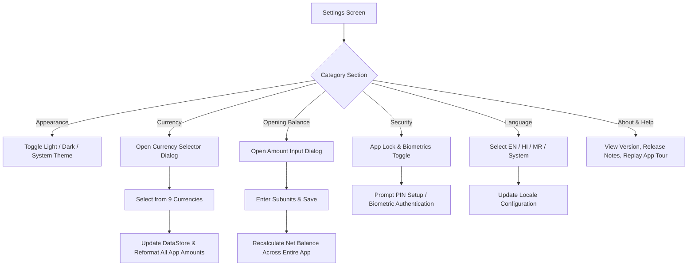

# FEAT-15: Settings and Preferences Specification

## 1. Feature Name & Unique ID
- **Feature Name**: Settings and Preferences Management
- **Feature ID**: `FEAT-15-SETTINGS-AND-PREFERENCES`
- **Sub-Features**:
  - `FEAT-15.1`: Theme Selection (Light, Dark, System Default)
  - `FEAT-15.2`: Currency Configuration (9 Supported Currencies & Subunit Precision)
  - `FEAT-15.3`: Base Opening Balance Calibration
  - `FEAT-15.4`: Default Transaction Payment Sources (Account / Cash)
  - `FEAT-15.5`: Notification & Reminder Configuration
  - `FEAT-15.6`: Security & Privacy Settings (PIN, Face ID / Touch ID, Recents Obfuscation)
  - `FEAT-15.7`: Profile Personalization (Display Name & Local Profile Avatar)
  - `FEAT-15.8`: Localization & Language Selection (English, Hindi, Marathi, System)
  - `FEAT-15.9`: Data Management, Cloud Sync & App Tour Access

---

## 2. Business Goal & Purpose
The Settings and Preferences module is the control center of Leaf, giving users complete autonomy over the application's appearance, financial defaults, security safeguards, notification rhythms, and privacy thresholds.

Key product objectives:
- Ensure seamless personalization while persisting preferences locally and reactively across all screens.
- Provide sensible, safe defaults (e.g., Cash default for expenses, Account for income, Light theme, INR currency).
- Maintain isolation between non-sensitive user preferences and secure authentication tokens (PIN vault).

---

## 3. User Persona & Value
- **Security-Conscious User**: Configures App Lock, Face ID, and hides app snapshots in iOS App Switcher / Android Recents.
- **International User**: Selects USD, EUR, GBP, or JPY and changes language preference.
- **Power Budgeter**: Sets opening balance, default payment accounts, and fine-tunes reminder notification times.

---

## 4. Complete Feature Scope
1. **Appearance & Theme**:
   - `themeMode`: `LIGHT`, `DARK`, `SYSTEM`.
   - `useDynamicColors`: Toggle for wallpaper-derived dynamic theming (Android Material You; on iOS maps to Accent Color harmonization).
2. **Financial Defaults**:
   - `currency`: Select one of 9 currencies (`INR`, `USD`, `EUR`, `GBP`, `AED`, `SGD`, `CAD`, `AUD`, `JPY`).
   - `openingBalanceSubunits`: Signed 64-bit integer specifying initial starting funds.
   - `defaultIncomeSource`: Default payment method for Income (`ACCOUNT` or `CASH`).
   - `defaultExpenseSource`: Default payment method for Expense (`CASH` or `ACCOUNT`).
   - `isBalanceVisible`: Global toggle hiding balance numbers on Dashboard with eye toggle.
3. **Notifications & Reminders**:
   - `notificationsMasterEnabled`: Global push notification permissions toggle.
   - `dailyReminderEnabled`: 9:00 PM evening prompt (configurable hour/minute).
   - Category-specific reminder toggles (`emiRemindersEnabled`, `billRemindersEnabled`, `creditCardRemindersEnabled`).
   - Default advance reminder offset (`defaultReminderOffsetDays`: 0 to 7 days).
4. **Security & App Lock**:
   - `appLockEnabled`: Requires PIN to enter app.
   - `biometricEnabled`: Enables Biometric prompt (Face ID / Touch ID / Fingerprint).
   - `autoLockDurationSeconds`: Grace period before re-locking (`0` = Immediately, `30`, `60`, `300`).
   - `hideContentInRecents`: Obfuscates screen snapshot in multitask switcher.
5. **Profile & Identity**:
   - `userName`: User's preferred name shown on Dashboard ("Hello, Vinay 👋").
   - `profileImageUri`: Local URI referencing user profile photo.
6. **Localization**:
   - `appLanguage`: `"SYSTEM"`, `"EN"`, `"HI"`, `"MR"`.

---

## 5. Explicit Exclusions
- Multi-currency accounts (Leaf operates in a single primary currency at any given time).
- Automatic real-time forex exchange rates (switching currency changes display symbol and subunit factor; it does not convert historical numbers).
- Cloud storage of PIN hash or salt (kept strictly in isolated device keychain / preferences).

---

## 6. User Flow & Journey


---

## 7. Visual & Layout Specifications
- **Layout Structure**: Organized into clear, spaced sections using `SettingsTiles.kt`:
  - Profile Header Card (Avatar, Name, Quick Status).
  - General & Display (`ThemeTile`, `CurrencyTile`, `LanguageTile`).
  - Financial Calibration (`OpeningBalanceTile`, `DefaultPaymentMethodTile`).
  - Notifications & Alerts (`DailyReminderTile`, `AdvanceReminderTile`).
  - Security & Privacy (`AppLockTile`, `BiometricsTile`, `RecentsPrivacyTile`).
  - Data & Cloud Sync (`GoogleDriveSyncTile`, `ExportImportTile`).
  - About & Version (`VersionInfoTile`, `AppTourTile`, `GitHubRepoTile`).
- **Icons**: Styled with the Emerald brand color inside 36×36 dp rounded containers.
- **Toggles**: Native platform switch controls adhering to HIG / Material 3 guidelines.

---

## 8. Screen-by-Screen Breakdown
1. **Main Settings Screen (`SettingsScreen.kt`)**:
   - Comprehensive scrollable list containing grouped preference cards.
2. **Currency Selection Dialog**:
   - Single-choice radio list of 9 currencies showing Code, Symbol, Full Name, and Decimal Format preview (e.g., `INR - ₹ (Indian Rupee) - 1,00,000.00`).
3. **Opening Balance Calibration Dialog**:
   - Calculator-style or formatted decimal input field pre-filled with current base opening balance.
4. **Language Selection Dialog**:
   - List of English, हिन्दी (Hindi), मराठी (Marathi), and System Default.
5. **App Lock Configuration Sheet**:
   - Directs to PIN creation flow if no PIN exists; enables Biometric toggle if hardware is available.

---

## 9. Input Controls & Validation Rules
| Setting | Storage Type | Allowed Values / Constraints | Default Value |
| :--- | :--- | :--- | :--- |
| `themeMode` | String / Enum | `LIGHT`, `DARK`, `SYSTEM` | `LIGHT` |
| `currency` | String (ISO) | `INR`, `USD`, `EUR`, `GBP`, `AED`, `SGD`, `CAD`, `AUD`, `JPY` | `INR` |
| `openingBalanceSubunits` | Long (64-bit) | $\pm 10^{14}$ subunits (can be negative, 0, or positive) | `0L` |
| `defaultIncomeSource` | String / Enum | `ACCOUNT`, `CASH` | `ACCOUNT` |
| `defaultExpenseSource` | String / Enum | `ACCOUNT`, `CASH` | `CASH` |
| `dailyReminderHour` | Int | $0 \dots 23$ | `21` (9:00 PM) |
| `dailyReminderMinute` | Int | $0 \dots 59$ | `0` |
| `autoLockDurationSeconds`| Long | `0` (immediate), `30`, `60`, `300` | `0L` |
| `userName` | String? | Max 50 characters, trimmed | `null` |
| `appLanguage` | String | `"SYSTEM"`, `"EN"`, `"HI"`, `"MR"` | `"SYSTEM"` |

---

## 10. State Model & UI States
```kotlin
data class SettingsUiState(
    val preferences: UserPreferences = UserPreferences(),
    val isLoading: Boolean = false,
    val showCurrencyDialog: Boolean = false,
    val showOpeningBalanceDialog: Boolean = false,
    val showLanguageDialog: Boolean = false,
    val appVersionName: String = "1.0.0",
    val appVersionCode: Int = 1
)
```

---

## 11. Mathematical & Financial Rules
- **Opening Balance Propagation**:
  The opening balance is added to historical transactions to compute the current liquid net balance:
  $$\text{NetBalance} = \text{openingBalanceSubunits} + \sum \text{IncomeSubunits} - \sum \text{ExpenseSubunits}$$
- **Currency Subunit Decimal Scaling**:
  When displaying amounts, divide subunits by $10^{\text{decimalPlaces}}$:
  $$\text{DisplayAmount} = \frac{\text{amount\_subunits}}{\text{currency.subunitsPerUnit}}$$
  - For JPY: $\text{factor} = 1$, 0 decimals.
  - For INR, USD, EUR, GBP, AED, SGD, CAD, AUD: $\text{factor} = 100$, 2 decimals.

---

## 12. Database & Persistence Layer
- **Preferences Storage**: Android Jetpack `DataStore<Preferences>` backed by file `user_preferences.preferences_pb`.
- Keys:
  - `KEY_THEME_MODE`: `stringPreferencesKey("theme_mode")`
  - `KEY_CURRENCY`: `stringPreferencesKey("currency")`
  - `KEY_OPENING_BALANCE`: `longPreferencesKey("opening_balance")`
  - `KEY_DEFAULT_INCOME_SOURCE`: `stringPreferencesKey("default_income_source")`
  - `KEY_DEFAULT_EXPENSE_SOURCE`: `stringPreferencesKey("default_expense_source")`
  - `KEY_APP_LOCK_ENABLED`: `booleanPreferencesKey("app_lock_enabled")`
  - `KEY_BIOMETRIC_ENABLED`: `booleanPreferencesKey("biometric_enabled")`
  - `KEY_AUTO_LOCK_DURATION`: `longPreferencesKey("auto_lock_duration")`
  - `KEY_HIDE_RECENTS`: `booleanPreferencesKey("hide_content_in_recents")`
  - `KEY_USER_NAME`: `stringPreferencesKey("user_name")`
  - `KEY_PROFILE_IMAGE_URI`: `stringPreferencesKey("profile_image_uri")`
  - `KEY_APP_LANGUAGE`: `stringPreferencesKey("app_language")`

---

## 13. Repository & Data Layer
- `UserPreferencesRepository`:
  - `userPreferencesFlow: Flow<UserPreferences>`
  - `setThemeMode(mode: ThemeMode)`
  - `setCurrency(currency: Currency)`
  - `setOpeningBalance(subunits: Long)`
  - `setDefaultPaymentMethod(type: TransactionType, method: PaymentMethod)`
  - `setAppLockEnabled(enabled: Boolean)`
  - `setBiometricEnabled(enabled: Boolean)`
  - `setAutoLockDuration(seconds: Long)`
  - `setHideContentInRecents(hide: Boolean)`
  - `setUserName(name: String?)`
  - `setProfileImageUri(uri: String?)`
  - `setAppLanguage(languageCode: String)`

---

## 14. Domain & Use Case Layer
- `GetUserPreferencesUseCase`: Exposes reactive Flow of `UserPreferences`.
- `UpdateUserPreferencesUseCase`: Dispatches atomic edits to DataStore.
- `PreferenceUseCases`: Aggregates fine-grained setters (`SetThemeUseCase`, `SetCurrencyUseCase`, etc.).

---

## 15. ViewModel & State Management Layer
- `SettingsViewModel`:
  - Collects `userPreferencesFlow` via `stateIn(viewModelScope, SharingStarted.WhileSubscribed(5000), initialValue)`.
  - Exposes actions: `onThemeChanged()`, `onCurrencySelected()`, `onOpeningBalanceChanged()`, `onLanguageChanged()`.

---

## 16. Background Processing & Lifecycle
- Changing `dailyReminderEnabled` or reminder times immediately triggers `ReminderAlarmScheduler.scheduleDailyReminder()` to align Android `AlarmManager` / iOS `UNCalendarNotificationTrigger`.
- Changing `hideContentInRecents` dynamically sets/clears Android window flag `WindowManager.LayoutParams.FLAG_SECURE`.

---

## 17. Hardware & System Integration
- **Biometrics**: Android `BiometricPrompt` / iOS `LAContext.evaluatePolicy(.deviceOwnerAuthenticationWithBiometrics)`.
- **Photo Picker**: Android `ActivityResultContracts.PickVisualMedia` / iOS `PhotosPicker` for local profile avatar selection.

---

## 18. Security, Privacy & Compliance
- PIN secrets are **never** stored in `UserPreferencesDataStore`. PIN salt and hash are stored strictly in `SecurePinManager` (EncryptedSharedPreferences / iOS Keychain).
- Profile pictures are stored locally in private application sandbox storage.

---

## 19. Accessibility & Internationalization
- All setting titles and descriptions link to `@string/` resources.
- When `appLanguage` is changed, locale is updated dynamically via Android `AppCompatDelegate.setApplicationLocales` / iOS bundle configuration.
- VoiceOver / TalkBack announcements accurately state toggle status ("App Lock, switch, on").

---

## 20. Edge Cases & Exception Handling
1. **User enters extremely large opening balance**: Capped at $\pm 10^{14}$ subunits to avoid integer overflow.
2. **User switches currency with existing transactions**: Subunit integers in database remain unchanged; currency formatter updates display symbol and decimal format.
3. **Biometrics unavailable on device**: The biometric toggle is disabled with subtitle: *"No biometric hardware or enrolled prints detected."*

---

## 21. Android Implementation Reference
- `domain/model/UserPreferences.kt`: Data class model.
- `data/preferences/UserPreferencesDataStore.kt`: DataStore implementation.
- `data/repository/UserPreferencesRepositoryImpl.kt`: Repository layer.
- `presentation/settings/SettingsScreen.kt`: Jetpack Compose UI.
- `presentation/settings/SettingsViewModel.kt`: ViewModel logic.
- `presentation/settings/components/SettingsTiles.kt`: Modular setting rows.

---

## 22. iOS Native Architecture & Implementation
- **Storage Strategy**:
  - Store non-sensitive settings in `UserDefaults` with a reactive wrapper (`@AppStorage` or `@Observable UserPreferencesStore`).
  - Store PIN salt and hash in iOS **Keychain Services** via `Security.framework`.
- **Multitask Obfuscation on iOS**:
  - Listen to `sceneWillResignActiveNotification` in `SceneDelegate` or `WindowGroup`.
  - Add a blurred overlay or visual privacy view over key window when entering background if `hideContentInRecents` is true. Remove on `sceneDidBecomeActiveNotification`.
- **Localization in iOS**:
  - Configure multi-language support in Xcode string catalogs (`Localizable.xcstrings`).

---

## 23. Cross-Platform Parity Contract
- Preference keys in backup JSON files must map seamlessly between Android and iOS.
- Default values must be identical: Light theme, INR currency, Cash for expenses, Account for income, 9:00 PM daily reminder.

---

## 24. Verification & Testing Strategy
- Unit test: DataStore / UserDefaults read-write serialization.
- Unit test: Currency formatter reaction upon changing preferences.
- Integration test: Verifying alarm rescheduled when reminder time updated.
- Security test: Verifying PIN not present in plain preferences file.

---

## 25. Known Issues, Technical Debt & Migration Notes
- In Android, changing language at runtime sometimes requires recreating the activity stack. On iOS, changing language in-app requires custom bundle localization or guiding user to iOS System Settings for the app.
- Dynamic Color (Material You) is Android-specific; on iOS, map this to enabling the native iOS System Tint color palette.

