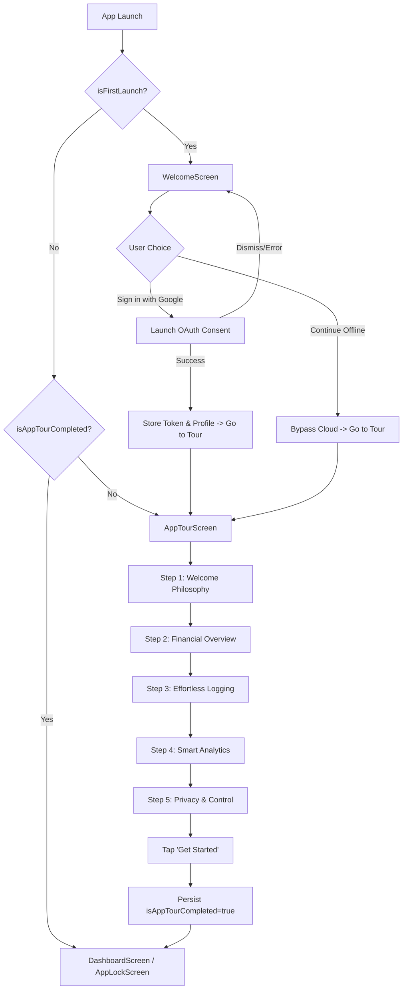

# FEAT-16: Onboarding and App Tour Specification

## 1. Feature Name & Unique ID
- **Feature Name**: Onboarding, Authentication Choice & Interactive App Tour
- **Feature ID**: `FEAT-16-ONBOARDING-AND-TOUR`
- **Sub-Features**:
  - `FEAT-16.1`: Welcome & Philosophy Showcase
  - `FEAT-16.2`: Authentication Onboarding (Google Sign-In with Drive Scope vs Local-First Bypass)
  - `FEAT-16.3`: Five-Step Interactive Visual App Tour (`AppTourScreen`)
  - `FEAT-16.4`: Custom Illustrated Step Components
  - `FEAT-16.5`: Tour Completion & State Persistence

---

## 2. Business Goal & Purpose
First impressions define user trust and long-term retention in financial software. Leaf's onboarding flow welcomes the user with a calm, privacy-first brand philosophy, gives them the option to link Google Drive for zero-friction encrypted backups or start completely offline without an account, and guides them through Leaf's core workflows in five digestible slides.

---

## 3. User Persona & Value
- **Privacy Purist**: Rejoices in the prominent "Continue Offline" button with zero account creation or personal data harvesting.
- **Backup Pragmatist**: Connects Google Drive immediately during welcome so their data is protected from day one.
- **First-Time App User**: Understands how to log expenses, view donut analytics, and calibrate opening balance via the 5-step interactive tour.

---

## 4. Complete Feature Scope
1. **Welcome Screen (`WelcomeScreen.kt`)**:
   - Leaf logo branding and emerald identity header.
   - Core value badges:
     - 🔒 **100% Offline First**: Your money data stays on your device.
     - ⚡ **Zero Trackers**: No analytics, no ads, no telemetry.
     - ☁️ **Private Cloud Backup**: Optional Google Drive sync in your personal vault.
   - Primary Action: "Sign in with Google" (requests `drive.appdata` / `drive.file` scope).
   - Secondary Action: "Continue Without Account" (enters local-first mode immediately).
2. **Interactive 5-Step App Tour (`AppTourScreen.kt`)**:
   - `HorizontalPager` with 5 interactive pages:
     - **Step 1: Welcome & Philosophy**: Introduction to Leaf's mindful financial clarity.
     - **Step 2: Financial Overview**: The Dashboard net balance card and cashflow metrics.
     - **Step 3: Effortless Logging**: Fast transaction entry, payment sources (Cash/Account), and categories.
     - **Step 4: Smart Analytics**: Visual spending distribution donut charts and monthly trends.
     - **Step 5: Privacy & Control**: App lock PIN protection and cloud backup control.
   - Dynamic page indicator dots with smooth spring width animation.
   - Skip button (top-right app bar) and bottom Navigation (Back / Next / "Get Started" on step 5).
   - Hardware Back button navigates to previous page if `currentPage > 0`, else skips tour.
3. **Completion & State Persistence**:
   - Flags `isFirstLaunch = false` and `isAppTourCompleted = true` in DataStore.
   - Rerunning tour is accessible at any time from Settings -> About -> "App Tour".

---

## 5. Explicit Exclusions
- Mandatory phone number, OTP, or email password account creation (Leaf has no proprietary backend or auth servers).
- In-tour complex database mutations (tour is purely educational and non-destructive).

---

## 6. User Flow & Journey


---

## 7. Visual & Layout Specifications
- **Welcome Screen**:
  - Gradient background blending Obsidian (`#0F172A`) with deep Emerald tints.
  - Emerald leaf brand glyph in a circular illuminated container.
  - Rounded buttons using `ButtonShape` (12 dp radius).
- **Tour Screen**:
  - Full-screen pager with top bar containing "Skip" `TextButton`.
  - Center Illustration Area: 260 dp height featuring custom Compose canvas / vector illustrations:
    - `Step1WelcomeIllustration`: Animated floating leaf with sparkle vectors.
    - `Step2OverviewIllustration`: Stylized miniature Dashboard balance card.
    - `Step3TransactionsIllustration`: Interactive expense/income pill with category badges.
    - `Step4AnalyticsIllustration`: Multi-colored donut segment preview.
    - `Step5SettingsIllustration`: Shield icon with floating padlock and cloud checkmark.
  - Page indicator: Active dot expands from 8 dp to 24 dp with emerald fill; inactive dots are 8 dp with muted surface variant fill.

---

## 8. Screen-by-Screen Breakdown
1. **Welcome Screen (`WelcomeScreen.kt`)**:
   - Manages Google Sign-In intent launcher and Google Drive consent intent.
   - Shows inline error snackbars if Google Play Services are missing or user aborts consent.
2. **App Tour Screen (`AppTourScreen.kt`)**:
   - Hosts `HorizontalPager(state = pagerState)`.
   - Bottom bar with "Back" button (hidden on slide 0) and "Next" / "Get Started" filled button.

---

## 9. Input Controls & Validation Rules
- **Google Sign-In**: Validates valid Google account authorization with required Google Drive scope (`https://www.googleapis.com/auth/drive.appdata`).
- **Tour Navigation**:
  - Next button advances page index by 1.
  - Back button decrements page index by 1.
  - Skip / Finish buttons persist completion to preferences.

---

## 10. State Model & UI States
```kotlin
sealed interface WelcomeUiState {
    object Idle : WelcomeUiState
    object Loading : WelcomeUiState
    data class ConsentRequired(val consentIntent: Intent) : WelcomeUiState
    object Success : WelcomeUiState
    data class Error(val message: String) : WelcomeUiState
}
```

---

## 11. Mathematical & Financial Rules
- No direct arithmetic performed in onboarding.
- Default opening balance initialized to $0.00$ (`0L` subunits) upon completing onboarding.

---

## 12. Database & Persistence Layer
- Preferences persisted to DataStore:
  - `is_first_launch`: Set to `false` when user completes Welcome screen.
  - `is_app_tour_completed`: Set to `true` when user finishes or skips Tour.
  - `user_name`: Pre-filled from Google Account display name if signed in.
  - `profile_image_uri`: Pre-filled from Google Account avatar URI if signed in.

---

## 13. Repository & Data Layer
- `UserPreferencesRepository`:
  - `setIsFirstLaunch(isFirstLaunch: Boolean)`
  - `setIsAppTourCompleted(isCompleted: Boolean)`

---

## 14. Domain & Use Case Layer
- `SetAppTourCompletedUseCase`: Invoked by `AppTourViewModel` when tour completes or is skipped.
- `CompleteWelcomeUseCase`: Invoked by `WelcomeViewModel` to conclude initial intro.

---

## 15. ViewModel & State Management Layer
- `WelcomeViewModel`: Manages Google OAuth results, signs in to Drive client, sets preferences.
- `AppTourViewModel`: Manages tour progress and invokes `SetAppTourCompletedUseCase`.

---

## 16. Background Processing & Lifecycle
- If user signs in with Google during Welcome, `CloudBackupWorker` / initial backup sync is scheduled once connectivity is confirmed.

---

## 17. Hardware & System Integration
- Haptic feedback when swiping between tour pages or tapping "Next" / "Get Started".

---

## 18. Security, Privacy & Compliance
- Transparent privacy disclosure: Informs users explicitly that data is stored offline on device.
- Local-first choice: Users can use 100% of the app without providing an email, identity, or network permission.

---

## 19. Accessibility & Internationalization
- Tour titles and descriptions load from `strings.xml`:
  - `app_tour_step1_title` / `desc`
  - `app_tour_step2_title` / `desc`
  - `app_tour_step3_title` / `desc`
  - `app_tour_step4_title` / `desc`
  - `app_tour_step5_title` / `desc`
- Screen readers announce "Page X of 5: [Title]".

---

## 20. Edge Cases & Exception Handling
1. **User cancels Google Sign-In dialog**: Return to Welcome screen without error crash; user can retry or tap "Continue Without Account".
2. **Device has no internet during Google Sign-In**: Display clear snackbar: *"Unable to connect. You can continue offline and sign in later."*
3. **User force-quits app mid-tour**: Upon relaunch, tour resumes from Step 1 until explicitly completed or skipped.

---

## 21. Android Implementation Reference
- `presentation/onboarding/WelcomeScreen.kt` & `WelcomeViewModel.kt`
- `presentation/tour/AppTourScreen.kt` & `AppTourViewModel.kt`
- `presentation/tour/components/TourStepIllustrations.kt`
- `domain/usecase/SetAppTourCompletedUseCase.kt`

---

## 22. iOS Native Architecture & Implementation
- **Authentication on iOS**:
  - Primary Cloud Option: **iCloud Drive** (via CloudKit / Ubiquitous Key-Value Store / private Documents container) requires **zero login** on iOS (uses native Apple ID).
  - Secondary Option: "Sign in with Apple" or Google Sign-In iOS SDK for cross-platform Google Drive sync.
  - Offline Option: "Continue Without Account" button.
- **Tour Carousel in SwiftUI**:
  - Implement using `TabView(selection: $currentStep) { ... }.tabViewStyle(.page(indexDisplayMode: .never))` accompanied by custom animated page indicator dots.
  - Vector illustrations recreated in SwiftUI `Canvas` or SF Symbols groupings.

---

## 23. Cross-Platform Parity Contract
- The 5 educational messages must communicate the identical value proposition on both platforms.
- Replaying the tour from Settings must be available on both platforms.

---

## 24. Verification & Testing Strategy
- UI test verifying Welcome screen button transitions.
- Pager navigation test: Swiping through 5 steps, tapping Skip, verifying `isAppTourCompleted` in preferences.
- Offline bypass test: Tapping "Continue Without Account" lands on Tour and then Dashboard with no cloud prompt.

---

## 25. Known Issues, Technical Debt & Migration Notes
- Google Drive Sign-In on iOS requires third-party GoogleSignIn SDK. It is highly recommended that iOS defaults to native **iCloud Drive** backup as the primary seamless cloud mechanism, while offering Google Drive for users migrating data from Android.

