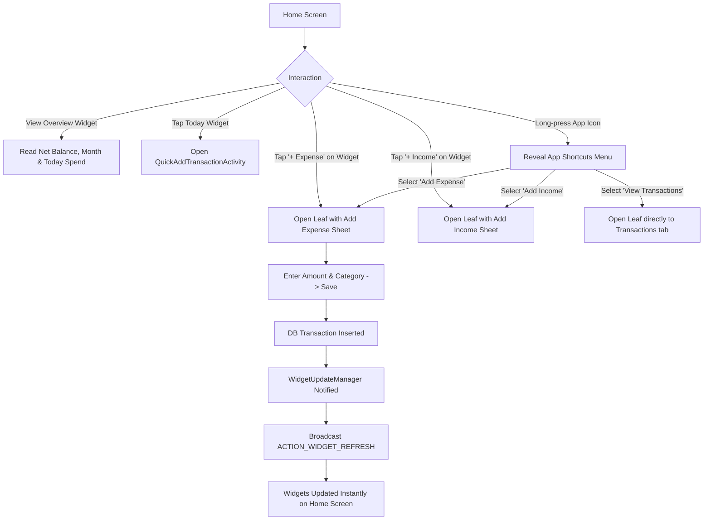

# FEAT-17: Home Screen Widgets and App Shortcuts Specification

## 1. Feature Name & Unique ID
- **Feature Name**: Home Screen Widgets, Quick Add Floating Entry & Launcher Shortcuts
- **Feature ID**: `FEAT-17-WIDGETS-AND-SHORTCUTS`
- **Sub-Features**:
  - `FEAT-17.1`: Financial Overview Widget (4×2 Multi-Metric Dashboard)
  - `FEAT-17.2`: Today's Spending Widget (2×1 Compact Tracker)
  - `FEAT-17.3`: Quick Action Floating Entry Launcher (`QuickAddWidgetProvider`)
  - `FEAT-17.4`: Reactive Widget State Synchronization (`WidgetUpdateManager`)
  - `FEAT-17.5`: Static Launcher App Shortcuts (Expense, Income, Transactions)
  - `FEAT-17.6`: Dedicated Floating Quick-Add Activity (`QuickAddTransactionActivity`)

---

## 2. Business Goal & Purpose
The primary point of friction in personal expense tracking is friction-to-entry. If logging a ₹20 coffee requires unlocking the phone, opening an app, waiting for cold launch, and tapping three buttons, users abandon the habit.

Leaf solves this by placing instantaneous glanceable financial metrics and 1-tap entry points directly on the user's home screen through native widgets and launcher shortcuts.

---

## 3. User Persona & Value
- **Busy Commuter**: Taps the "+ Expense" widget button at a checkout counter to log a transit fare in under 3 seconds.
- **Mindful Spender**: Glances at their home screen widget throughout the day to see their current day's spend without ever opening the app.
- **Power User**: Uses launcher app shortcuts via long-press on the app icon to jump straight into the transaction history or income logging.

---

## 4. Complete Feature Scope
1. **Financial Overview Widget (`ExpenseTrackerWidgetProvider`)**:
   - Medium 4×2 widget card.
   - Live metrics:
     - Net Liquid Balance.
     - Total Spending This Month.
     - Total Spending Today.
     - Monthly Budget Status or Income summary.
   - Interactive Buttons:
     - "+ Expense" (launches transaction entry modal with `EXPENSE` pre-selected).
     - "+ Income" (launches transaction entry modal with `INCOME` pre-selected).
     - "Refresh" icon (triggers background recalculation of `WidgetFinancialSummary`).
2. **Today's Spending Widget (`TodayExpenseWidgetProvider`)**:
   - Small / Compact 2×1 card.
   - Shows today's cumulative expense total and count of transactions logged today.
   - Tapping anywhere launches `QuickAddTransactionActivity`.
3. **Quick Action Launcher Widget (`QuickAddWidgetProvider`)**:
   - Minimal 1×1 button widget providing immediate access to transaction entry.
4. **App Launcher Shortcuts (`shortcuts.xml`)**:
   - Long-press menu on Leaf app icon:
     - **Add Expense** (`shortcut_add_expense`): Deep links into `MainActivity` with route `"add_expense"`.
     - **Add Income** (`shortcut_add_income`): Deep links into `MainActivity` with route `"add_income"`.
     - **View Transactions** (`shortcut_view_transactions`): Deep links into `MainActivity` with route `"transactions"`.
5. **Lightweight Quick-Add Window (`QuickAddTransactionActivity`)**:
   - Transparent, dialog-themed activity allowing rapid numeric input, category selection, and instant save without loading the complete dashboard UI stack.

---

## 5. Explicit Exclusions
- Interactive full-blown calculator inside the widget (widget framework limits complex gestures; entry opens the specialized quick-add sheet).
- Showing private balance if App Lock is enabled and user preference restricts widget visibility.

---

## 6. User Flow & Journey


---

## 7. Visual & Layout Specifications
- **Widget Background**:
  - High-contrast card (`bg_widget_card.xml`) using Obsidian dark tone (`#1E293B`) or Light mode elevation surface.
  - Emerald highlight accents on active buttons and primary balance figures.
- **Typography in Widgets**:
  - Primary Balance: Bold 20 sp tabular figures.
  - Stat Labels: Uppercase 11 sp muted Slate gray.
- **Button Styling**:
  - "+ Expense": Ruby/Red accent tinted button (`bg_widget_btn_expense.xml`).
  - "+ Income": Emerald/Green accent tinted button (`bg_widget_btn_income.xml`).

---

## 8. Screen-by-Screen Breakdown
1. **Overview Widget Layout (`widget_expense_tracker.xml`)**:
   - Header with Leaf icon, app title, and refresh button.
   - Balance section with currency symbol and formatted net amount.
   - Grid with two stat pills: "TODAY" and "THIS MONTH".
   - Footer action bar with two equal-width pill buttons ("+ Expense" and "+ Income").
2. **Today Expense Layout (`widget_today_expense.xml`)**:
   - Compact vertical layout: Label "SPENT TODAY", large amount, and subtext (e.g. "3 transactions").
3. **Quick-Add Dialog Activity (`QuickAddTransactionActivity.kt`)**:
   - Centered floating modal overlaying the home screen wallpaper.

---

## 9. Input Controls & Validation Rules
- Widget clicks fire explicit `PendingIntent` instances with `Intent.FLAG_ACTIVITY_NEW_TASK | Intent.FLAG_ACTIVITY_CLEAR_TOP`.
- Refresh button fires broadcast `com.vinaynalavade.expensetracker.ACTION_WIDGET_REFRESH`.

---

## 10. State Model & UI States
```kotlin
data class WidgetFinancialSummary(
    val netBalanceSubunits: Long = 0L,
    val todayExpenseSubunits: Long = 0L,
    val monthExpenseSubunits: Long = 0L,
    val currency: Currency = Currency.DEFAULT,
    val isAppLockEnabled: Boolean = false,
    val todayTransactionCount: Int = 0
)
```

---

## 11. Mathematical & Financial Rules
- **Today's Expense Aggregation**:
  $$\text{TodayExpense} = \sum_{t \in \text{Transactions}, t.\text{type} = \text{EXPENSE}, t.\text{date} = \text{Today}} t.\text{amount\_subunits}$$
- **Month's Expense Aggregation**:
  $$\text{MonthExpense} = \sum_{t \in \text{Transactions}, t.\text{type} = \text{EXPENSE}, t \in \text{CurrentMonth}} t.\text{amount\_subunits}$$
- **Formatting**: Strictly respect user's selected `Currency` symbol and decimal factor.

---

## 12. Database & Persistence Layer
- `WidgetUpdateManager` queries `TransactionDao` and `UserPreferencesDataStore` to calculate the summary.
- No dedicated table; uses indexed queries on `transactions (date, type)` and `budgets`.

---

## 13. Repository & Data Layer
- `GetWidgetFinancialSummaryUseCase`: Aggregates opening balance, monthly income, monthly expenses, and today's transactions into a single synchronous/coroutine payload.

---

## 14. Domain & Use Case Layer
- `GetWidgetFinancialSummaryUseCase`: Invoked by `WidgetUpdateManager` on background IO dispatcher whenever repository emits an updated transaction list.

---

## 15. ViewModel & State Management Layer
- Widgets are managed outside the ViewModel lifecycle via `AppWidgetProvider` broadcast receivers.

---

## 16. Background Processing & Lifecycle
- `WidgetUpdateManager.updateAllWidgets(context)`:
  - Invoked after any transaction is inserted, updated, or deleted.
  - Broadcasts update intent to `AppWidgetManager`.
  - Android `APPWIDGET_UPDATE` handled in `ExpenseTrackerWidgetProvider.onUpdate`.

---

## 17. Hardware & System Integration
- Home screen widget host manager (`AppWidgetManager`).
- Launcher shortcut manager (`ShortcutManager`).

---

## 18. Security, Privacy & Compliance
- **Privacy Masking**: If `appLockEnabled == true`, the widget can optionally mask balances with `••••••` or show only transaction counts, preventing sensitive financial numbers from being visible on lock screens.

---

## 19. Accessibility & Internationalization
- All widget buttons provide descriptive `contentDescription` attributes ("Add expense", "Add income", "Refresh balances").
- Supports dynamic system font scaling.

---

## 20. Edge Cases & Exception Handling
1. **Database is locked or migrating**: Widget displays fallback cached values or "Tap to update".
2. **User has 0 transactions today**: Widget displays `₹0.00` and "No expenses today".
3. **Device reboots**: Widgets are refreshed automatically via `BOOT_COMPLETED` receiver.

---

## 21. Android Implementation Reference
- `presentation/widget/ExpenseTrackerWidgetProvider.kt`
- `presentation/widget/TodayExpenseWidgetProvider.kt`
- `presentation/widget/QuickAddWidgetProvider.kt`
- `presentation/widget/WidgetUpdateManager.kt`
- `domain/usecase/GetWidgetFinancialSummaryUseCase.kt`
- `QuickAddTransactionActivity.kt`
- `res/xml/shortcuts.xml`

---

## 22. iOS Native Architecture & Implementation
- **WidgetKit Implementation**:
  - Implement native iOS widgets using **WidgetKit** and **SwiftUI**.
  - Provide a `TimelineProvider` delivering snapshots:
    - Small widget (`systemSmall`): Maps to Today's Spending (`TodayExpenseWidget`).
    - Medium widget (`systemMedium`): Maps to Financial Overview (`ExpenseTrackerWidget`).
    - Lock Screen widgets (`accessoryRectangular`, `accessoryCircular`): Glanceable net balance and today's spend on iOS 16+ lock screen.
- **Interactive Widgets (iOS 17+)**:
  - Use `AppIntent` (`AddExpenseIntent`, `AddIncomeIntent`, `RefreshWidgetIntent`) to trigger interactive button actions directly on the widget.
- **iOS Home Screen Quick Actions**:
  - Configure `UIApplicationShortcutItem` in `Info.plist` or dynamically via `UIApplication.shared.shortcutItems`:
    - `shortcut_add_expense` ("Add Expense", icon `.add`)
    - `shortcut_add_income` ("Add Income", icon `.creditCard`)
    - `shortcut_view_transactions` ("Transactions", icon `.listBullet`)

---

## 23. Cross-Platform Parity Contract
- Metric calculations (Today's Spend, Month's Spend, Net Balance) must evaluate to identical penny values on both platforms.
- Deep linking from shortcuts must land directly on the relevant modal forms.

---

## 24. Verification & Testing Strategy
- Unit test: `GetWidgetFinancialSummaryUseCaseTest` verifying mathematical accuracy across boundary dates.
- Integration test: Verifying widget update broadcast sent upon transaction insertion.
- Manual test: Placing all 3 widget sizes on home screen, verifying tap targets and layout integrity in light and dark mode.

---

## 25. Known Issues, Technical Debt & Migration Notes
- In Android, RemoteViews have restricted styling capabilities compared to Jetpack Compose. On iOS, WidgetKit views are authored 100% in SwiftUI, allowing for superior visual fidelity, smooth gradients, and glassmorphic materials.

