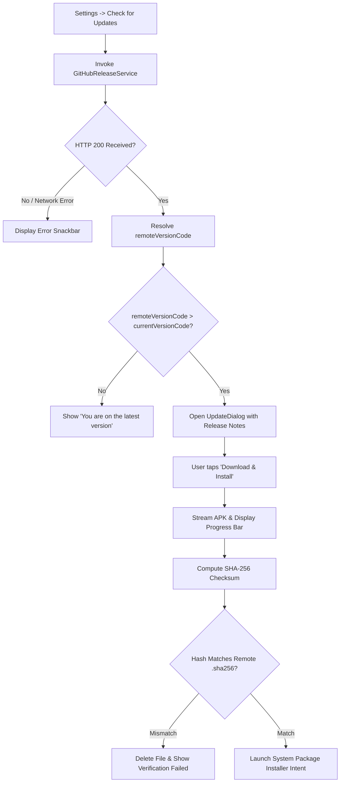

# FEAT-18: Application Update System Specification

## 1. Feature Name & Unique ID
- **Feature Name**: In-App Release Checker, Integrity Verification & OTA Updater
- **Feature ID**: `FEAT-18-APP-UPDATE-SYSTEM`
- **Sub-Features**:
  - `FEAT-18.1`: GitHub Releases API Metadata Client (`GitHubReleaseService`)
  - `FEAT-18.2`: Dual-Source Version Code Resolver (release.json & Markdown Regex Parsing)
  - `FEAT-18.3`: Streaming APK Downloader with Progress Tracking (`ApkDownloader`)
  - `FEAT-18.4`: Cryptographic SHA-256 Checksum Verification (`ApkVerifier`)
  - `FEAT-18.5`: Package Installer Handoff via Android FileProvider
  - `FEAT-18.6`: Native iOS App Store / TestFlight Migration Architecture

---

## 2. Business Goal & Purpose
Leaf is distributed primarily as an open-source, private, tracker-free application via GitHub Releases. To provide users with a secure and frictionless upgrade path without relying on Google Play Services, Leaf incorporates an in-app release monitoring and verification pipeline.

Key product objectives:
- Detect newly published releases automatically or upon user request in Settings.
- Guarantee distribution integrity by validating cryptographic SHA-256 hashes before executing any update.
- Present human-readable release notes directly inside the application.

---

## 3. User Persona & Value
- **FOSS / Privacy Enthusiast**: Installs Leaf via GitHub and receives seamless OTA notifications and updates without Google Play Store dependencies.
- **Security-Conscious User**: Trusts that downloaded APK packages are bit-for-bit identical to the GitHub build through cryptographic checksum verification.

---

## 4. Complete Feature Scope
1. **Release Discovery (`GitHubReleaseService`)**:
   - Endpoint: `https://api.github.com/repos/vinaynalavade/Leaf/releases/latest`
   - Request headers: `User-Agent: Leaf-Android-App`, `Accept: application/json`.
   - Parses release metadata: Tag name, Release name, Publication timestamp, Release notes body, and Asset list.
2. **Version Code Resolution**:
   - Method 1: Inspects attached `release.json` asset for structured `{"versionCode": 5, "versionName": "1.4.0", "sha256": "..."}`.
   - Method 2: Fallback to parsing release notes markdown via regex:
     `(?i)(?:version_?code|version\s*code)[\s:=|*`]+(\d+)`
3. **Update Decision**:
   - If `remoteVersionCode > localVersionCode`, an update is flagged as `Available`.
4. **Streaming Download (`ApkDownloader`)**:
   - Downloads APK into app's private cache directory (`context.cacheDir/updates/`).
   - Streams progress percentage and byte counts to the UI.
5. **Integrity Verification (`ApkVerifier`)**:
   - Reads SHA-256 checksum string from remote asset (e.g. `Leaf-v1.4.0.apk.sha256`).
   - Computes SHA-256 digest over the downloaded file using `MessageDigest.getInstance("SHA-256")`.
   - If hash matches, marks file as `ReadyToInstall`; if mismatch, deletes file and returns `SecurityError`.
6. **Package Installer Handoff**:
   - Dispatches `Intent.ACTION_VIEW` with `FLAG_GRANT_READ_URI_PERMISSION` using `FileProvider.getUriForFile`.

---

## 5. Explicit Exclusions
- Sideloading IPA files or executing out-of-band binary updates on iOS (strictly forbidden by Apple App Store Review Guidelines Section 2.5.2).
- Automatic silent background installation without user consent.

---

## 6. User Flow & Journey


---

## 7. Visual & Layout Specifications
- **Update Dialog (`UpdateDialog.kt`)**:
  - Surface modal with Emerald header icon (`system_update`).
  - Title: "New Version Available (vX.Y.Z)".
  - Publication Date & Size pill badges.
  - Scrollable Release Notes markdown text container.
  - Linear progress bar showing active download percentage and `X.X MB / Y.Y MB`.
  - Actions: "Cancel" and "Download & Install" / "Install Now".

---

## 8. Screen-by-Screen Breakdown
1. **Settings Screen Row**:
   - Displays "App Version" (e.g. `v1.4.0 (5)`).
   - "Check for updates" button triggers `UpdateViewModel.checkForUpdate(isManual = true)`.
2. **Update Modal Dialog**:
   - Handles progressive state transitions from checking to downloading and ready.

---

## 9. Input Controls & Validation Rules
- **Rate Limit Handling**: Detects HTTP 403 Forbidden from GitHub API and informs user gracefully: *"Update service is temporarily busy. Please try again later."*
- **Asset Selection**: Filters assets ending with `.apk`, excluding debug builds, prioritizing names containing "Leaf".

---

## 10. State Model & UI States
```kotlin
sealed interface UpdateState {
    object Idle : UpdateState
    object Checking : UpdateState
    data class Available(val release: RemoteReleaseInfo) : UpdateState
    data class Downloading(val progressPercent: Int, val bytesDownloaded: Long, val totalBytes: Long) : UpdateState
    data class ReadyToInstall(val apkFile: File) : UpdateState
    object UpToDate : UpdateState
    data class Error(val message: String) : UpdateState
}
```

---

## 11. Mathematical & Financial Rules
- **Version Code Comparison**: Strictly numeric comparison:
  $$\text{UpdateAvailable} = (\text{remoteVersionCode} > \text{BuildConfig.VERSION\_CODE})$$
- **Progress Ratio**:
  $$\text{ProgressPercent} = \left\lfloor \frac{\text{bytesDownloaded}}{\text{totalBytes}} \times 100 \right\rfloor$$

---

## 12. Database & Persistence Layer
- Update states are ephemeral and managed in-memory during app runtime.
- Downloaded APK is stored temporarily at:
  `${context.cacheDir}/updates/Leaf_${versionName}.apk` and wiped after installation or cancellation.

---

## 13. Repository & Data Layer
- `UpdateRepository`:
  - `checkForUpdate(): Flow<AppResult<UpdateState>>`
  - `downloadAndVerify(release: RemoteReleaseInfo): Flow<UpdateState>`

---

## 14. Domain & Use Case Layer
- `CheckForUpdateUseCase`: Queries GitHubReleaseService and evaluates version delta.
- `DownloadAndVerifyUpdateUseCase`: Coordinates download stream, file hash calculation, and state emissions.

---

## 15. ViewModel & State Management Layer
- `UpdateViewModel`: Exposes `StateFlow<UpdateState>` and dispatches user actions (`startDownload`, `dismiss`, `retry`).

---

## 16. Background Processing & Lifecycle
- Network downloads run strictly on `Dispatchers.IO` using buffered input streams (buffer size 8192 bytes).

---

## 17. Hardware & System Integration
- Android `FileProvider` (`com.vinaynalavade.expensetracker.fileprovider`) for granting secure temporary read URI permissions to the Android OS package installer.
- Permission `REQUEST_INSTALL_PACKAGES` (Android 8.0+).

---

## 18. Security, Privacy & Compliance
- **TLS 1.3 / HTTPS**: All requests strictly enforced over HTTPS.
- **SHA-256 Digest**: Prevents MitM attacks, corrupted downloads, or tampered APKs.
- **No Private Credentials**: GitHub releases API accessed without requiring user authentication tokens.

---

## 19. Accessibility & Internationalization
- All update dialog states include clear spoken feedback for screen readers ("Download progress: 45 percent").

---

## 20. Edge Cases & Exception Handling
1. **GitHub API rate limit exceeded**: Display friendly message rather than raw error code.
2. **Download interrupted mid-stream**: Incomplete file is discarded and state reset to `Available`.
3. **User denies unknown sources install permission**: App guides user to Android Settings toggle.

---

## 21. Android Implementation Reference
- `data/update/GitHubReleaseService.kt`: GitHub REST communication.
- `data/update/ApkDownloader.kt`: Streaming network downloader.
- `data/update/ApkVerifier.kt`: SHA-256 checksum engine.
- `domain/model/UpdateState.kt` & `domain/model/RemoteReleaseInfo.kt`: Data contracts.
- `presentation/update/UpdateDialog.kt` & `UpdateViewModel.kt`: Presentation layer.

---

## 22. iOS Native Architecture & Implementation
- **Apple Platform Constraint**:
  - iOS does NOT support downloading and installing executable binaries out-of-band.
  - All updates for iOS are handled via the **Apple App Store** or **TestFlight**.
- **Native iOS Implementation Strategy**:
  1. **iTunes Lookup API**:
     - Query `https://itunes.apple.com/lookup?bundleId=com.vinaynalavade.Leaf` to inspect the latest App Store version string.
     - Compare `remoteVersion` with `Bundle.main.infoDictionary["CFBundleShortVersionString"]`.
  2. **In-App Notification**:
     - If a newer App Store version exists, display an alert with release notes and an "Update in App Store" button.
  3. **App Store Deep Link**:
     - Tapping the button opens the App Store product page directly:
       `UIApplication.shared.open(URL(string: "itms-apps://itunes.apple.com/app/id<APP_ID>")!)`

---

## 23. Cross-Platform Parity Contract
- Both platforms inform the user when a newer release is published.
- Android completes the download and invokes the OS package installer directly; iOS deep-links to the App Store product page.

---

## 24. Verification & Testing Strategy
- Unit test: Regex extraction of `versionCode` from release notes markdown strings.
- Unit test: SHA-256 calculation matching known test strings.
- Integration test: Mocking GitHub HTTP 200 payload with `release.json` and verifying `UpdateState.Available`.

---

## 25. Known Issues, Technical Debt & Migration Notes
- Regex parsing of `versionCode` in release notes is resilient, but attached `release.json` is the gold standard for automated CI/CD releases.
- In iOS, ensure the App Store bundle ID is correctly configured before enabling the iTunes lookup endpoint.

