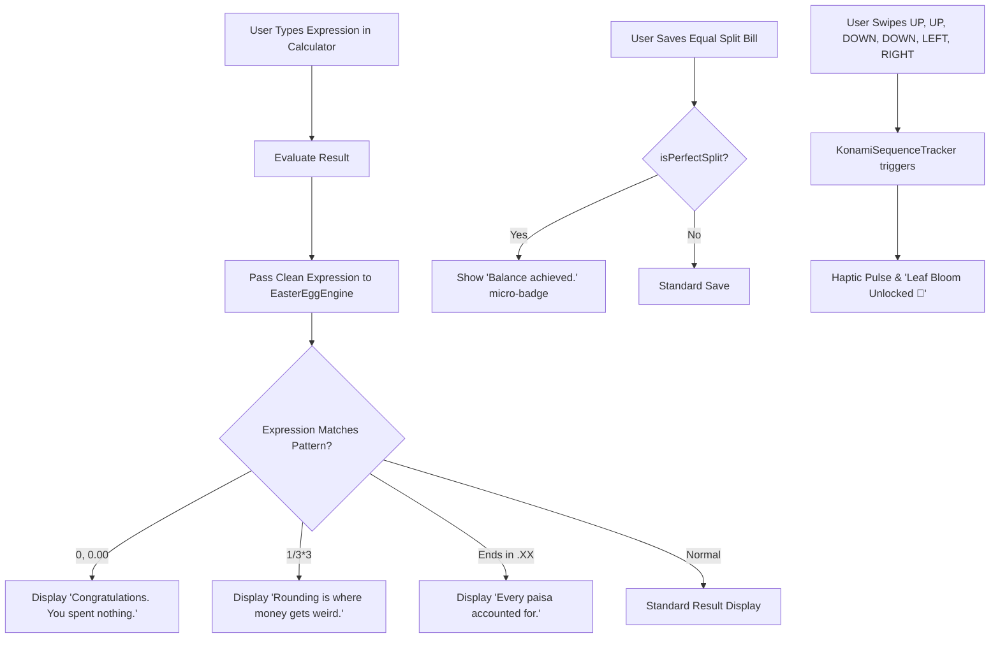

# FEAT-19: Easter Eggs and Delight Universe Specification

## 1. Feature Name & Unique ID
- **Feature Name**: Leaf Easter Egg Engine & Delight Universe
- **Feature ID**: `FEAT-19-EASTER-EGGS`
- **Sub-Features**:
  - `FEAT-19.1`: Calculator "Zero Mode" Delight
  - `FEAT-19.2`: The Floating-Point "₹1 Test" Detection
  - `FEAT-19.3`: "Paisa Perfect" Fractional Milestone
  - `FEAT-19.4`: Split & Collect "Balance Achieved" Trigger
  - `FEAT-19.5`: "Midnight Leaf" Night-Owl Greeting
  - `FEAT-19.6`: Gesture Sequence Tracker ("Leaf Bloom" Unlocked)
  - `FEAT-19.7`: Founder's Signature & Philosophy Quotes

---

## 2. Business Goal & Purpose
Finance applications are often perceived as sterile, cold, and anxiety-inducing. Leaf incorporates subtle, tasteful "Easter eggs" and micro-delights designed to make users smile, reward mathematical curiosity, and humanize the experience.

Critical architectural principle:
> **Strict Financial Decoupling**: Easter eggs must NEVER alter numeric results, roundings, balances, or database state. They are strictly observational presentation-layer micro-delights.

---

## 3. User Persona & Value
- **Curious Explorer**: Enjoys discovering hidden software details, gestures, and playful responses to mathematical edge cases.
- **Night-Owl Budgeter**: Logging expenses late at night feels recognized and less lonely with the midnight greeting.
- **Precision Enthusiast**: Smiles when the calculator acknowledges exact paisa division or perfect split equality.

---

## 4. Complete Feature Scope
1. **Calculator Easter Eggs (`detectCalculatorEasterEgg`)**:
   - **Zero Mode**:
     - Trigger: User evaluates `0`, `0.0`, `0.00`, or `00`.
     - Toast / Subtitle: *"Congratulations. You spent nothing."*
   - **The ₹1 Test (Rounding Paradox)**:
     - Trigger: Expression evaluates `1÷3×3`, `1/3*3`, `1÷3*3`, or `1/3×3`.
     - Message: *"Rounding is where money gets weird."*
   - **Paisa Perfect**:
     - Trigger: Evaluated non-zero expression results in non-zero two decimal places (e.g. `.25`, `.50`, `.33`, `.75`).
     - Subtitle: *"Every paisa accounted for."*
2. **Bill Split "Balance Achieved"**:
   - Trigger: Split expense calculated where all participants have strictly identical non-zero shares (`isPerfectSplit == true`).
   - Badge / Toast: *"Balance achieved."*
3. **Midnight Leaf Greeting**:
   - Trigger: App active between 11:00 PM and 3:59 AM (`hour in 0..3 || hour == 23`).
   - Greeting replaces standard "Good evening" with: *"Still keeping an eye on your money?"*
4. **Leaf Bloom Swipe Sequence (`KonamiSequenceTracker`)**:
   - Target Sequence: `UP`, `UP`, `DOWN`, `DOWN`, `LEFT`, `RIGHT`.
   - Result: Haptic vibration pulse, confetti / blossom particle effect, and toast:
     *"Leaf Bloom Unlocked 🌸"*
5. **Hidden Leaf & Founder Signature**:
   - Tapping brand logo 5 times: *"You found something that wasn't in the budget."*
   - About Screen Footer: *"Built with too many cups of chai. — Vinay"*

---

## 5. Explicit Exclusions
- Easter eggs that modify database records, balances, or currency factors.
- Intrusive or noisy audio sounds (visual toasts, subtle text banners, and haptics only).

---

## 6. User Flow & Journey


---

## 7. Visual & Layout Specifications
- **Calculator Toast / Banner**:
  - Rendered in subtle caption typography (`labelSmall`) beneath the evaluated number.
  - Emerald tint with gentle fade-in animation.
- **Midnight Greeting**:
  - Dashboard top bar header: Displays soft moon icon (🌙) alongside *"Still keeping an eye on your money?"*.
- **Konami Blossom Effect**:
  - Translucent falling petal canvas particles over the active screen for 2.5 seconds.

---

## 8. Screen-by-Screen Breakdown
1. **Financial Calculator Screen (`CalculatorScreen.kt`)**:
   - Subtitle area below the expression preview observes `CalculatorEasterEgg` state.
2. **Dashboard Screen (`DashboardScreen.kt`)**:
   - Evaluates `EasterEggEngine.isMidnight()` when constructing the dynamic header greeting.
3. **Split Expenses Summary Screen (`SplitSummaryScreen.kt`)**:
   - Evaluates `isPerfectSplit` on participant breakdown list.
4. **About Screen (`AboutScreen.kt`)**:
   - Displays founder signature and philosophy quote banner.

---

## 9. Input Controls & Validation Rules
- `KonamiSequenceTracker`: Maintains index pointer `0..5`. Any incorrect swipe resets pointer to `1` (if matching first direction) or `0`.
- Calculator expression analyzer strips all whitespace prior to matching.

---

## 10. State Model & UI States
```kotlin
sealed interface CalculatorEasterEgg {
    val message: String
    data class ZeroMode(override val message: String = MSG_ZERO_MODE) : CalculatorEasterEgg
    data class RoundingTest(override val message: String = MSG_ROUNDING_TEST) : CalculatorEasterEgg
    data class PaisaPerfect(override val message: String = MSG_PAISA_PERFECT) : CalculatorEasterEgg
}
```

---

## 11. Mathematical & Financial Rules
- Easter eggs execute purely as pure read-only predicates.
- Mathematical evaluation is identical whether an easter egg is triggered or not.

---

## 12. Database & Persistence Layer
- Easter eggs require zero database tables.
- Konami unlock status can optionally be remembered in DataStore preferences (`leaf_bloom_unlocked`).

---

## 13. Repository & Data Layer
- None (pure domain utility layer).

---

## 14. Domain & Use Case Layer
- `EasterEggEngine`: Standalone Kotlin/Swift singleton object with deterministic, side-effect-free methods.

---

## 15. ViewModel & State Management Layer
- ViewModels invoke `EasterEggEngine` methods and publish string states to UI state flows.

---

## 16. Background Processing & Lifecycle
- Entirely synchronous and instantaneous on the main thread (evaluation takes $< 0.1$ ms).

---

## 17. Hardware & System Integration
- Haptic engine (`HapticFeedbackConstants.LONG_PRESS` / iOS `UINotificationFeedbackGenerator(.success)`).

---

## 18. Security, Privacy & Compliance
- Contains zero network traffic, telemetry, or security hazards.

---

## 19. Accessibility & Internationalization
- Easter egg messages are defined in string resources to allow localization.
- TalkBack / VoiceOver announces the micro-delight message cleanly.

---

## 20. Edge Cases & Exception Handling
1. **User rapidly inputs invalid math**: Calculator reports syntax error without triggering easter egg engine.
2. **Device clock changed manually**: `isMidnight()` safely uses current device local hour.

---

## 21. Android Implementation Reference
- `core/easteregg/EasterEggEngine.kt`
- `presentation/calculator/CalculatorViewModel.kt`
- `presentation/dashboard/DashboardViewModel.kt`

---

## 22. iOS Native Architecture & Implementation
- Recreate `EasterEggEngine` in Swift:
  ```swift
  struct EasterEggEngine {
      static let msgZeroMode = "Congratulations. You spent nothing."
      static let msgRoundingTest = "Rounding is where money gets weird."
      static let msgPaisaPerfect = "Every paisa accounted for."
      static let msgPerfectSplit = "Balance achieved."
      static let msgMidnightGreeting = "Still keeping an eye on your money?"
      static let msgKonamiUnlocked = "Leaf Bloom Unlocked 🌸"
      static let msgFounderSignature = "Built with too many cups of chai. — Vinay"
      
      static func isMidnight(hour: Int = Calendar.current.component(.hour, from: Date())) -> Bool {
          return hour >= 23 || hour < 4
      }
      
      static func isPerfectSplit(sharesSubunits: [Int64]) -> Bool {
          guard sharesSubunits.count >= 2, let first = sharesSubunits.first, first > 0 else { return false }
          return sharesSubunits.allSatisfy { $0 == first }
      }
  }
  ```
- Use SwiftUI drag gestures (`DragGesture`) to detect directional swipes for the Konami sequence.

---

## 23. Cross-Platform Parity Contract
- All string messages and trigger conditions must match exactly between Android and iOS.
- Mathematical triggers (e.g. `1/3*3`) must behave identically.

---

## 24. Verification & Testing Strategy
- Unit test `EasterEggEngineTest`:
  - Test zero mode: `"0"`, `"0.00"`.
  - Test rounding: `"1/3*3"`, `"1÷3×3"`.
  - Test paisa perfect: `"12.45"`, `"100.33"`.
  - Test midnight predicate at hours 22, 23, 0, 3, 4, 12.
  - Test Konami sequence state transitions.

---

## 25. Known Issues, Technical Debt & Migration Notes
- Ensure Easter eggs remain playful without annoying power users who desire maximum brevity.

