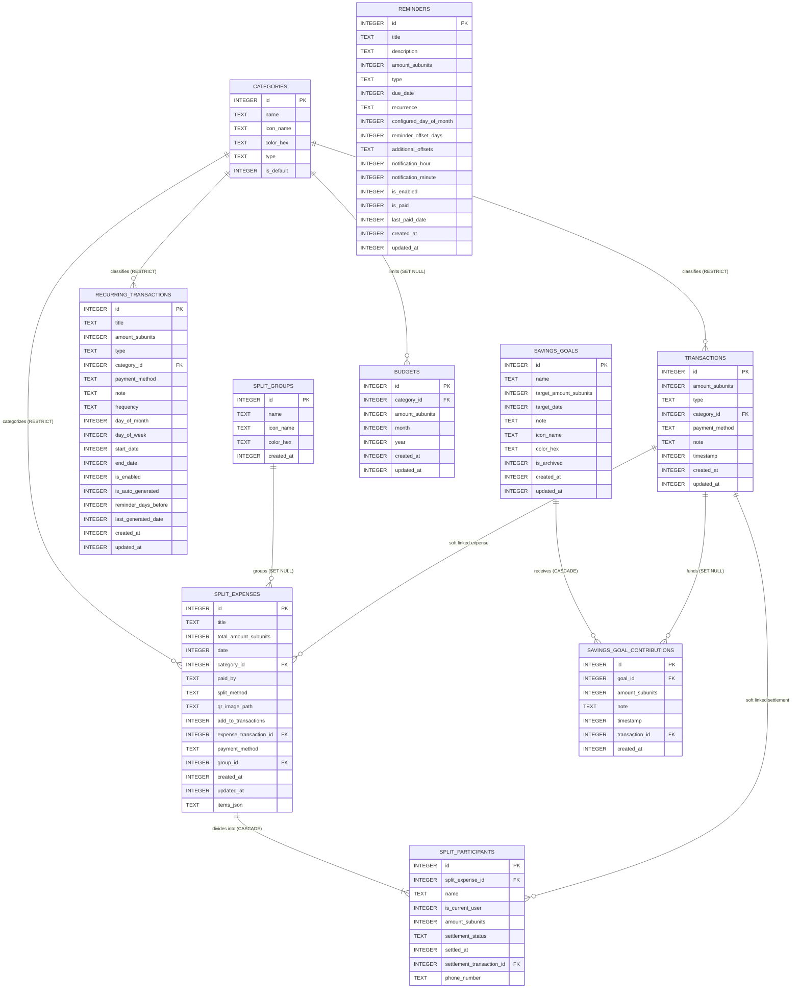

# Leaf Database: Entity-Relationship Diagram (ERD)

## 1. Executive Summary
This document provides the visual and structural Entity-Relationship Diagram (ERD) representing all 10 tables in Leaf's SQLite schema at Version 10.

---

## 2. Complete Mermaid ER Diagram

---

## 3. Structural Analysis & Integrity Highlights

1. **Category Centrality**:
   The `CATEGORIES` entity forms the semantic core of the application, linked via restricted foreign keys to `transactions`, `recurring_transactions`, and `split_expenses`.
2. **Double Ledger Linkage**:
   The diagram highlights the dual relationship between `TRANSACTIONS` and the Split module:
   - Outflow link: `SPLIT_EXPENSES.expense_transaction_id` tracks the payer's initial outlay.
   - Inflow link: `SPLIT_PARTICIPANTS.settlement_transaction_id` tracks participant repayments.
3. **Decoupled Standalone Modules**:
   - `REMINDERS` is intentionally decoupled from transactional tables, allowing lightweight schedule evaluation without locking transaction tables.
   - `SAVINGS_GOALS` maintains its own historical contribution ledger (`savings_goal_contributions`), with optional soft links to `transactions`.

