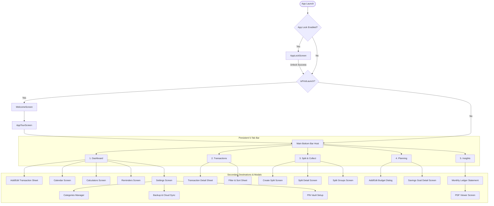

# Leaf User Flows: Navigation Hierarchy & Deep Linking Specifications

## 1. Executive Summary
Leaf employs a clear, shallow navigation hierarchy designed to minimize cognitive load and provide 1-tap or 2-tap access to all critical financial actions. The navigation model separates primary day-to-day features into a persistent 5-tab bottom navigation bar, while specialized tools and detail editors use transient modal sheets and full-screen detail destinations.

---

## 2. Navigation Architecture Overview

---

## 3. Modal Presentation Contracts

Leaf adheres to strict presentation rules to maintain orientation and state:

1. **Bottom Sheets (`ModalBottomSheet` / SwiftUI `.sheet`)**:
   - Used for quick data entry and filtering:
     - `AddEditTransactionSheet`: Form with numeric input and category picker.
     - `TransactionFilterSheet`: Filter criteria and sorting options.
     - `AddEditBudgetDialog`: Quick limit calibration.
     - `AddContributionDialog`: Quick savings deposit.
   - Characteristics: Dismissible by downward drag gesture; retains state if interrupted.
2. **Full-Screen Push Destinations (`NavigationStack` / NavHost)**:
   - Used for complex workflows requiring multi-step interaction:
     - `CreateSplitScreen`: Multi-step bill splitting with itemizer.
     - `SplitDetailScreen`: Detailed debt breakdown and settlement status.
     - `SavingsGoalDetailScreen`: History logs and milestone tracking.
     - `CalendarScreen` & `CalculatorsScreen`.
     - `MonthlyLedgerScreen` & `PdfViewerScreen`.
     - `SettingsScreen` and child preference sub-screens.

---

## 4. Deep Linking & External Intent Matrix

Leaf handles external intent deep links originating from home screen shortcuts, widgets, and background push notifications:

| Trigger Source | Intent Action / Route | Target Destination | Required Payload / Parameters | Behavior |
| :--- | :--- | :--- | :--- | :--- |
| **Shortcut: Add Expense** | `extra_start_route = "add_expense"` | `AddEditTransactionSheet` | `type = EXPENSE` | Launches app and immediately presents transaction entry sheet with Expense pre-selected. |
| **Shortcut: Add Income** | `extra_start_route = "add_income"` | `AddEditTransactionSheet` | `type = INCOME` | Launches app and immediately presents transaction entry sheet with Income pre-selected. |
| **Shortcut: Transactions** | `extra_start_route = "transactions"` | `TransactionsScreen` | None | Navigates directly to Tab 1 (Transactions). |
| **Widget: Quick Add** | Floating Activity / Deep Link | `QuickAddTransactionActivity` | None | Displays rapid entry dialog without loading full dashboard stack. |
| **Daily Reminder Alert** | `ACTION_DAILY_REMINDER` | `AddEditTransactionSheet` | `type = EXPENSE` | User tapped 9:00 PM evening reminder; opens expense entry sheet. |
| **Financial Due Date Alert** | `ACTION_REMINDER_ALERT` | `RemindersScreen` | `reminder_id: Long` | Highlights the specific pending reminder in the list. |
| **Reminder Action: Paid** | `ACTION_REMINDER_MARK_PAID` | Background Broadcast | `reminder_id: Long` | Marks reminder as paid without opening the UI. |

---

## 5. iOS NavigationStack Implementation Guidelines
- Use a single top-level `TabView` bound to an `enum Tab: Hashable`.
- Wrap each tab in an independent `NavigationStack(path: $path)` so that navigating deep within Tab 1 does not disrupt navigation history in Tab 2.
- Handle external deep links via `.onOpenURL` or `.handlesExternalEvents`.

