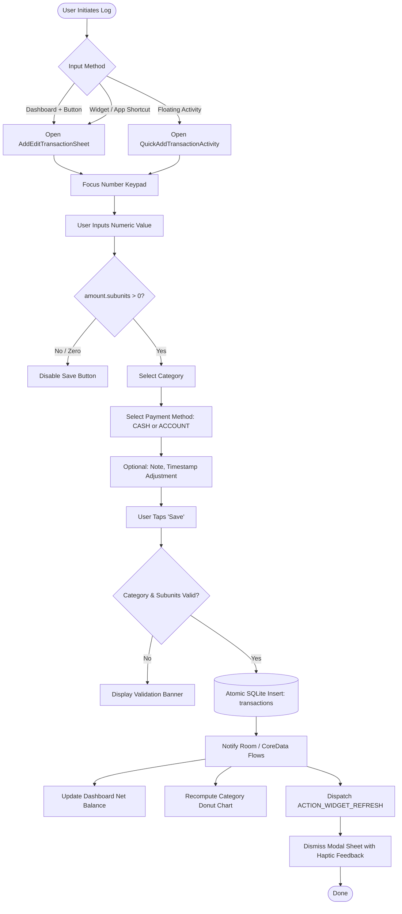
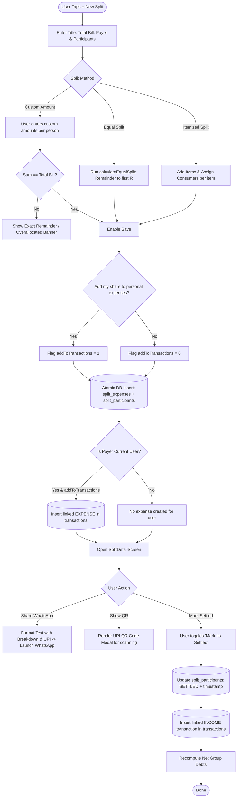

# Leaf User Flows: Visual User Flow Diagrams

## 1. Executive Summary
This document provides visual flowcharts modeling the operational states, decision gates, and data persistence pipelines for Leaf's core workflows.

---

## 2. Flowchart 1: Transaction Logging Pipeline



---

## 3. Flowchart 2: Split & Collect 2.0 (Bill Splitting & Settlement)



---

## 4. Flowchart 3: App Lock & Security Vault State Machine

```mermaid
stateDiagram-v2
    [*] --> Locked : App Cold Launch
    
    state Locked {
        [*] --> CheckingBiometrics
        CheckingBiometrics --> BiometricPrompt : Biometrics Enabled
        CheckingBiometrics --> EnterPIN : PIN Only
        
        BiometricPrompt --> Unlocked : Auth Success
        BiometricPrompt --> EnterPIN : Auth Failed / Cancelled
        
        EnterPIN --> ValidatePIN : 4 Digits Entered
        ValidatePIN --> Unlocked : SHA256(PIN + Salt) Matches
        ValidatePIN --> FailedAttempt : Hash Mismatch
        
        FailedAttempt --> EnterPIN : Attempts < 5
        FailedAttempt --> RateLimited : Attempts == 5
        
        RateLimited --> EnterPIN : 30 Seconds Cooldown Elapsed
    }
    
    state Unlocked {
        [*] --> ActiveSession
        ActiveSession --> Backgrounded : User exits app
        Backgrounded --> ActiveSession : User returns within autoLockGracePeriod
        Backgrounded --> Locked : autoLockDuration expired
    }
    
    Unlocked --> [*] : App Process Terminated
```

---

## 5. Flowchart 4: Cross-Platform Backup & Restore Pipeline

```mermaid
flowchart TD
    StartBackup([User Taps Export Backup]) --> GatherData[Query All 10 DB Tables + UserPreferences]
    GatherData --> BuildJSON[Construct JSON v2 Payload with Metadata]
    BuildJSON --> SaveFile[Save to Local Device or Upload to Google Drive]
    SaveFile --> BackupDone([Export Complete])
    
    StartRestore([User Selects Backup File]) --> ReadPayload[Read JSON Payload]
    ReadPayload --> ValidateSchema{Check version & required arrays}
    ValidateSchema -->|Corrupted / Invalid| RejectBackup[Display 'Invalid backup file format']
    ValidateSchema -->|Valid| PromptConfirm[Display Warning: All existing data will be replaced]
    
    PromptConfirm --> UserConfirm{User Confirms Restore?}
    UserConfirm -->|Cancel| Abort([Restore Aborted])
    UserConfirm -->|Confirm| BeginTxn[(BEGIN ATOMIC TRANSACTION)]
    
    BeginTxn --> ClearTables[Wipe existing records in all 10 tables]
    ClearTables --> RestoreCategories[Restore Categories]
    RestoreCategories --> RestoreTransactions[Restore Transactions]
    RestoreTransactions --> RestoreSplits[Restore Splits & Participants]
    RestoreSplits --> RestoreBudgets[Restore Budgets]
    RestoreBudgets --> RestoreSavings[Restore Goals & Contributions]
    RestoreSavings --> RestoreReminders[Restore Reminders]
    RestoreReminders --> RestorePrefs[Restore User Preferences (Excluding PIN Vault)]
    
    RestorePrefs --> CommitTxn[(COMMIT TRANSACTION)]
    CommitTxn --> RecomputeAll[Trigger full balance & widget recalculation]
    RecomputeAll --> RestartUI[Navigate to Dashboard with success toast]
    RestartUI --> EndRestore([Done])
```

