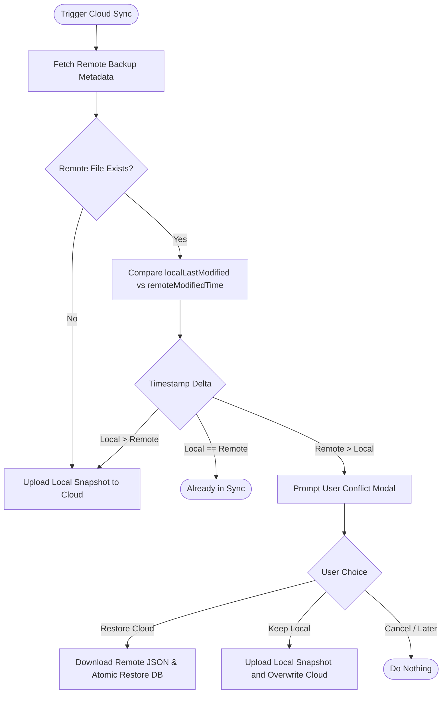

# Leaf API & Synchronization: Cloud Data Synchronization & Conflict Protocol

## 1. Executive Summary
Leaf implements a **Snapshot-Based Cloud Synchronization Protocol**. Rather than executing complex, high-latency operational transformations or peer-to-peer differential synchronization, Leaf treats the user's encrypted JSON/SQLite backup as an atomic, immutable snapshot stored in the user's private cloud container.

---

## 2. Cloud Storage Providers Architecture

### 2.1 Native iOS: Apple iCloud Drive (Default)
On iOS, the primary and seamless cloud sync rail is **Apple iCloud Drive** using ubiquitous documents:
- **Zero Authentication**: No email, password, or third-party SDK required. Leaf saves directly into the app's private iCloud container (`iCloud.com.vinaynalavade.Leaf/Documents/backup.json`).
- **OS-Level Sync**: iOS daemon `cloudd` manages background synchronization, delta compression, and retry logic automatically.

### 2.2 Cross-Platform: Google Drive API (Optional on iOS)
For users who alternate between an Android phone and an iPhone, Leaf provides an optional Google Drive sync provider:
- Backups are stored in `appDataFolder/leaf_backup_v2.json`.
- Both Android and iOS clients use identical JSON schemas, enabling seamless cross-platform migration.

---

## 3. Conflict Resolution Protocol

When Leaf detects that a remote backup exists alongside local modifications:

### Conflict Prompt UI Specification
- Title: *"Newer Cloud Backup Found"*
- Message: *"A backup from [Date, Time] containing [X] transactions was found in your cloud account. Your local device was last updated on [Date, Time]. Which version would you like to keep?"*
- Options:
  1. **Restore from Cloud** (Replaces local data).
  2. **Keep Local & Overwrite Cloud** (Uploads local data).
  3. **Decide Later**.

---

## 4. Background Automatic Backup Scheduling

- **Android**: Scheduled via Android `WorkManager` (`PeriodicWorkRequestBuilder<CloudBackupWorker>(24, TimeUnit.HOURS)`) with network constraints (`NetworkType.UNMETERED`) and battery constraints (`requiresCharging = true`).
- **iOS**: Scheduled via `BackgroundTasks` framework (`BGAppRefreshTaskRequest(identifier: "com.vinaynalavade.Leaf.backup")`) or triggered automatically on `sceneDidEnterBackgroundNotification` when Wi-Fi is active.

