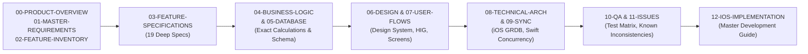

# Leaf Product Documentation & iOS Migration Blueprint: Master Index

## 1. Executive Overview
Welcome to the master technical documentation and iOS migration blueprint for **Leaf**, an offline-first personal finance management application. 

This documentation system provides an exhaustive, verified specification of the entire Android codebase and an implementation-ready architectural guide for developing Leaf natively for Apple iOS using Swift and SwiftUI.

---

## 2. Recommended Reading Sequence

For an optimal understanding of the product and its implementation architecture, follow this reading path:

---

## 3. Complete Directory Map & File Manifest

### Root Documentation
- [00-PRODUCT-OVERVIEW.md](file:///x:/Leaf/shared-docs/00-PRODUCT-OVERVIEW.md): Executive summary, value proposition, brand identity, privacy pillars, and iOS scope.
- [01-MASTER-REQUIREMENTS.md](file:///x:/Leaf/shared-docs/01-MASTER-REQUIREMENTS.md): Traceable functional, calculation, security, database, and non-functional requirements.
- [02-FEATURE-INVENTORY.md](file:///x:/Leaf/shared-docs/02-FEATURE-INVENTORY.md): Complete matrix of all 69 features with source file and test references.
- [README.md](file:///x:/Leaf/shared-docs/README.md): Quick start guide and repository orientation.
- [DOCUMENTATION-AUDIT-REPORT.md](file:///x:/Leaf/shared-docs/DOCUMENTATION-AUDIT-REPORT.md): Audit report validating 100% requirements coverage and parity.

---

### Section 03: Feature Specifications (`03-FEATURE-SPECIFICATIONS/`)
Exhaustive 25-point engineering specifications for every functional module in Leaf:
1. [FEAT-01-DASHBOARD.md](file:///x:/Leaf/shared-docs/03-FEATURE-SPECIFICATIONS/FEAT-01-DASHBOARD.md): Hero balance card, quick actions, donut chart, recent activity feed.
2. [FEAT-02-TRANSACTIONS.md](file:///x:/Leaf/shared-docs/03-FEATURE-SPECIFICATIONS/FEAT-02-TRANSACTIONS.md): Fast logging, search, multi-criteria filtering, swipe-to-delete.
3. [FEAT-03-SPLIT-EXPENSES.md](file:///x:/Leaf/shared-docs/03-FEATURE-SPECIFICATIONS/FEAT-03-SPLIT-EXPENSES.md): Split & Collect 2.0, equal, custom, itemized, WhatsApp share, UPI QR.
4. [FEAT-04-PLANNING-BUDGETS.md](file:///x:/Leaf/shared-docs/03-FEATURE-SPECIFICATIONS/FEAT-04-PLANNING-BUDGETS.md): Monthly category expenditure limits, 4-tier colored threshold alerts.
5. [FEAT-05-PLANNING-SAVINGS-GOALS.md](file:///x:/Leaf/shared-docs/03-FEATURE-SPECIFICATIONS/FEAT-05-PLANNING-SAVINGS-GOALS.md): Milestone progress rings, contribution log, required savings rates.
6. [FEAT-06-INSIGHTS-ANALYTICS.md](file:///x:/Leaf/shared-docs/03-FEATURE-SPECIFICATIONS/FEAT-06-INSIGHTS-ANALYTICS.md): Spending vs income comparisons, cashflow savings rate, category rankings.
7. [FEAT-07-STATEMENTS.md](file:///x:/Leaf/shared-docs/03-FEATURE-SPECIFICATIONS/FEAT-07-STATEMENTS.md): Bank-grade continuous monthly ledger, vector PDF generator, in-app viewer.
8. [FEAT-08-CALENDAR.md](file:///x:/Leaf/shared-docs/03-FEATURE-SPECIFICATIONS/FEAT-08-CALENDAR.md): Interactive monthly calendar, daily expense badges, selected day feed.
9. [FEAT-09-RECURRING-TRANSACTIONS.md](file:///x:/Leaf/shared-docs/03-FEATURE-SPECIFICATIONS/FEAT-09-RECURRING-TRANSACTIONS.md): Recurrence intervals, automated generation, advance alerts.
10. [FEAT-10-FINANCIAL-REMINDERS.md](file:///x:/Leaf/shared-docs/03-FEATURE-SPECIFICATIONS/FEAT-10-FINANCIAL-REMINDERS.md): Due-date alerts for bills and EMIs, smart evening reminder suppression.
11. [FEAT-11-FINANCIAL-CALCULATORS.md](file:///x:/Leaf/shared-docs/03-FEATURE-SPECIFICATIONS/FEAT-11-FINANCIAL-CALCULATORS.md): EMI loan calculator, SIP wealth planner, FD, RD, GST, Discount tools.
12. [FEAT-12-SECURITY-AND-APPLOCK.md](file:///x:/Leaf/shared-docs/03-FEATURE-SPECIFICATIONS/FEAT-12-SECURITY-AND-APPLOCK.md): 4-digit PIN vault, Face ID biometrics, 5-attempt lockout, recents blur.
13. [FEAT-13-BACKUP-AND-RESTORE.md](file:///x:/Leaf/shared-docs/03-FEATURE-SPECIFICATIONS/FEAT-13-BACKUP-AND-RESTORE.md): JSON v2 export/import, CSV export, Google Drive sync protocol.
14. [FEAT-14-CATEGORIES.md](file:///x:/Leaf/shared-docs/03-FEATURE-SPECIFICATIONS/FEAT-14-CATEGORIES.md): 20 default categories, custom builder, 22 icons, 12 colors, deletion safety.
15. [FEAT-15-SETTINGS-AND-PREFERENCES.md](file:///x:/Leaf/shared-docs/03-FEATURE-SPECIFICATIONS/FEAT-15-SETTINGS-AND-PREFERENCES.md): Theme, currency, opening balance, default sources, language (EN/HI/MR).
16. [FEAT-16-ONBOARDING-AND-TOUR.md](file:///x:/Leaf/shared-docs/03-FEATURE-SPECIFICATIONS/FEAT-16-ONBOARDING-AND-TOUR.md): Welcome screen, Google Sign-in vs Offline bypass, 5-step visual tour.
17. [FEAT-17-WIDGETS-AND-SHORTCUTS.md](file:///x:/Leaf/shared-docs/03-FEATURE-SPECIFICATIONS/FEAT-17-WIDGETS-AND-SHORTCUTS.md): 4x2 overview widget, 2x1 today widget, quick-add, app shortcuts.
18. [FEAT-18-APP-UPDATE-SYSTEM.md](file:///x:/Leaf/shared-docs/03-FEATURE-SPECIFICATIONS/FEAT-18-APP-UPDATE-SYSTEM.md): GitHub release checker, SHA-256 verifier, iTunes Lookup mapping.
19. [FEAT-19-EASTER-EGGS.md](file:///x:/Leaf/shared-docs/03-FEATURE-SPECIFICATIONS/FEAT-19-EASTER-EGGS.md): Zero mode, ₹1 test, Paisa perfect, Midnight greeting, Konami sequence.

---

### Section 04: Business Logic & Calculations (`04-BUSINESS-LOGIC/`)
- [CALCULATIONS.md](file:///x:/Leaf/shared-docs/04-BUSINESS-LOGIC/CALCULATIONS.md): Exhaustive mathematical formulas (Net Balance, Split, EMI, SIP, FD, RD, GST).
- [ROUNDING-RULES.md](file:///x:/Leaf/shared-docs/04-BUSINESS-LOGIC/ROUNDING-RULES.md): Subunit arithmetic, zero-sum penny reconciliation, floating-point prohibition.
- [VALIDATIONS.md](file:///x:/Leaf/shared-docs/04-BUSINESS-LOGIC/VALIDATIONS.md): Field-by-field input constraints, ceilings ($10^{14}$ subunits), duplicate checks.
- [TRANSACTION-RULES.md](file:///x:/Leaf/shared-docs/04-BUSINESS-LOGIC/TRANSACTION-RULES.md): Double-entry-style continuity, ledger integration, soft unlinking.

---

### Section 05: Database & Persistence (`05-DATABASE/`)
- [DATABASE-SCHEMA.md](file:///x:/Leaf/shared-docs/05-DATABASE/DATABASE-SCHEMA.md): Complete SQL schemas for all 10 tables at Version 10.
- [DATA-MODELS.md](file:///x:/Leaf/shared-docs/05-DATABASE/DATA-MODELS.md): Room entities vs Kotlin domain models vs Swift domain models.
- [DATABASE-RELATIONSHIPS.md](file:///x:/Leaf/shared-docs/05-DATABASE/DATABASE-RELATIONSHIPS.md): Foreign keys, cascading behaviors (`CASCADE`, `RESTRICT`, `SET NULL`), joins.
- [MIGRATIONS.md](file:///x:/Leaf/shared-docs/05-DATABASE/MIGRATIONS.md): Complete SQL migration scripts from Version 1 to 10.
- [ENTITY-RELATIONSHIP-DIAGRAM.md](file:///x:/Leaf/shared-docs/05-DATABASE/ENTITY-RELATIONSHIP-DIAGRAM.md): Visual Mermaid ER diagram of all 10 tables.

---

### Section 06: Design System & HIG (`06-DESIGN/`)
- [DESIGN-SYSTEM.md](file:///x:/Leaf/shared-docs/06-DESIGN/DESIGN-SYSTEM.md): "Emerald & Obsidian" philosophy, HIG adaptation, continuous squircle geometry.
- [COLORS.md](file:///x:/Leaf/shared-docs/06-DESIGN/COLORS.md): Hex palette, dark/light surfaces, financial semantic colors, gradients, 12 swatches.
- [TYPOGRAPHY.md](file:///x:/Leaf/shared-docs/06-DESIGN/TYPOGRAPHY.md): Typographic scale, weights, letter spacing, SF Pro and tabular number rules.
- [COMPONENT-INVENTORY.md](file:///x:/Leaf/shared-docs/06-DESIGN/COMPONENT-INVENTORY.md): Catalog of UI building blocks (Hero Card, Pills, Squircle Badges, Donut).
- [SCREEN-INVENTORY.md](file:///x:/Leaf/shared-docs/06-DESIGN/SCREEN-INVENTORY.md): Complete catalog of all 33 screens, sheets, and dialogs.
- [SCREENSHOTS/README.md](file:///x:/Leaf/shared-docs/06-DESIGN/SCREENSHOTS/README.md): Visual asset guide, drawables inventory, and screenshot capture guidance.

---

### Section 07: User Flows & Navigation (`07-USER-FLOWS/`)
- [NAVIGATION.md](file:///x:/Leaf/shared-docs/07-USER-FLOWS/NAVIGATION.md): Bottom navigation structure (5 tabs), modal sheets, full-screen push destinations, deep links.
- [USER-JOURNEYS.md](file:///x:/Leaf/shared-docs/07-USER-FLOWS/USER-JOURNEYS.md): 6 detailed user journeys (Onboarding, 3s logging, split dinner, monthly audit).
- [USER-FLOW-DIAGRAMS.md](file:///x:/Leaf/shared-docs/07-USER-FLOWS/USER-FLOW-DIAGRAMS.md): Visual Mermaid flowcharts for logging, splitting, app lock, and backup.

---

### Section 08: Technical Architecture (`08-TECHNICAL-ARCHITECTURE/`)
- [ANDROID-ARCHITECTURE.md](file:///x:/Leaf/shared-docs/08-TECHNICAL-ARCHITECTURE/ANDROID-ARCHITECTURE.md): Clean Architecture, DI container (`AppContainer`), reactive Coroutine flows.
- [IOS-ARCHITECTURE.md](file:///x:/Leaf/shared-docs/08-TECHNICAL-ARCHITECTURE/IOS-ARCHITECTURE.md): Native Swift/SwiftUI MVVM, `@Observable`, GRDB SQLite recommendation.
- [ANDROID-IOS-MAPPING.md](file:///x:/Leaf/shared-docs/08-TECHNICAL-ARCHITECTURE/ANDROID-IOS-MAPPING.md): Comprehensive component-by-component technology translation matrix.
- [PROJECT-STRUCTURE.md](file:///x:/Leaf/shared-docs/08-TECHNICAL-ARCHITECTURE/PROJECT-STRUCTURE.md): Complete, implementation-ready Xcode project folder hierarchy.

---

### Section 09: API & Synchronization (`09-API-AND-SYNCHRONIZATION/`)
- [API-REQUIREMENTS.md](file:///x:/Leaf/shared-docs/09-API-AND-SYNCHRONIZATION/API-REQUIREMENTS.md): Google Drive v3 REST client, GitHub Releases API, iTunes Lookup API.
- [DATA-SYNCHRONIZATION.md](file:///x:/Leaf/shared-docs/09-API-AND-SYNCHRONIZATION/DATA-SYNCHRONIZATION.md): Cloud snapshot sync protocol, conflict resolution prompt, automated backups.
- [BACKUP-AND-RESTORE.md](file:///x:/Leaf/shared-docs/09-API-AND-SYNCHRONIZATION/BACKUP-AND-RESTORE.md): JSON v1/v2 universal schema, table serialization, CSV export specs.

---

### Section 10: Quality Assurance & Parity (`10-QUALITY-ASSURANCE/`)
- [TEST-STRATEGY.md](file:///x:/Leaf/shared-docs/10-QUALITY-ASSURANCE/TEST-STRATEGY.md): Testing pyramid, coverage thresholds (100% for engines), parity verification.
- [TEST-CASES.md](file:///x:/Leaf/shared-docs/10-QUALITY-ASSURANCE/TEST-CASES.md): Executable test cases with unique IDs (`TC-TXN`, `TC-SPLIT`, `TC-BUD`, etc.).
- [EDGE-CASES.md](file:///x:/Leaf/shared-docs/10-QUALITY-ASSURANCE/EDGE-CASES.md): Comprehensive catalog of financial, calendar, timezone, and security edge cases.
- [ACCEPTANCE-CRITERIA.md](file:///x:/Leaf/shared-docs/10-QUALITY-ASSURANCE/ACCEPTANCE-CRITERIA.md): Feature-by-feature acceptance criteria in Gherkin (Given-When-Then) format.
- [FEATURE-PARITY-MATRIX.md](file:///x:/Leaf/shared-docs/10-QUALITY-ASSURANCE/FEATURE-PARITY-MATRIX.md): Definitive matrix of all 69 features with parity priorities.

---

### Section 11: Issues & Technical Debt (`11-ISSUES-AND-TECHNICAL-DEBT/`)
- [KNOWN-ISSUES.md](file:///x:/Leaf/shared-docs/11-ISSUES-AND-TECHNICAL-DEBT/KNOWN-ISSUES.md): Documented bugs, edge-case hazards, and inconsistencies in Android.
- [TECHNICAL-DEBT.md](file:///x:/Leaf/shared-docs/11-ISSUES-AND-TECHNICAL-DEBT/TECHNICAL-DEBT.md): Legacy KharchaFlow naming artifacts, Room exportSchema debt, modernization guide.

---

### Section 12: Master iOS Implementation Guide (`12-IOS-IMPLEMENTATION-GUIDE/`)
- [MASTER-IOS-DEVELOPMENT-GUIDE.md](file:///x:/Leaf/shared-docs/12-IOS-IMPLEMENTATION-GUIDE/MASTER-IOS-DEVELOPMENT-GUIDE.md): Critical architectural mandates and binding instructions for the iOS agent.
- [DEVELOPMENT-PHASES.md](file:///x:/Leaf/shared-docs/12-IOS-IMPLEMENTATION-GUIDE/DEVELOPMENT-PHASES.md): Step-by-step 8-phase execution roadmap.
- [IOS-CHECKLIST.md](file:///x:/Leaf/shared-docs/12-IOS-IMPLEMENTATION-GUIDE/IOS-CHECKLIST.md): Feature-by-feature verification checklist.
- [RELEASE-CHECKLIST.md](file:///x:/Leaf/shared-docs/12-IOS-IMPLEMENTATION-GUIDE/RELEASE-CHECKLIST.md): App Store pre-flight, `PrivacyInfo.xcprivacy`, TestFlight deployment gates.

